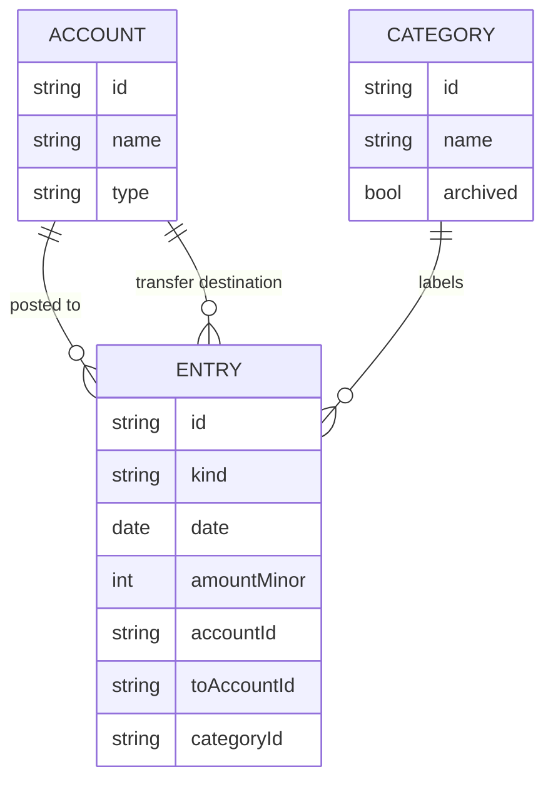

# North Star Architecture

Only decisions that are genuinely expensive to change later. UI, routing,
component structure, and reporting layout are deliberately absent — those are
slice-scoped. Vocabulary lives in `CONTEXT.md`.

## Domain model

One ledger, one user. **Accounts carry all balances**; entries are effects on
accounts, never free-floating records.

Account types: `checking`, `savings`, `credit`. Card type is *derived* —
`credit` for credit accounts, `debit` otherwise. No entry carries a card-type
field; filtering by card type means filtering by account.

Entries are a single collection with a `kind` discriminator:

| kind | fields | effect on balance |
|---|---|---|
| `expense` | accountId, categoryId, amount (positive) | negative on that account |
| `income` | accountId, categoryId, amount (positive) | positive on that account |
| `transfer` | fromAccountId, toAccountId, amount (positive) | −from, +to |
| `opening` | accountId, amount (signed) | as signed |

`opening` is the only kind whose stored amount is signed, because an account
can start in debt (a card owing $240 opens at `-24000`) or in credit. All other
kinds store a positive magnitude and derive direction from `kind`. Exactly one
write path (`createEntry`) enforces this.

Rules that fall out of this, and are not negotiable later:

- **Balance is always the sum of an account's entry effects.** No stored
  balance field, no special cases.
- **Credit balances are negative by convention.** A card owing $240 has a
  derived balance of `-24000`. Display flips the sign and says "owed".
- **Spending totals count expenses only.** Transfers, openings, and income
  never appear in a category total. Paying a card is not spending.
- **A transfer is one row**, with `fromAccountId` and `toAccountId`, so it
  cannot half-exist.
- **Opening balance is an entry**, dated the account's creation date, entered
  once when the account is added.
- Categories are flat, user-managed, one per expense/income, archived rather
  than deleted so history stays labelled.

## Storage

IndexedDB via Dexie. Tables: `accounts`, `categories`, `entries`, `settings`.
No backend, no auth, no user table, no sync. IndexedDB is chosen over SQLite
WASM because it is universally available on the target browser, needs no
worker or cross-origin isolation, and the query load (one user's ledger) is
tiny. Dexie supplies the schema versioning and transactions the ledger needs.

## Money and time

- Amounts are **integer minor units** (cents). Never floats, never decimal
  strings, never `Number` arithmetic on dollars.
- One currency, held in `settings` as an ISO code plus its minor-unit
  exponent. Formatting derives from that pair.
- Dates are **local calendar dates** (`YYYY-MM-DD`), not timestamps. "This
  month" is a string prefix, which keeps month boundaries stable regardless of
  timezone or DST.

## Delivery

Static PWA, installable, offline-first. The service worker precaches the app
shell; the running app never needs the network. `navigator.storage.persist()`
is requested on first launch, and the UI states plainly when storage is not
persisted. **JSON export/import with a `schemaVersion` is a required feature**,
not a nicety: it is the only backup and the only migration path across model
changes.

## Settled boundaries

- No auth, no user identity, no sync, no conflict resolution.
- No server-side data; hosting is static files.
- No bank sync, CSV import, or OCR.
- No envelope limits, forecasting, investments, or multi-currency.

## Deliberately left open

Refund handling (negative expense vs. income), edit/delete semantics and
whether history is audited, the category seed list, reporting charts beyond
the headline, and the exact export file shape beyond `schemaVersion`.
