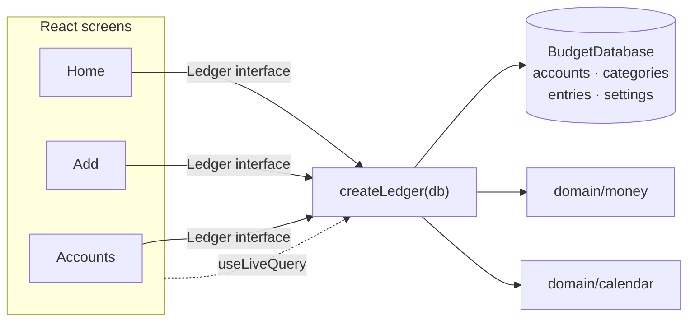

# Slice 01 Architecture — Log spending and see this month by category

Extends `docs/architecture/north-star.md`. It does not reopen anything the
north star settled; it decides only what this slice needs.

## What this slice adds

- The four north-star Dexie tables, with slice-1 indexes.
- One persistence seam (`createLedger`) that every screen reads and writes
  through.
- One entry write path (`addExpense`) and one read model (`monthSummary`).
- Three screens behind a hash route, no router dependency.
- A precached PWA shell that works offline after first load.

There are **no endpoints**: the app is static files plus IndexedDB (ADR 0001).
No HTTP API, no server-side validation, no sync.

## Inherited, not re-decided

- Single user, local-first, installable PWA; IndexedDB via Dexie (ADR 0001,
  0005).
- Accounts carry balances; entries are effects on accounts; account types are
  `checking | savings | credit`; card type is derived from the account (ADR
  0003).
- One `entries` collection with a `kind` discriminator; one write path for
  entries; all kinds store positive magnitudes except `opening`.
- Spending counts `expense` entries only; a credit-card expense counts exactly
  like a checking expense.
- Amounts are integer minor units; currency code and exponent live in
  `settings`; formatting happens only at the display edge (ADR 0004).
- Dates are local calendar dates (`YYYY-MM-DD`); a month is a string prefix.
- Categories are flat, seeded, archived rather than deleted.
- JSON export with `schemaVersion` is required later (slice 3), not built here.

## Storage — Dexie schema v1

`SCHEMA_VERSION = 1`, database name `budget` (overridable for tests).

| Table | Key | Indexes | Row shape used this slice |
|---|---|---|---|
| `accounts` | `id` (UUID string) | `createdAt` | `{ id, name, type, createdAt }` |
| `categories` | `id` (stable string) | — | `{ id, name, archived }` |
| `entries` | `id` (UUID string) | `date` | `{ id, kind, date, amountMinor, accountId, categoryId?, toAccountId? }` |
| `settings` | `id` (`'app'`) | — | `{ id, currency, currencyExponent, lastAccountId? }` |

```ts
// src/data/db.ts
import Dexie, { type Table } from 'dexie';
import type { Account, Category, Entry, Settings } from '../domain/types';

export const SCHEMA_VERSION = 1;

export class BudgetDatabase extends Dexie {
  accounts!: Table<Account, string>;
  categories!: Table<Category, string>;
  entries!: Table<Entry, string>;
  settings!: Table<Settings, string>;

  constructor(name = 'budget') {
    super(name);
    this.version(SCHEMA_VERSION).stores({
      accounts: 'id, createdAt',
      categories: 'id',
      entries: 'id, date',
      settings: 'id',
    });
  }
}
```

Notes that keep this slice honest:

- `Entry` is the north-star union (`expense | income | transfer | opening`),
  but slice 1 writes only `kind: 'expense'` and never sets `toAccountId`.
- `categories.archived` exists because the north star requires archive-not-
  delete. Slice 1 seeds `false`; there is no archive UI and no filter on it
  yet.
- `accounts.createdAt` is an ISO instant used only for stable picker ordering.
  Ledger dates remain local `YYYY-MM-DD`.
- `settings` starts as `{ id: 'app', currency: 'CAD', currencyExponent: 2 }`.
- `entries.date` is the only index used for filtering: `monthSummary` is
  `where('date').startsWith('YYYY-MM')`. `accounts.createdAt` is used only to
  order the account picker.
- No index on `accountId`, `categoryId`, `kind`, or `archived`: no slice-1
  query filters on them at the database level. Adding one later is a Dexie
  version bump with no data rewrite.
- No stored balances, no monthly-total table, no cache.

## Module seams



- **`domain/money`** — pure parsing and formatting. Deep: locale separators,
  exponent, and precision rules behind two functions.
- **`domain/calendar`** — pure local-date and month arithmetic. Deep:
  timezone-safe "today", month stepping, labels, and validation behind five
  functions.
- **`data/db`** — Dexie schema and typed tables. Not imported by the UI.
- **`data/ledger`** — the only seam the UI crosses for persistence. Owns
  seeding, validation, referential integrity, transactions, and the month read
  model.
- **`app` / `ui`** — routing, screens, and live queries. No Dexie imports
  outside `data/`.

One adapter (Dexie) means no repository interface and no fake adapter. Tests
construct a real `BudgetDatabase` on fake-indexeddb and cross the same
`Ledger` seam callers use.

### Interfaces

```ts
// src/domain/types.ts
export type AccountType = 'checking' | 'savings' | 'credit';
export type EntryKind = 'expense' | 'income' | 'transfer' | 'opening';
export type LocalDate = string; // YYYY-MM-DD
export type MonthKey = string;  // YYYY-MM

export interface Account {
  id: string;
  name: string;
  type: AccountType;
  createdAt: string; // ISO instant, ordering only
}

export interface Category {
  id: string;
  name: string;
  archived: boolean;
}

export interface Entry {
  id: string;
  kind: EntryKind;
  date: LocalDate;
  amountMinor: number;
  accountId: string;
  categoryId?: string;
  toAccountId?: string;
}

export interface Settings {
  id: 'app';
  currency: string;         // ISO 4217
  currencyExponent: number; // 2 for CAD
  lastAccountId?: string;
}
```

```ts
// src/domain/money.ts
export function parseAmount(input: string, exponent: number): number | null;
export function formatAmount(
  amountMinor: number,
  currency: string,
  exponent: number,
  locale?: string,
): string;
```

```ts
// src/domain/calendar.ts
export function todayLocalDate(now?: Date): LocalDate;
export function monthOf(date: LocalDate): MonthKey;
export function addMonths(month: MonthKey, delta: number): MonthKey;
export function formatMonth(month: MonthKey, locale?: string): string;
export function isValidLocalDate(value: string): boolean;
```

```ts
// src/data/ledger.ts
export interface CategorySpend {
  categoryId: string;
  name: string;
  amountMinor: number;
}

export interface MonthSummary {
  month: MonthKey;
  totalMinor: number;
  rows: CategorySpend[]; // amount desc, then name asc
}

export interface Ledger {
  initialize(): Promise<void>;
  listAccounts(): Promise<Account[]>;
  addAccount(input: { name: string; type: AccountType }): Promise<Account>;
  renameAccount(id: string, name: string): Promise<void>;
  listCategories(): Promise<Category[]>;
  addExpense(input: {
    amountMinor: number;
    categoryId: string;
    accountId: string;
    date: LocalDate;
  }): Promise<Entry>;
  monthSummary(month: MonthKey): Promise<MonthSummary>;
  getSettings(): Promise<Settings>;
}

export function createLedger(db: BudgetDatabase): Ledger;
```

```ts
export type LedgerErrorCode =
  | 'invalid-name'
  | 'invalid-account-type'
  | 'invalid-amount'
  | 'invalid-date'
  | 'unknown-account'
  | 'unknown-category';

export class LedgerError extends Error {
  constructor(readonly code: LedgerErrorCode, message: string) {
    super(message);
  }
}
```

The UI maps `LedgerErrorCode` to user-facing text; tests assert the code, not
the message.

## Write path

`addExpense` is the **only path that writes an `Entry`** — the slice-1 form of
the north star's single `createEntry`. No component writes to `entries`
directly. When income, transfers, and opening balances arrive, they extend this
function; they do not add a second entry write path.

Inside one Dexie `rw` transaction over `accounts`, `categories`, `entries`,
and `settings`:

1. Reject unless `amountMinor` is a positive safe integer
   (`LedgerError('invalid-amount')`).
2. Reject unless `isValidLocalDate(date)` (`LedgerError('invalid-date')`).
3. Read the account; reject if missing (`LedgerError('unknown-account')`).
4. Read the category; reject if missing (`LedgerError('unknown-category')`).
5. Insert one row:
   `{ id: crypto.randomUUID(), kind: 'expense', date, amountMinor, accountId, categoryId }`.
6. Update `settings.lastAccountId` to `accountId`.
7. Return the inserted entry.

Deliberately absent:

- No duplicate detection.
- No edit or delete.
- No balance update (balances are derived, and slice 1 shows none).
- No archived-category check — nothing can be archived until slice 4.
- No entry for a future `kind`; the union admits them, the write path does
  not.

`addAccount`:

- Trim the name; reject empty (`invalid-name`).
- Validate `type` against the three account types (`invalid-account-type`).
- `id = crypto.randomUUID()`, `createdAt = new Date().toISOString()`.
- **No opening entry.** An account added in this slice has a derived balance of
  zero until slice 6 adds opening balances.
- Duplicate names are allowed: two cards called "Visa" are legitimate, and the
  picker also shows the account type.

`renameAccount`:

- Trim the name; reject empty (`invalid-name`).
- Update by id; unknown id → `unknown-account`.
- Entries reference `accountId`, so the rename applies to all history without
  rewriting entries. No audit trail.

## First run, seeding, and settings

`initialize()` is idempotent and runs once at boot before the first render:

- Create `settings` if absent:
  `{ id: 'app', currency: 'CAD', currencyExponent: 2 }`.
- Insert any missing starter category by its stable id. Never overwrite an
  existing row, so a category archived in a later slice stays archived across
  boots.
- Do **not** create accounts. First-run state is "zero accounts", which the UI
  uses as its setup gate.

Starter categories (content, not architecture — slice 4 can rename or archive
them):

| id | name |
|---|---|
| `cat_groceries` | Groceries |
| `cat_eating_out` | Eating out |
| `cat_transport` | Transport |
| `cat_housing` | Housing |
| `cat_bills` | Bills |
| `cat_shopping` | Shopping |
| `cat_health` | Health |
| `cat_fun` | Fun |
| `cat_other` | Other |

Ids are stable and human-readable; entries reference them. User-created
categories in slice 4 will use UUIDs; the type stays an opaque string.

`getSettings()` assumes `initialize()` has run. `listCategories()` returns all
categories sorted by name; there is nothing archived to filter yet.

## Read path — month summary

`monthSummary(month)`:

1. `db.entries.where('date').startsWith(month).toArray()` — index-backed.
2. Keep `kind === 'expense'`; ignore every other kind. Slice 1 cannot create
   another kind, but this is the north-star spending rule and costs one
   predicate.
3. Group by `categoryId`, summing `amountMinor`.
4. Fetch names for the referenced category ids with `bulkGet`.
5. Sort rows by `amountMinor` descending, then `name` ascending.
6. Compute `totalMinor` from the rows. Rows therefore always add up to the
   total.

An empty month returns `{ month, totalMinor: 0, rows: [] }`. A referenced
category with no row (corruption only — categories are archived, never
deleted) is labelled `Uncategorized` and kept, so the total invariant still
holds.

There is **no account filter**: every expense counts, including credit-card
expenses. Account type never enters this query.

No monthly totals are stored. At one user and a few thousand rows, the date
index plus in-memory grouping is sufficient. If that ever stops being true,
add a compound `[kind+date]` index in a Dexie version bump; do not add it now.

### Live updates

- Home: `useLiveQuery(() => ledger.monthSummary(month), [month])`.
- Add form: `useLiveQuery(() => ledger.listAccounts(), [])` and
  `useLiveQuery(() => ledger.getSettings(), [])`.
- Dexie tracks the reads; `addExpense` re-runs the home query. No manual cache,
  event bus, or refresh button.
- New dependency: `dexie-react-hooks`.

## Screens and navigation

Hash routes, no router dependency:

| Route | Screen |
|---|---|
| `#/` | Home, current month by default |
| `#/?m=YYYY-MM` | Home, selected month |
| `#/add` | Add expense |
| `#/accounts` | Accounts list / first-run setup |

`useHashRoute` parses `location.hash` and subscribes to `hashchange`. A
malformed `m` falls back to the current month.

- **First run:** after `initialize()`, if `listAccounts()` is empty, force
  `#/accounts`. The screen adds accounts and shows "Start logging" once at
  least one exists. Once an account exists, the gate is gone even if the user
  never tapped the button.
- **Home:** month name (`formatMonth`), total, category rows largest first,
  previous/next month controls, add action, accounts link. With no rows, show
  an empty state with an add CTA.
- **Add:** amount, category, account, date. Date defaults to today. Account
  preselects `settings.lastAccountId` when it still exists. Category has no
  default. Submit runs `parseAmount` and then `addExpense`; errors render
  inline.
- **After save:** navigate to `#/?m=<monthOf(entry.date)>`, so a backdated
  expense is visibly in its month rather than silently absent from the current
  one.
- **Accounts:** list, add (name + type), inline rename. No delete, no balance
  field.
- **No settings screen.** Currency is a constant written by `initialize()`.

## PWA and offline

- `vite-plugin-pwa`, `registerType: 'autoUpdate'`.
- Manifest: name `Budget`, `display: 'standalone'`, `start_url: '/'`, theme and
  background colours, 192/512 icons plus a maskable icon.
- Workbox precaches the built shell (`js`, `css`, `html`, `svg`, `png`, `ico`,
  `woff2`), `navigateFallback: 'index.html'`. No runtime caching and no network
  calls.
- Offline works because every read and write is IndexedDB; after the first
  load, no request is needed.
- `navigator.storage.persist()` is requested once at boot, per the north star.
  The result is **not** surfaced in this slice; the storage warning belongs to
  slice 3.
- Auto-update is safe while the schema stays at v1. Future schema changes are
  forward-only Dexie upgrades, paired with the export `schemaVersion` when
  slice 3 lands (ADR 0005).
- iOS install metadata (`apple-touch-icon`, status bar) is build detail.

## Testing

`src/test/setup.ts` imports `fake-indexeddb/auto`; Vitest + React Testing
Library.

- **Domain unit tests:** money parsing/formatting (`.` and `,`, exponent 0 and
  2, excess decimals rejected, negative and empty rejected, zero parses but is
  rejected by the write path), calendar (local today, month arithmetic across
  year boundaries, invalid dates, leap day).
- **Ledger integration tests** at the `createLedger` seam, with a fresh
  `BudgetDatabase(uniqueName)` per test:
  - `initialize` seeds nine categories and CAD settings; a second call is a
    no-op.
  - `addAccount` / `renameAccount`; renaming does not change existing entries.
  - `addExpense` writes one expense and updates `lastAccountId`; invalid
    amount, date, account, or category produces the matching error code.
  - `monthSummary`: totals across all accounts, a credit account counts,
    grouping and largest-first order, rows sum to the total, other months are
    excluded, a backdated entry lands in its month, an empty month is empty.
- **UI tests** (RTL, real ledger on fake-indexeddb, `waitFor` for live
  queries): first-run gate; add flow updates the home total; previous/next
  month; empty state; last-account preselection.
- No mocks of `ledger` or Dexie internals. fake-indexeddb is the system
  boundary.
- **Manual:** build, preview, install, go offline, add an expense, verify the
  total; repeat with a backdated date and a credit account.

## How the architecture serves the acceptance criteria

| Slice acceptance | Where it is satisfied |
|---|---|
| First-time setup without instructions | Zero-accounts gate; `addAccount` with name + type only |
| Repeat expense under ten seconds | One add screen; today default; last account in `settings` |
| Home names the month | `formatMonth(month)` |
| Total equals that month's expenses across accounts | `monthSummary` has no account filter |
| Breakdown largest first, sums to total | `MonthSummary.rows`; total computed from rows |
| Credit-card purchase counts as spending | Account type never enters the query |
| Backdated expense appears in its month | `date` prefix query; after-save route |
| Installed and offline | PWA precache; all data in IndexedDB |
| Empty state shows how to add the first one | Home `rows.length === 0` CTA |
| Cents accepted and shown in one currency | `parseAmount` / `formatAmount` with exponent 2 |

## Deliberately deferred

- Edit/delete entries and the per-category entry list — slice 2.
- Export/import, `schemaVersion` file, storage warning — slice 3.
- Add/rename/archive categories — slice 4.
- Last-month comparison — slice 5.
- Balances and opening entries — slice 6.
- Income — slice 7. Transfers — slice 8.
- Account deletion, settings UI, currency change, locale setting,
  multi-currency.
- No `opening`, `income`, or `transfer` write paths; no `toAccountId` writes.

## Decision log and reversibility

| Question | Resolution | Cost to change |
|---|---|---|
| Where does the UI cross persistence? | `createLedger(db)`; no repository interface | Low |
| How is a month read? | `entries.date` index + in-memory grouping | Low; add an index later |
| How do screens update? | `useLiveQuery` | Low |
| How are routes handled? | Hash routes, no dependency | Low |
| Starter category identity? | Stable slug ids | Medium once entries reference them |
| Default currency? | **CAD, exponent 2** (user decision) | **High — data migration** |
| Persist request? | Now, no UI | Low |
| Export schema? | Deferred to slice 3 | n/a |

The only high-cost item is the currency value. It is stored in `settings`, and
changing it later reinterprets or rewrites every stored amount, so it is not a
settings toggle. It was flagged and resolved as CAD before this document was
written.
