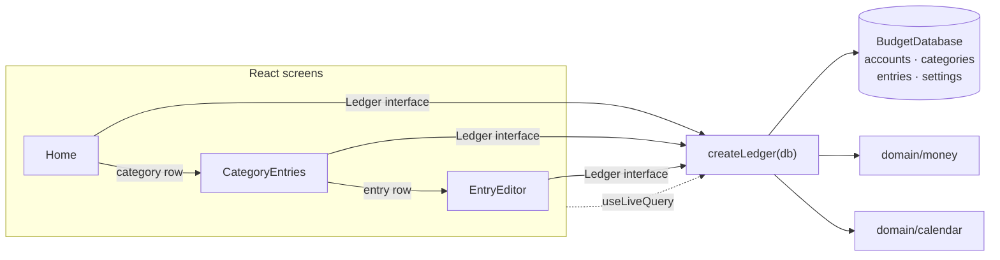

# Slice 02 Architecture — Inspect and correct entries

Extends `docs/architecture/north-star.md` and
`docs/architecture/slices/slice-01-architecture.md`. It does not reopen
anything either settled; it decides only what this slice needs.

## What this slice adds

- One category-month read model: `categoryEntries(month, categoryId)`.
- One entry lookup: `getEntry(id)`.
- Two lifecycle mutations: `updateExpense` and `deleteExpense`, sharing the
  existing expense validation with `addExpense`.
- Two screens and two hash routes: the category's entry list and the entry
  editor, including in-place removal confirmation.
- **No storage change**: `SCHEMA_VERSION` stays `1`, no new table, no new
  index, no migration, no `updatedAt`, no tombstone.

There are **no endpoints**. The app remains static files plus IndexedDB (ADR
0001); `Ledger` is still the whole application API.

## Inherited, not re-decided

- Single user, local-first, installable PWA; IndexedDB via Dexie (ADR 0001,
  0005).
- One `entries` collection with a `kind` discriminator. `addExpense` remains
  the only path that **creates** an entry; this slice adds lifecycle
  operations, not a second creation path.
- Amounts are positive integer minor units for expenses; currency and exponent
  live in `settings`; formatting happens only at the display edge.
- Dates are local calendar dates (`YYYY-MM-DD`); a month is a string prefix.
- Spending counts `expense` entries only, across every account. Account type
  never enters a spending query.
- Categories are flat and archived rather than deleted.
- Balances stay derived and are not shown in this slice.
- No audit history, no undo, and removal is final — settled by
  `docs/product/slices/slice-02-scope.md`, not reopened here.

This slice introduces **no new north-star-level decision**. The only
hard-to-reverse choices it relies on — corrections replace the stored entry,
and removal hard-deletes it — were already fixed by the slice scope. They are
recorded in the decision log below, not decided unilaterally here.

## Storage — unchanged Dexie schema v1

No table, key, or index changes:

| Table | Key | Indexes | Used by this slice |
|---|---|---|---|
| `accounts` | `id` | `createdAt` | account names in the list; validation on update |
| `categories` | `id` | — | category name in the list; validation on update |
| `entries` | `id` | `date` | list, lookup, update, delete |
| `settings` | `id` (`'app'`) | — | formatting only; **not written** by update/delete |

Access paths:

| Operation | Query |
|---|---|
| Category-month list | `entries.where('date').startsWith(month)`, then filter `kind === 'expense'` and category in memory |
| Open one entry | primary key `entries.get(id)` |
| Update | primary key read, then `entries.update(id, …)` |
| Delete | primary key read, then `entries.delete(id)` |
| Month summary | unchanged: date prefix plus in-memory grouping |

Why no new index:

- A month is the only list scope, and the `date` index already narrows to it.
  Filtering one category from a month's rows is trivial at one user's volume.
- `[categoryId+date]` would only pay off for an all-time per-category query,
  which this slice does not have.
- Adding an index later is a Dexie version bump with no data rewrite, so
  deferring it costs nothing.

Hard delete is the storage expression of "removal is final". There is no
`deletedAt`, no tombstone table, and no previous-version row. An update
overwrites the four editable fields on the existing row and leaves `id` and
`kind` untouched, so entry identity survives a correction.

## Module seams



- **`domain/money`** gains one pure function: `formatAmountInput`, which turns
  stored minor units back into a plain decimal string for the edit field. No
  currency symbol, no locale separators; `parseAmount` accepts the result.
- **`domain/calendar`** is unchanged; `monthOf` and `formatMonth` already
  cover the editor and list headers.
- **`data/db`** is still not imported by the UI.
- **`data/ledger`** grows the read models and lifecycle operations. A private
  validator (`requireExpenseFields` here; renamed
  `requireCategorizedEntryFields` in slice 07 and unified as
  `requireEntryFields` in `data/ledgerEntryWrite.ts`) becomes the single
  validation rule set shared by add and update; it is an internal seam, not
  part of `Ledger`.
- **`app` / `ui`** gains two screens and two routes. No Dexie imports outside
  `data/`.

One adapter (Dexie) still means no repository interface and no fake adapter.
Tests cross the same `Ledger` seam callers use.

### Interfaces

```ts
// src/data/ledger.ts
export interface CategorizedEntryInput { // named ExpenseInput in this slice
  amountMinor: number;
  categoryId: string;
  accountId: string;
  date: LocalDate;
}

export interface EntryListItem {
  id: string;
  date: LocalDate;
  amountMinor: number;
  accountId: string;
  accountName: string;              // "Unknown account" if the row is gone
  accountType: AccountType | null;  // null only when the account is gone
}

export interface CategoryEntries {
  month: MonthKey;
  categoryId: string;
  categoryName: string;             // "Uncategorized" for the sentinel
  totalMinor: number;               // sum of rows, always
  rows: EntryListItem[];            // date desc, then id desc
}

export const UNCATEGORIZED_CATEGORY_ID = '__uncategorized__';

export interface Ledger {
  // unchanged: initialize, listAccounts, addAccount, renameAccount,
  // listCategories, monthSummary, getSettings

  addExpense(input: CategorizedEntryInput): Promise<Entry>; // ExpenseInput in this slice
  updateExpense(id: string, input: CategorizedEntryInput): Promise<Entry>;
  deleteExpense(id: string): Promise<Entry>;                // returns the removed snapshot
  getEntry(id: string): Promise<Entry | null>;
  categoryEntries(month: MonthKey, categoryId: string): Promise<CategoryEntries>;
}
```

```ts
// src/domain/money.ts
export function formatAmountInput(amountMinor: number, exponent: number): string;
```

```ts
// src/app/router.ts
export type Route =
  | { name: 'home'; month: MonthKey }
  | { name: 'add' }
  | { name: 'accounts' }
  | { name: 'category'; month: MonthKey; categoryId: string }
  | { name: 'entry'; entryId: string };
```

Slices 03–08 added `backup`, `categories`, `income`, `transfers`,
`add-income`, and `add-transfer`; `entry` now serves every kind, dispatching on
the stored entry (`router.ts:9-21`). The current scheme is `#/add`,
`#/add/income`, `#/add/transfer`, and `#/entry/<id>`.

`AddExpenseInput` is renamed to `ExpenseInput` because add and update accept the
same four fields; slice 07 renamed it again to `CategorizedEntryInput` when
income reused the same shape. There is no compatibility alias; the only caller
passes an object literal.

```ts
export type LedgerErrorCode =
  | 'invalid-name'
  | 'invalid-account-type'
  | 'invalid-amount'
  | 'invalid-date'
  | 'unknown-account'
  | 'unknown-category'
  | 'unknown-entry'
  | 'unsupported-entry-kind'
  | 'duplicate-category-name' // added in slice 04
  | 'archived-category'       // added in slice 04
  | 'unknown-to-account'      // added in slice 08
  | 'same-transfer-account'   // added in slice 08
  | 'invalid-opening-amount'; // added in slice 06
```

The UI maps codes to text; tests assert codes. `getEntry` returns `null` for a
missing id rather than throwing, because a stale URL is a normal read outcome.

## Write paths

`requireEntryFields(input)` (named `requireExpenseFields` here) is called
inside the write transaction and is the only place these four rules live —
slice 04 adds a fifth, `archived-category`:

1. `amountMinor` is a positive safe integer (`invalid-amount`).
2. `isValidLocalDate(date)` (`invalid-date`).
3. The account exists (`unknown-account`).
4. The category exists (`unknown-category`).

`addExpense` keeps its slice-1 behaviour: validate, insert one
`kind: 'expense'` row with a fresh UUID, set `settings.lastAccountId`, return
the row.

`updateExpense(id, input)` — one `rw` transaction over `accounts`,
`categories`, `entries`:

1. Read the entry; missing → `unknown-entry`.
2. Reject unless `kind === 'expense'` (`unsupported-entry-kind`).
3. Run `requireEntryFields(input)`.
4. `entries.update(id, { date, amountMinor, accountId, categoryId })`.
5. Return the merged entry, with the original `id` and `kind`.

`deleteExpense(id)` — one `rw` transaction over `entries`:

1. Read the entry; missing → `unknown-entry`.
2. Reject unless `kind === 'expense'` (`unsupported-entry-kind`).
3. `entries.delete(id)`.
4. Return the removed snapshot, so the caller can navigate by the stored
   values rather than by possibly stale form state.

Deliberately absent:

- No history row, no audit fields, no soft delete.
- No change to `settings.lastAccountId` on update or delete. That field means
  "the account used when adding"; correcting an old entry is not adding.
- No batch operations. One id per call.
- No balance or total recalculation: every total is derived on read.
- No change to `kind`, `id`, or `toAccountId`; those are not editable fields.
- No duplicate detection.

## Read path — category entries

`categoryEntries(month, categoryId)`:

1. Reject an invalid month with `RangeError('Invalid month key')`, matching
   `monthSummary`.
2. `entries.where('date').startsWith(month).toArray()`.
3. Keep `kind === 'expense'`; drop every other kind.
4. Keep entries whose `(categoryId ?? UNCATEGORIZED_CATEGORY_ID)` equals the
   requested id.
5. Resolve account rows with one `bulkGet`; resolve the category row unless the
   id is the sentinel.
6. Sort `date` descending, then `id` descending as a deterministic tie-break.
7. Sum `amountMinor` into `totalMinor`.

Properties:

- **The list total equals the home row.** `monthSummary` groups the same
  month-prefixed, `expense`-only rows by category; `categoryEntries` applies
  the same predicates to one category. Their sums must agree, and this is a
  tested invariant.
- **No account filter.** Credit-card and checking expenses are listed
  identically.
- **No other month, no other kind.** Transfers, income, and openings can never
  appear here.
- **The sentinel is supported.** An entry with no `categoryId` (corruption
  today; possible after import later) is reachable through the
  `__uncategorized__` row that `monthSummary` already exposes. The row is
  labelled `Uncategorized` and its amounts still add up. The existing literal
  in `monthSummary` is replaced by the exported
  `UNCATEGORIZED_CATEGORY_ID` constant; its behaviour is unchanged.
- **Missing account or category rows degrade, they do not disappear.** A
  missing account yields `"Unknown account"` and `accountType: null`; a
  missing category yields `"Uncategorized"`. The amount stays in the total, so
  the home/list invariant survives.
- **Empty result** is `{ month, categoryId, categoryName, totalMinor: 0,
  rows: [] }`; the category name still resolves when the category exists.

`getEntry(id)` is a primary-key read returning `Entry | null`. It does not
join accounts or categories: the editor already loads those lists for its
pickers.

No monthly totals, entry lists, or joined rows are stored or cached. At one
user and a few thousand entries, the date index plus in-memory filtering is
sufficient, exactly as in slice 1. If a single month ever reaches the point
where this is visibly slow, add a compound `[categoryId+date]` index in a Dexie
version bump; do not add it now.

### Live updates

- Home: unchanged `useLiveQuery(() => ledger.monthSummary(month), …)`.
- Category list:
  `useLiveQuery(() => ledger.categoryEntries(month, categoryId), …)`.
- Editor: `useLiveQuery(() => ledger.getEntry(entryId), …)` plus the existing
  account, category, and settings queries.
- `updateExpense` and `deleteExpense` touch `entries`; Dexie re-runs every
  affected query. No manual cache, event bus, or refresh.

The slice-1 single-tab assumption carries over: the editor seeds its form state
once from the loaded entry. A concurrent change from another tab is visible to
the live queries but not merged into a half-edited form; the next write still
re-reads and validates inside its transaction.

## Screens and navigation

| Route | Screen |
|---|---|
| `#/` | Home, current month |
| `#/?m=YYYY-MM` | Home, selected month |
| `#/add` | Add expense |
| `#/accounts` | Accounts |
| `#/category?m=YYYY-MM&c=<categoryId>` | That month's entries in that category |
| `#/entry/<entryId>` | Entry editor |

Parsing rules:

- `/category` requires a non-empty `c`; a missing or empty `c` falls back to
  home for the parsed month.
- An invalid `m` falls back to the current month, as in slice 1.
- `/entry/<id>` requires a non-empty id; missing → home.
- `c` and the entry id are `encodeURIComponent`-encoded when building a hash
  and decoded when parsing. A malformed encoding falls back to home.

**Why the editor route carries only the entry id.** The entry's stored month
and category *are* the origin: the only way in is that category's list for
that month. Back, save, and remove can all derive their destination from the
entry, so no `from=` parameter can go stale or disagree with the row. After an
edit that re-files or re-dates the entry, the returned entry is the new
origin.

Screen behaviour:

- **Home:** category rows become buttons that navigate to the category route
  for the displayed month. Every row is tappable, including `Uncategorized`.
- **Category list:** heading names the category and the month, with a total
  that must match the home row. Rows are newest first and show amount, date,
  and the account name with its type (`Name · Type`, the same label as every
  other list and picker). Back returns to `#/?m=<month>`. Tapping a row opens
  the editor.
- **Editor:** amount, category, account, and date are prefilled from the
  stored entry; amount is rendered by `formatAmountInput`. The same client-side
  checks and `LedgerErrorCode` messages as the add form apply. Back leaves
  without writing. A missing entry renders a not-found state with a link home.
- **Save:** call `updateExpense`, then navigate to
  `#/category?m=<monthOf(updated.date)>&c=<updated.categoryId>` with
  `replace: true`, so the list that now holds the entry is shown and the stale
  editor does not remain in history.
- **Remove:** an inline confirmation panel inside the editor — no route and no
  modal dependency — naming the entry's amount, date, and account. Cancel
  closes the panel and writes nothing. Confirm calls `deleteExpense`, then
  `categoryEntries` for the removed snapshot's month and category: if it is
  empty, navigate to `#/?m=<month>` (which shows the month's empty state when
  that was the last entry); otherwise navigate to the category list. Both use
  `replace: true`.
- **Stale id:** if `getEntry` returns `null`, or a write raises
  `unknown-entry`, show not-found with a home link. No silent redirect, so the
  user learns the entry is gone.

No new dependency. `useLiveQuery` remains the only data-sync mechanism.

## How the architecture serves the acceptance criteria

| Slice acceptance | Where it is satisfied |
|---|---|
| Tapping a category opens that month's entries, newest first, summing to the row | `categoryEntries` + the shared predicate invariant; `rows` sorted date desc |
| Each listed entry shows amount, date, account | `EntryListItem` |
| Open any entry and change amount, category, account, or date | `getEntry` + `CategorizedEntryInput` on `updateExpense` |
| Category change moves the amount between rows immediately | one-row `update`; live `monthSummary` queries |
| Date change moves the entry to its new month | date is an editable field; save routes to `monthOf(updated.date)` |
| Save shows the list that now holds the entry | save navigates to the returned entry's month and category |
| Removal asks for confirmation; cancel keeps it | inline confirmation in the editor; no write until confirm |
| Confirmed removal updates list, row, and total immediately | `deleteExpense` + live queries |
| Removing a category's last entry lands on that month's home | post-delete `categoryEntries` check |
| Removing the month's last entry shows the empty state | home `rows.length === 0`, unchanged |
| Correcting one entry leaves every other entry unchanged | update/delete address exactly one id |
| Credit-card entries edit and remove like checking | no account-type branch in any path |
| Backing out of an edit leaves the entry unchanged | editor writes only on save/confirm |

## Testing

Ledger integration tests at the `createLedger` seam, with a fresh
`BudgetDatabase(uniqueName)` per test:

- `categoryEntries` returns only the requested category and month; newest
  first; credit-card entries included; rows sum to `totalMinor`; its total
  equals the matching `monthSummary` row.
- An empty category-month returns zero rows and the resolved category name; an
  invalid month throws `RangeError`.
- `getEntry` returns the stored row and `null` for an unknown id.
- `updateExpense` changes the four fields, preserves `id` and `kind`, leaves
  every other entry untouched, and moves amounts between category rows and
  months in `monthSummary`.
- `updateExpense` rejects unknown id, a non-expense kind inserted directly for
  the test, and each invalid field with the matching code; it does not change
  `settings.lastAccountId`.
- `deleteExpense` removes exactly one row, returns its snapshot, updates
  `monthSummary`, and empties the month when it was the last entry; unknown id
  and non-expense kind are rejected.
- The cross-read invariant is asserted directly:
  `categoryEntries(month, row.categoryId).totalMinor === row.amountMinor` for
  every `monthSummary` row.

UI tests (RTL, real ledger on fake-indexeddb, `waitFor` for live queries):

- Home category row opens the list with amount, date, and account.
- Editing an amount updates the list, the home row, and the home total.
- Changing category moves the amount between home rows.
- Changing the date to another month lands on the new month's list.
- Delete confirmation: cancel keeps the entry; confirm removes it; the last
  entry in a category lands home without that category; the last entry in the
  month shows the empty state.
- Back without saving leaves the entry unchanged.
- A credit-card entry edits and deletes like a checking one.
- A stale `/entry/<id>` route shows not-found.

No mocks of `ledger` or Dexie internals. fake-indexeddb remains the system
boundary. Manual: build, preview, install, go offline, drill into a category,
correct an amount and a month, remove an entry, and confirm the totals on both
sides.

## Answers to the scope handoff's open questions

| Open question | Resolution |
|---|---|
| How is an opened entry addressed so back/save return to the right list? | `#/entry/<id>` only; the stored entry supplies its month and category. |
| Does the drill-down need a new index? | No. `entries.date` narrows to the month; category filtering is in memory. |
| Does removal delete the row or record something else? | Hard delete, confirmed; no tombstone or audit row. |
| How does edit reuse the single write path? | `requireEntryFields` is shared; `addExpense` stays the only creation path in this slice, and update/delete are lifecycle operations on one id. |
| New read model or expose from `monthSummary`? | New `categoryEntries` read model; `monthSummary` stays the home aggregate. |
| Is `CONTEXT.md`'s `Entry` definition corrected? | Yes: four kinds (expense, income, transfer, opening), plus correction/removal terms. |

## Deliberately deferred

- All-entries feed, in-category search or filtering, bulk edit/delete.
- Undo, audit history, soft delete, and any "recently removed" recovery.
- `createdAt` on entries and insertion-order tie-breaking within a day.
- Compound `[categoryId+date]` index and any stored/cached totals.
- Custom category management, backup/restore, last-month comparison, balances,
  opening balances, income, and transfers.
- Account deletion and any cascade behaviour.

## Decision log and reversibility

| Question | Resolution | Cost to change |
|---|---|---|
| What does "edit" mean? | In-place overwrite of the four fields; `id` and `kind` stable | **High** — past corrections are unrecoverable; settled by slice scope |
| What does "remove" mean? | Hard delete after confirmation; no tombstone | **High** — irreversible by product design; settled by slice scope |
| Is a schema migration needed? | No; `SCHEMA_VERSION` stays `1` | Low |
| How is the category list queried? | `date` prefix + in-memory `kind`/category filter | Low; add an index later |
| How is an entry addressed? | `#/entry/<id>`, origin derived from the row | Low |
| Where does save land? | The returned entry's category and month, `replace: true` | Low |
| Where does removal land? | Remaining category list, or that month's home when empty | Low |
| Same-day ordering? | `date` desc, then `id` desc; within-day order unspecified | Low; `createdAt` can be added later, but old rows stay unordered |
| Does update touch `settings.lastAccountId`? | No; that field tracks adding only | Low |
| How are orphaned references shown? | `"Unknown account"` / `"Uncategorized"`, amount retained | Low |
| Is the uncategorized row reachable? | Yes, through the existing `__uncategorized__` sentinel | Low |
