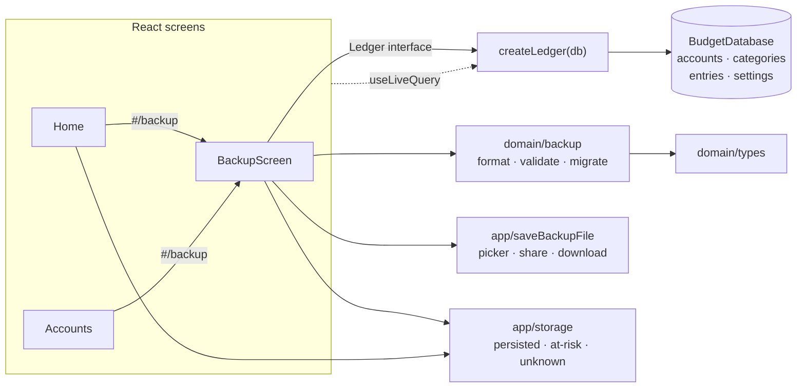

# Slice 03 Architecture — Keep a backup

Extends `docs/architecture/north-star.md`,
`docs/architecture/slices/slice-01-architecture.md`, and
`docs/architecture/slices/slice-02-architecture.md`. It reopens nothing they
settled; it decides only what this slice needs.

## The one durable contract — confirmed by the build

Everything in this slice is cheap to change except **the shape of the backup
file**. Once a user has saved one, every future version of the app must still
read it; changing the envelope after that means shipping a second reader.
North-star deliberately left the shape open for this slice, so it was decided
below and shipped as v1:

- Envelope: `format` + `schemaVersion` + `exportedAt` + `data`.
- `schemaVersion` is the **data-model** version — not the app version and not
  the Dexie store version. A backup from an older app build with the same
  data model restores without migration; a lower `schemaVersion` migrates on
  restore; a higher one is refused.
- The file carries **ledger data only** — accounts, categories, entries, and
  the currency setting. Device state (`lastBackupAt`, `lastAccountId`) never
  enters a backup and survives a restore.

A separate envelope `formatVersion`, a different top-level shape, or a
different ledger/device-state split would now cost a compatibility reader
because v1 files exist. Everything else below is reversible at slice cost.

## What this slice adds

- One pure format module: `domain/backup` — build, serialize, parse, migrate,
  validate, preview, filename.
- Three `Ledger` operations: `readBackupData`, `restoreBackup`,
  `markBackupSaved`.
- One storage-status module and hook: `app/storage` — persisted / at risk /
  unknown.
- One save adapter: `app/saveBackupFile` — file picker, share sheet, download
  fallback.
- One screen and one route: `#/backup`, reached from home and from the
  accounts screen (so first run can restore).
- `Settings.lastBackupAt?: string`, device-local; **no Dexie version bump**.
- One behavioural tightening in `initialize`: starter categories seed only on
  first run, so a restore is not re-seeded at the next boot.

There are **no endpoints**. The app remains static files plus IndexedDB (ADR
0001); `Ledger` is still the whole application API. There is **no new table
and no new index**.

## Inherited, not re-decided

- Single user, local-first, installable PWA; IndexedDB via Dexie (ADR 0001,
  0005).
- One `entries` collection with a `kind` discriminator; amounts are integer
  minor units; dates are local calendar dates; spending counts expenses only;
  categories are flat and archived; balances are derived.
- Correction is in place and removal is final (slice 2). `Ledger` remains the
  only persistence seam; there is no repository interface and no fake adapter.
- Restore **replaces, never merges**; a restore is all-or-nothing; there is no
  undo — settled by `docs/product/slices/slice-03-scope.md`, not reopened here.
- Manual backups only: no schedule, cloud, sync, encryption, CSV, or merging.
- The backup file is the only backup and the only migration path across model
  changes (north-star).

The only durable choice this slice makes is the file contract flagged above.
The rest follows from the scope.

## Storage — unchanged Dexie schema v1

No table, key, or index changes:

| Table | Key | Indexes | Used by this slice |
|---|---|---|---|
| `accounts` | `id` | `createdAt` | dumped by export; replaced by restore |
| `categories` | `id` | — | dumped by export; replaced by restore |
| `entries` | `id` | `date` | dumped by export; replaced by restore |
| `settings` | `id` (`'app'`) | — | `lastBackupAt`; currency/exponent dumped and replaced |

`settings` gains one optional, non-indexed field:

```ts
export interface Settings {
  id: 'app';
  currency: string;
  currencyExponent: number;
  lastAccountId?: string;
  lastBackupAt?: string; // ISO instant; device state, never in a backup
}
```

Adding a non-indexed property to a stored object is not a Dexie store change:
`SCHEMA_VERSION` stays `1`, `version(1).stores(...)` is untouched, and no
upgrade function ships. `lastBackupAt` is not in `accounts`, `categories`, or
`entries`, so no backfill is needed.

Two version numbers now exist and are deliberately independent:

| Constant | Meaning | Today |
|---|---|---|
| `SCHEMA_VERSION` (`data/db`) | IndexedDB store/index version | `1` |
| `BACKUP_SCHEMA_VERSION` (`domain/backup`) | data-model version written into backup files | `1` |

The bump rule, part of the flagged contract:

- A stored field is added, removed, renamed, or changes meaning → bump
  `BACKUP_SCHEMA_VERSION`, add a migration from the previous value, and keep
  the Dexie upgrade if the store also changed.
- Only an index or store changes, with the same data shape → bump
  `SCHEMA_VERSION` only.
- A new entry `kind` or a new account type → data-model change → bump
  `BACKUP_SCHEMA_VERSION`.

## The backup file

```json
{
  "format": "budget-backup",
  "schemaVersion": 1,
  "exportedAt": "2026-11-10T19:42:11.000Z",
  "data": {
    "accounts": [
      {
        "id": "…",
        "name": "Checking",
        "type": "checking",
        "createdAt": "2026-11-02T14:03:00.000Z"
      }
    ],
    "categories": [
      { "id": "cat_groceries", "name": "Groceries", "archived": false }
    ],
    "entries": [
      {
        "id": "…",
        "kind": "expense",
        "date": "2026-11-10",
        "amountMinor": 1842,
        "accountId": "…",
        "categoryId": "cat_groceries"
      }
    ],
    "settings": { "currency": "CAD", "currencyExponent": 2 }
  }
}
```

- **`format`** identifies this app's file. A JSON file without it is not a
  backup.
- **`schemaVersion`** gates compatibility. It is not the app's version: app
  releases that do not change the data model must keep restoring.
- **`exportedAt`** is the instant the snapshot was read, ISO 8601 UTC. It is
  the time shown in the restore preview and recorded as the last backup.
- **`data`** keeps the envelope separate from table names, so envelope fields
  can be added later without colliding with a table.
- **`data.settings`** carries only the currency pair. `lastAccountId` is a
  device convenience; `lastBackupAt` is device state. Neither belongs to the
  ledger.
- Arrays are sorted by `id` on export, so the `data` block of two backups of
  the same ledger is byte-identical and easy to diff.
- The file is pretty-printed (`JSON.stringify(file, null, 2)` plus a trailing
  newline). One user's ledger is tiny; inspectability beats bytes.
- The filename is local time:
  `budget-backup-YYYY-MM-DD-HHmmss.json`.

### Parsing, refusal, and migration

`parseBackupFile(text)` is the only reader. It never touches Dexie, and it
either returns a current-schema `BackupFile` or throws `BackupError`:

| Condition | Code |
|---|---|
| Not JSON, not an object, wrong/missing `format` | `not-a-backup` |
| `schemaVersion` is a higher integer than `BACKUP_SCHEMA_VERSION` | `newer-version` |
| Envelope right but any field or row is malformed | `damaged` |
| `schemaVersion` lower with no registered migration | `damaged` |

Validation, after migration:

- `schemaVersion` is a positive safe integer; `exportedAt` parses as a date.
- `data` has `accounts`, `categories`, `entries` arrays and a `settings`
  object.
- Account: non-empty string `id` and `name`; `type` is one of the three;
  string `createdAt`.
- Category: non-empty string `id` and `name`; boolean `archived`.
- Entry: non-empty string `id`; `kind` is one of the four; `date` passes
  `isValidLocalDate`; `amountMinor` is a safe integer, positive for `expense`,
  `income`, and `transfer`, signed for `opening`; `accountId` is a non-empty
  string; `toAccountId` is required for `transfer`; optional `categoryId` and
  `toAccountId` must be non-empty strings when present.
- Settings: non-empty string `currency`; non-negative safe integer
  `currencyExponent`.
- Unknown extra fields are ignored.

Deliberately **not** validated:

- **Referential integrity.** An entry whose account or category is missing
  restores; reads already degrade to `"Unknown account"` / `"Uncategorized"`
  and keep the amount (slice 2). A restore must not be stricter than the
  ledger it restores into.
- **Duplicate ids.** `restoreBackup` uses `bulkAdd`; a duplicate aborts the
  write transaction and the previous ledger survives. That is the damaged-file
  outcome, and it is also the atomicity proof.

Migrations are an ordered registry keyed by source `schemaVersion`:

```ts
type BackupMigration = (data: unknown) => unknown;
const MIGRATIONS: Record<number, BackupMigration> = {};
```

Today the registry is empty and `1` is the first schema, so a lower number is
`damaged`. The first data-model change must ship its migration and a test
against a fixture of the old file. A same-schema backup from any older app
build needs no migration and restores directly.

## Module seams



- **`domain/backup`** is pure: no Dexie, no DOM, no browser API. It owns the
  envelope, version gate, migrations, row validation, preview, serialization,
  and filename. This is the deep module of the slice: one `parseBackupFile`
  call hides the whole compatibility story.
- **`data/ledger`** grows three operations. It still owns every Dexie
  transaction; the UI still never imports `data/db`.
- **`app/storage`** reads the browser's persistence status and owns the
  one-time `persist()` request. `app/pwa` keeps only service-worker
  registration.
- **`app/saveBackupFile`** is a browser adapter: picker, share sheet, or
  anchor download. It knows nothing about the ledger or the file format.
- **`app` / `ui`** gains the backup screen, the route, the home action and
  warning, and the accounts-screen restore link.

One adapter per browser capability still means no interface and no fake:
tests stub the browser globals, exactly as they use `fake-indexeddb` for
Dexie.

### Interfaces

```ts
// src/domain/backup.ts
export const BACKUP_FORMAT = 'budget-backup';
export const BACKUP_SCHEMA_VERSION = 1;

export interface BackupSettings {
  currency: string;
  currencyExponent: number;
}

export interface BackupData {
  accounts: Account[];
  categories: Category[];
  entries: Entry[];
  settings: BackupSettings;
}

export interface BackupFile {
  format: typeof BACKUP_FORMAT;
  schemaVersion: number;
  exportedAt: string; // ISO instant
  data: BackupData;
}

export interface BackupPreview {
  exportedAt: string;
  accountCount: number;
  entryCount: number;
}

export type BackupErrorCode = 'not-a-backup' | 'newer-version' | 'damaged';

export class BackupError extends Error {
  readonly name = 'BackupError';
  constructor(
    readonly code: BackupErrorCode,
    message: string,
  );
}

export function byCodeUnitId(
  left: { id: string },
  right: { id: string },
): number; // shared with data/ledger so snapshot and file ordering cannot diverge

export function createBackupFile(data: BackupData, exportedAt: Date): BackupFile;
export function serializeBackup(file: BackupFile): string;
export function parseBackupFile(text: string): BackupFile;
export function previewBackup(file: BackupFile): BackupPreview;
export function backupFileName(at: Date): string;
```

```ts
// src/data/ledger.ts
export interface Ledger {
  // unchanged: initialize, listAccounts, addAccount, renameAccount,
  // listCategories, addExpense, updateExpense, deleteExpense, getEntry,
  // categoryEntries, monthSummary, getSettings

  readBackupData(): Promise<BackupData>;
  restoreBackup(data: BackupData): Promise<void>;
  markBackupSaved(at: string): Promise<void>;
}
```

```ts
// src/app/storage.ts
export type StorageStatus = 'persisted' | 'at-risk' | 'unknown';

export function readStorageStatus(): Promise<StorageStatus>;
export function requestPersistentStorage(): Promise<void>; // memoized
export function useStorageStatus(): StorageStatus | undefined; // React hook
```

```ts
// src/app/saveBackupFile.ts
export type SaveOutcome = 'saved' | 'cancelled' | 'unconfirmed';

export function saveBackupFile(file: File): Promise<SaveOutcome>;
```

```ts
// src/domain/calendar.ts
export function formatLocalDateTime(iso: string, locale?: string): string;
```

```ts
// src/app/router.ts
export type Route =
  | { name: 'home'; month: MonthKey }
  | { name: 'add' }
  | { name: 'accounts' }
  | { name: 'backup' }
  | { name: 'category'; month: MonthKey; categoryId: string }
  | { name: 'entry'; entryId: string };
```

`readBackupData` is named for what it returns — the ledger contents a backup
needs, not a file. `restoreBackup` takes the already-parsed data. The format
module is the only place that knows the envelope.

## Write paths

### `readBackupData()`

One `r` transaction over all four tables:

1. Read `settings`; missing → `Error('Ledger not initialized')`, matching
   `getSettings`.
2. Read all accounts, categories, and entries; sort each by `id`.
3. Return them with `settings: { currency, currencyExponent }` only.

The transaction makes the file a consistent snapshot: no write can land
between the table reads. `lastAccountId` and `lastBackupAt` are deliberately
dropped.

### `markBackupSaved(at)`

One `rw` transaction on `settings`:

1. `settings.update('app', { lastBackupAt: at })`.
2. Zero rows updated → `Error('Ledger not initialized')`.

It touches no other field and writes nothing else.

### `restoreBackup(data)`

One `rw` transaction over all four tables:

1. Read the current settings row and remember `lastBackupAt`.
2. `clear()` accounts, categories, entries, and settings.
3. `bulkAdd` the backup's accounts, categories, and entries.
4. `add` the settings row: `id: 'app'`, the backup's `currency` and
   `currencyExponent`, plus the remembered `lastBackupAt` when present.
   `lastAccountId` is dropped: the previous "last used account" may not exist
   in the restored ledger and is not ledger data.

Why this is all-or-nothing:

- Dexie rolls back the whole transaction on any throw — a constraint error
  from `bulkAdd`, a quota failure, or a failed settings write.
- `bulkAdd`, not `bulkPut`: duplicate ids fail loudly instead of silently
  dropping a row.
- Live queries are notified after the transaction commits, so the UI never
  renders the cleared middle.

No validation happens here. `parseBackupFile` validated the file; the typed
`BackupData` is the contract. The transaction is the safety net.

### `initialize()` — first-run seeding only

```ts
const settings = await db.settings.get('app');
if (!settings) {
  await db.settings.add({ id: 'app', currency: 'CAD', currencyExponent: 2 });
  for (const category of STARTER_CATEGORIES) {
    if (!(await db.categories.get(category.id))) {
      await db.categories.add(category);
    }
  }
}
```

Previously categories were seeded whenever one was missing. That would let a
boot after a restore re-add a starter category the restored ledger does not
contain, breaking "restore replaces". Seeding is now gated on the absence of
the settings row, which is exactly first run. First-run behaviour, idempotency,
and the "never overwrite existing rows" test are unchanged.

## Read paths and screens

| Route | Screen |
|---|---|
| `#/backup` | Backup and restore |

Parsing: `path === '/backup'` returns `{ name: 'backup' }`; `routeToHash`
returns `#/backup`. No query parameters.

**Zero-account gate.** `App` currently forces `#/accounts` whenever there are
no accounts. The gate now allows `accounts` **and** `backup`, in both the
redirect effect and the loading guard, so a replacement phone can open the
backup screen before any account exists.

A successful restore must land on home, not bounce back to accounts while the
live accounts query catches up. The backup screen reports the restored account
count to `App`; `App` suppresses the empty-ledger redirect until the live
accounts query reflects the restore. A restore with at least one account then
lands on home; a restore with none goes to accounts, which is also the correct
state for an empty restored ledger. The suppression clears once the accounts
query is non-empty.

**Home.** Adds a `Backup` action next to `Accounts`, and, when the status is
`at-risk` or `unknown`, a warning that the phone may not keep the ledger, with
a link to `#/backup`. The warning is persistent, not an alert: it is a state,
not an event. `undefined` (still checking) shows nothing.

**Accounts.** Adds a `Restore from backup` action that navigates to
`#/backup`. It is shown whether or not accounts exist, so first run and a
later restore use the same path.

**Backup screen.** Shows:

- **Last backup**: `settings.lastBackupAt` via the existing live settings
  query. Absent → "No backup yet." Present → a `<time dateTime={iso}>` with
  `formatLocalDateTime`. The time is the backup's, not the screen's.
- **Storage status**: `useStorageStatus()`.
  - `persisted` → the phone has agreed to keep the ledger.
  - `at-risk` → the phone may discard it; a backup file is the only
    protection.
  - `unknown` → this browser cannot report it; keep a backup.
  - `undefined` while the check runs → a neutral checking state, never a
    premature warning.
- **Save backup**: `readBackupData` → `createBackupFile(data, now)` →
  `serializeBackup` → `File` → `saveBackupFile`. The same `now` is the file's
  `exportedAt` and, on a confirmed save, `markBackupSaved(now.toISOString())`.
- **Restore from backup**: a labelled file input
  (`accept=".json,application/json"`). On choose: `file.text()` →
  `parseBackupFile` → `previewBackup`. The preview names the file's date and
  its account and entry counts and states plainly that restoring replaces
  everything. Preview and confirmation are inline on the backup screen, like
  slice 2's removal panel — no modal and no route. Cancel clears the input and
  the preview and writes nothing.
  Confirm calls `restoreBackup(file.data)`, reports the restored account count
  to `App`, and navigates to `{ name: 'home', month: monthOf(todayLocalDate()) }`
  with `replace: true`. A parse error shows the mapped message and leaves the
  ledger untouched. A write error shows "Couldn't restore the backup. Your
  ledger is unchanged." The input value is reset after every attempt so the
  same file can be chosen again.

`BackupError` maps to text at the screen:

| Code | Message |
|---|---|
| `not-a-backup` | "That file isn't a Budget backup." |
| `newer-version` | "That backup was made by a newer version of Budget. Update the app and try again." |
| `damaged` | "That backup is damaged and can't be restored." |

Copy may be refined in the slice spec; the codes are the contract.

### Save outcomes

`saveBackupFile(file)` tries capabilities in order:

1. **File System Access** (`showSaveFilePicker`): write, `close()` →
   `'saved'`; `AbortError` → `'cancelled'`. `NotAllowedError` (the user
   activation expired while the ledger was read) or `SecurityError` falls
   through to the next capability; any other error propagates to the screen's
   error state.
2. **Web Share** (`navigator.canShare({ files: [file] })`): resolved share →
   `'saved'`; `AbortError` → `'cancelled'`; any other failure falls through.
3. **Anchor download**: create a blob URL, click a temporary
   `<a download={file.name}>`, revoke the URL → `'unconfirmed'`.

Only `'saved'` calls `markBackupSaved`. `'cancelled'` and `'unconfirmed'`
record nothing: the anchor path cannot tell a saved download from a cancelled
one, and the scope forbids claiming a backup succeeded when no file was saved.
The screen says what happened in each case; on `'unconfirmed'` it says the
browser has taken the file and that it is a backup only if it was saved. If
`markBackupSaved` fails after the file was written, the file exists but the
timestamp is not recorded; the screen says so rather than claiming the backup
was recorded.

The ledger read happens before the picker/share call. Both APIs want transient
user activation; a fast IndexedDB read normally stays inside the activation
window, and the `NotAllowedError` fallback covers the case where it does not.
This is the only browser-timing compromise in the slice.

`showSaveFilePicker` and `createWritable` are not in the project's TypeScript
DOM lib; declare their minimal shapes locally in `saveBackupFile.ts` rather
than adding a dependency.

### Storage status

`readStorageStatus()`:

- `navigator.storage?.persisted` absent → `'unknown'`.
- `await persisted()` → `'persisted'` when true, `'at-risk'` when false.
- Any throw → `'unknown'`.

`requestPersistentStorage()` memoizes one `persist()` call and resolves when
it finishes; `readStorageStatus()` is always a fresh read. `boot` calls the
request after render, as slice 1 did. The hook awaits the memoized request and
then reads the status, so mounting both home and backup does not prompt twice,
and a granted persistence shows up on the next read or `visibilitychange`
without a reload.

The home screen warns when the status is `'at-risk'` or `'unknown'`.
`'at-risk'` says the phone may discard the ledger; `'unknown'` says the
browser cannot confirm it will keep it. Both are states where a backup is the
only protection. The backup screen distinguishes the two. Storage status is
never stored in Dexie: it is a browser fact, re-readable on every load.

## How the architecture serves the acceptance criteria

| Slice acceptance | Where it is satisfied |
|---|---|
| From home, make a backup and save it outside the app | Home action → `#/backup` → `readBackupData` + `saveBackupFile` picker/share |
| Backup holds every account, category, entry, and currency | `BackupData` dumps all three tables and the currency pair |
| Restoring on an empty phone reproduces accounts, entries, month totals | `#/backup` allowed with zero accounts; `restoreBackup` replaces all tables |
| After a backup, show its date and time; before, say none | `settings.lastBackupAt`, written only on a confirmed save |
| State whether the phone keeps the ledger; warn on home when at risk | `useStorageStatus`; home warning on `'at-risk'` and `'unknown'` |
| Choosing a backup shows its date, account/entry counts, and replacement warning | `parseBackupFile` + `previewBackup` before any write |
| Cancelling changes nothing | No write until confirm; the file input resets |
| Confirming replaces the ledger and shows the restored home for this month | `restoreBackup` + navigate home with `todayLocalDate()` |
| Not-a-backup, damaged, and newer-version files are refused; ledger untouched | `BackupError` before the transaction; `newer-version` gate |
| An earlier-version backup restores and is brought up to date | Same schema restores directly; lower schema migrates via the registry |
| A failed restore leaves the ledger exactly as it was | One `rw` transaction; `bulkAdd`; Dexie rollback |
| Backup and restore work without a connection | No network in any path; blob, picker, and share are local |
| After restore, add/correct/remove work as before | Restore writes the same tables and settings shape; no path changes |
| Restoring on a phone with no accounts needs no account first | Zero-account gate allows `#/backup`; accounts screen links to it |

## Testing

**`domain/backup` unit tests (no Dexie, no DOM):**

- `createBackupFile` → `serializeBackup` → `parseBackupFile` round-trips all
  rows and the currency pair; arrays are sorted by `id`.
- `parseBackupFile` rejects invalid JSON, a wrong/missing `format`, a newer
  `schemaVersion`, a missing `data`, non-array tables, and each malformed row
  field, with the matching `BackupError.code`.
- A same-schema file with unknown extra fields parses.
- `previewBackup` counts accounts and entries.
- `backupFileName` uses local date parts and the `budget-backup-` prefix.

**Ledger integration tests** at the `createLedger` seam, fresh
`BudgetDatabase(uniqueName)` per test:

- `readBackupData` returns every row and only `currency` /
  `currencyExponent` from settings; before `initialize` it throws
  `Ledger not initialized`.
- `restoreBackup` replaces all three tables and the settings row; it preserves
  `lastBackupAt` and drops `lastAccountId`.
- `restoreBackup` with duplicate entry ids throws and leaves the previous
  ledger byte-for-byte intact — the atomicity test.
- `markBackupSaved` sets `lastBackupAt` and changes nothing else.
- After restoring a ledger with a reduced category set, `initialize` does not
  re-seed starter categories.
- The existing slice-1/2 tests still pass unchanged, including `initialize`
  idempotency.

**Adapter tests (stubbed globals, no real files):**

- `saveBackupFile`: picker close → `'saved'`; picker `AbortError` →
  `'cancelled'`; picker `NotAllowedError` → falls through; share resolve →
  `'saved'`; share `AbortError` → `'cancelled'`; no picker/share → anchor →
  `'unconfirmed'`, with the blob URL created and revoked.
- `readStorageStatus`: true → `'persisted'`; false → `'at-risk'`; missing or
  throwing API → `'unknown'`.

**UI tests (RTL, real ledger on `fake-indexeddb`, `waitFor` for live queries):**

- Backup screen says no backup yet; a confirmed save records and displays a
  timestamp; a cancelled or unconfirmed save does not.
- Choose a valid file → preview shows its date and counts and the replacement
  warning; cancel leaves the ledger unchanged; confirm replaces it and lands
  on home with the restored total.
- Invalid, damaged, and newer-version files show the mapped message and leave
  the ledger unchanged.
- First run: the accounts screen reaches `#/backup`, and the zero-account gate
  does not bounce it.
- A confirmed restore lands on home with the restored ledger, not on the
  accounts screen; a restore with zero accounts lands on accounts.
- Home warns when `persisted()` is false or the API is missing, not when
  true; the backup screen explains all three states.
- Existing tests are unaffected; storage APIs are stubbed where a test needs a
  status.

**Manual:** build, preview, install, go offline; save a backup through the
phone's share sheet to Files or a cloud drive; restore it in a fresh browser
profile; verify accounts, entries, month totals, and currency; corrupt a file
and confirm it is refused with the ledger intact; revoke storage permission
and confirm the home warning.

## Answers to the scope handoff's open questions

| Open question | Resolution |
|---|---|
| What the file contains beyond the user-visible list, and how it is versioned | All four tables; envelope `format` + `schemaVersion`; `schemaVersion` is the data-model version; lower migrates, higher is refused. |
| How restore is all-or-nothing, including failure partway | One Dexie `rw` transaction over all four tables; `clear` then `bulkAdd`; any throw rolls back. |
| How the app learns a file was actually saved, and what time is recorded | Picker `close()` or share resolve means saved; anchor download is unconfirmed and records nothing. The file's `exportedAt` is recorded on success. |
| Where the last-backup timestamp lives and how it behaves after restore | `settings.lastBackupAt`, device state; preserved across restore, never in the file. |
| How storage status is read and surfaced | `navigator.storage.persisted()` → `persisted` / `at-risk` / `unknown`; home warns on `at-risk` / `unknown`; backup screen explains all three. |
| How restore is reached on first run | `#/backup` is allowed with zero accounts; the accounts screen links to it. |
| Does `settings` gain a backup timestamp, and does the first schema upgrade ship | Yes to `lastBackupAt`, non-indexed; no Dexie bump; `SCHEMA_VERSION` and `BACKUP_SCHEMA_VERSION` both stay `1`. |
| Backup vs export vocabulary | Backup and Restore are canonical; "export/import" describes the mechanism, not a second feature. Added to `CONTEXT.md`. |

## Deliberately deferred

- Automatic, scheduled, or background backups; reminders; multiple backup
  slots; cloud accounts; sync; multi-device.
- Merging, partial backups, CSV export, encryption, compression, checksums,
  and any app-version field in the file.
- Undo after restore; a backup history or file list.
- Backing up device state (`lastBackupAt`, `lastAccountId`) or any future
  preference.
- Storage-quota display via `navigator.storage.estimate()`.
- Custom category management, balances, income, transfers, and last-month
  comparison.

## Decision log and reversibility

| Question | Resolution | Cost to change |
|---|---|---|
| What is the backup file's shape? | Envelope `format` + `schemaVersion` + `exportedAt` + `data` | **High once files exist** — flagged above |
| What does `schemaVersion` mean? | Data-model version, independent of app and Dexie versions | **High once files exist** — flagged above |
| What does restore replace? | Ledger data only; preserves `lastBackupAt`, drops `lastAccountId` | Medium; device-state semantics |
| How is restore atomic? | One `rw` transaction; `bulkAdd`; rollback on any throw | Low |
| How are older files handled? | Ordered migration registry keyed by source `schemaVersion`; empty today | Low |
| How is a saved backup confirmed? | Picker close / share resolve; anchor download is unconfirmed and records nothing | Low |
| What time is the last backup? | The file's `exportedAt`, recorded only on a confirmed save | Low |
| Where is `lastBackupAt` stored? | `settings`, device state, not in the backup | Low |
| How is storage status read? | `navigator.storage.persisted()`; home warns on `at-risk` / `unknown` | Low |
| How is restore reached on first run? | `#/backup` allowed with zero accounts; accounts screen link | Low |
| Does boot re-seed after restore? | No; seeding is gated on the absence of the settings row | Low |
| Does restore enforce referential integrity? | No; missing references degrade as in slice 2 | Low |
| Are duplicate ids checked before writing? | No; `bulkAdd` aborts the transaction, which is the safe outcome | Low |
| Is the backup sorted? | Yes, by `id`, for deterministic files and diffs | Low |
