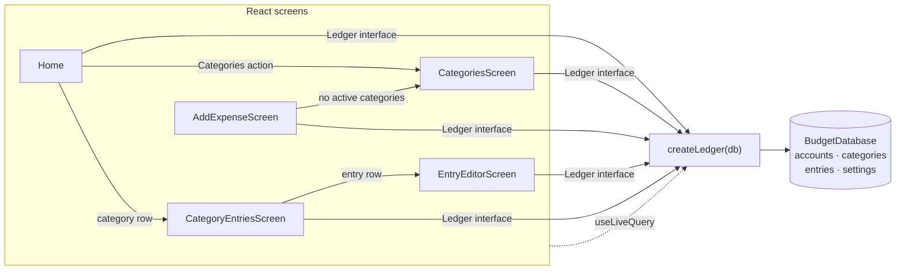

# Slice 04 Architecture — Manage categories

**Slice scope:** the user can add, rename, archive, and unarchive categories
so the home breakdown uses their own words, while every amount and total
stays unchanged.

**Status:** built as designed on branch `slice-04`. The delivered interface,
write paths, ordering, routes, screen states, and invariants match this
document; exact copy and the backfilled implementation contract live in
`docs/program-design/slices/slice-04-spec.md`.

Extends `docs/architecture/north-star.md`,
`docs/architecture/slices/slice-01-architecture.md`,
`docs/architecture/slices/slice-02-architecture.md`, and
`docs/architecture/slices/slice-03-architecture.md`. It reopens nothing they
settled; it decides only what this slice needs.

## What this slice adds

- Three `Ledger` mutations: `addCategory`, `renameCategory`, and
  `setCategoryArchived`.
- One ordering contract on `listCategories`: active categories first, archived
  categories below, alphabetical within each group.
- Category name rules in the ledger write path: trim, 1–60 characters, and
  case-insensitive uniqueness across active and archived categories.
- Archive-aware expense validation: `addExpense` refuses an archived
  category; `updateExpense` allows the entry's current archived category and
  refuses any other archived category.
- One screen and one hash route: `#/categories`, reached from home and from
  the add-expense empty state.
- One home action; one filtered category list on add; one filtered list on
  correction.
- **No storage change**: `SCHEMA_VERSION` stays `1`, no new table, no new
  index, no migration, no new `Category` field.
- **No backup change**: `BACKUP_SCHEMA_VERSION` stays `1`; v1 already carries
  `id`, `name`, and `archived`.

There are **no endpoints**. The app remains static files plus IndexedDB
(ADR 0001); `Ledger` is still the whole application API. There is **no new
table and no new index**.

## The durable question — checked, nothing to flag

This slice does not reopen a north-star decision, and it introduces no
contract that is expensive to change after data exists:

- `Category` already has `{ id, name, archived }`. The scope needs no new
  field.
- North-star already settled flat categories, archive-not-delete, one
  category per expense/income, and entries referencing a category by id.
- Backup v1 already serializes `archived` and arbitrary category names and
  ids. Adding and renaming categories is a data change, not a data-model
  change.
- The two rules this slice adds — unique names and archive-aware writes —
  are fixed by `docs/product/slices/slice-04-scope.md`. They are validation
  rules, not storage shapes; relaxing either later needs no data rewrite.

The one constraint that would be expensive to introduce after the fact is
name uniqueness across archived categories, because a ledger that already
contains collisions cannot be tightened without a cleanup or a refusal. The
scope already decided it, so this doc implements it rather than deciding it
unilaterally. The cost is in introducing it late, not in reversing it: once
shipped, relaxing the rule is a validation change. **No flag is raised.** No
ADR is warranted: the decision is not hard to reverse, not surprising without
context, and not a trade-off against a viable alternative.

## Inherited, not re-decided

- Single user, local-first, installable PWA; IndexedDB via Dexie (ADR 0001,
  0005).
- One `entries` collection with a `kind` discriminator; amounts are integer
  minor units; dates are local calendar dates; spending counts expenses only;
  balances are derived.
- Categories are flat, user-managed, and archived rather than deleted.
- `Ledger` remains the only persistence seam; there is no repository
  interface and no fake adapter.
- Restore **replaces, never merges**; a restore is all-or-nothing.
- The backup file is the only backup and the only migration path across model
  changes.
- Correction is in place and removal is final (slice 2). This slice changes
  neither.

## Storage — unchanged Dexie schema v1

No table, key, or index changes:

| Table | Key | Indexes | Used by this slice |
|---|---|---|---|
| `categories` | `id` | — | list, add, rename, archive, unarchive |
| `entries` | `id` | `date` | read-time category joins; category management never rewrites entries |
| `accounts` | `id` | `createdAt` | unchanged |
| `settings` | `id` (`'app'`) | — | unchanged |

`Category`'s shape stays exactly (the write rule lives in the validator, not in
the type's comments):

```ts
export interface Category {
  id: string;   // stable string; seed ids are cat_*
  name: string; // display name
  archived: boolean;
}
```

Why no new index:

- The duplicate-name check compares `name.trim().toLowerCase()`, which a
  Dexie index on `name` cannot answer. A normalized-name field would be a
  stored derived value and a migration; the category list is tens of rows.
- The Categories screen reads every category anyway. `listCategories` already
  does `categories.toArray()`.
- A `name` index would only help a lookup this slice does not have. Adding
  one later is a Dexie version bump with no data rewrite.

The two version numbers remain independent and unchanged:

| Constant | Meaning | Today |
|---|---|---|
| `SCHEMA_VERSION` (`data/db`) | IndexedDB store/index version | `1` |
| `BACKUP_SCHEMA_VERSION` (`domain/backup`) | data-model version in backup files | `1` |

`parseCategory` already requires a non-empty `name` and a boolean
`archived`; restore already replaces the `categories` table wholesale.
Nothing in `domain/backup` changes.

## Module seams



- **`data/ledger`** grows the three category mutations and owns the name
  rules, uniqueness check, archive-aware expense validation, and the
  `listCategories` ordering. The name helpers are private, like
  `requireAccountName`; they are not a new module.
- **`data/db`** is unchanged and still not imported by the UI.
- **`app` / `ui`** gains the Categories screen and route, the home action,
  the add-screen empty state, and the correction-screen option filter.
- **`domain`** is unchanged. Category naming is a ledger write rule, not a
  new pure domain module; the existing `domain/types` already models a
  category.

One adapter (Dexie) still means no repository interface and no fake adapter.
Tests cross the same `Ledger` seam callers use.

### Interfaces

```ts
// src/data/ledger.ts
export interface Ledger {
  // unchanged: initialize, listAccounts, addAccount, renameAccount,
  // addExpense, updateExpense, deleteExpense, getEntry, categoryEntries,
  // monthSummary, getSettings, readBackupData, restoreBackup,
  // markBackupSaved

  listCategories(): Promise<Category[]>; // active first, then archived; name asc, id asc
  addCategory(name: string): Promise<Category>;
  renameCategory(id: string, name: string): Promise<void>;
  setCategoryArchived(id: string, archived: boolean): Promise<void>;
}
```

```ts
export type LedgerErrorCode =
  | 'invalid-name'
  | 'invalid-account-type'
  | 'invalid-amount'
  | 'invalid-date'
  | 'unknown-account'
  | 'unknown-category'
  | 'unknown-entry'
  | 'unsupported-entry-kind'
  | 'duplicate-category-name' // new
  | 'archived-category'       // new
  | 'unknown-to-account'      // added in slice 08
  | 'same-transfer-account'   // added in slice 08
  | 'invalid-opening-amount'; // added in slice 06
```

```ts
export class LedgerError extends Error {
  readonly name = 'LedgerError';

  constructor(
    readonly code: LedgerErrorCode,
    message: string,
    // Only set by duplicate-category-name: the stored name of the category
    // that already holds the requested name, so the screen can name it.
    readonly existingCategoryName?: string,
  ) {
    super(message);
  }
}
```

`existingCategoryName` is a narrow, named field rather than a generic
`details` bag. It exists because the scope requires the refusal to say
*which* category already has the name, and the UI otherwise has no reliable
way to identify the conflict. The project convention still holds: tests
assert the code and the field, not the message.

`listCategories` returns **every** category, including archived ones. It does
not take an `includeArchived` flag and there is no second
`listActiveCategories` method: callers filter the small list they already
have. The interface contract is the ordering.

## Write paths

### Category name rules

Private helpers in `data/ledger`, next to `requireAccountName`:

```ts
const MAX_CATEGORY_NAME_LENGTH = 60;

function requireCategoryName(name: string): string {
  const trimmed = name.trim();
  if (trimmed.length === 0 || trimmed.length > MAX_CATEGORY_NAME_LENGTH) {
    throw new LedgerError(
      'invalid-name',
      'Enter a category name of 60 characters or fewer.',
    );
  }
  return trimmed;
}

function categoryNameKey(name: string): string {
  return name.trim().toLowerCase();
}
```

`requireUniqueCategoryName(name, exceptId?)` runs inside the write
transaction:

1. Read `categories.toArray()`.
2. Compare `categoryNameKey(category.name)` with `categoryNameKey(name)`.
3. Skip the category whose id equals `exceptId` (rename excludes itself).
4. On a match, throw
   `new LedgerError('duplicate-category-name', message, existing.name)` so
   `existingCategoryName` carries the stored name.

Rules that fall out of this:

- Names are stored trimmed. Leading and trailing spaces never enter the
  ledger.
- Comparison is case-insensitive but **not** whitespace-collapsing:
  `"Eating  out"` and `"Eating out"` are different names. The scope asks only
  that surrounding spaces and capitalisation be ignored.
- Comparison uses `toLowerCase()`, not `toLocaleLowerCase()`. It is
  deterministic across devices and backups; locale-sensitive folding would
  make the same two names compare differently under different browser
  settings. It covers ordinary case differences; it does not attempt full
  Unicode case folding or accent-insensitive matching.
- Length is measured with `string.length`, matching the account-name limit.
- The check spans active and archived categories. A name is unavailable
  because an archived category holds it.
- Renaming a category to its own name with different capitalisation is
  allowed, because the self id is excluded.
- The scan is in memory over the whole `categories` table. At one user's
  volume this is trivial, and it keeps the rule independent of an index that
  cannot express case folding.

### `addCategory(name)`

One `rw` transaction over `categories`:

1. `const trimmed = requireCategoryName(name)`.
2. `await requireUniqueCategoryName(trimmed)`.
3. Add `{ id: crypto.randomUUID(), name: trimmed, archived: false }`.
4. Return the inserted `Category`.

No settings write, no entry, no account. The new category is immediately
active and appears in the add-expense choices through the live query. It
creates no home-screen row: `monthSummary` groups entries, not categories.

### `renameCategory(id, name)`

One `rw` transaction over `categories`:

1. Read the row; missing → `unknown-category`.
2. `const trimmed = requireCategoryName(name)`.
3. `await requireUniqueCategoryName(trimmed, id)`.
4. `categories.update(id, { name: trimmed })`.
5. Return `void`.

No entry is rewritten. Every surface that shows a category name resolves it
from the `categories` row at read time:

- `monthSummary` joins names for the home breakdown.
- `categoryEntries` resolves the list header and the category row.
- `listCategories` feeds the add-expense and correction choices.

So a rename propagates to past months automatically, and it changes no
entry, no amount, and no total. There is no audit field and no previous name.

### `setCategoryArchived(id, archived)`

One `rw` transaction over `categories`:

1. Read the row; missing → `unknown-category`.
2. If `row.archived === archived`, return without writing (idempotent).
3. `categories.update(id, { archived })`.
4. Return `void`.

Archiving is allowed even when it leaves zero active categories. The scope
wants that state reachable and handled on the add screen; blocking it in the
write path would hide the product rule. No entry is changed, so history stays
labelled and totals stay put. Unarchiving is the same operation with
`false`.

### `requireEntryFields` — archive-aware

The existing shared validator grows one optional argument (renamed from
`requireExpenseFields` in slice 07 to `requireCategorizedEntryFields`, then
unified as `requireEntryFields` in `data/ledgerEntryWrite.ts`):

```ts
async function requireEntryFields(
  db: BudgetDatabase,
  draft: CategorizedEntryDraft,
  options?: { allowArchivedCategoryId?: string },
): Promise<void> {
  // amount, date, and account checks as today

  const category = await db.categories.get(input.categoryId);
  if (!category) {
    throw new LedgerError('unknown-category', …);
  }
  if (
    category.archived &&
    category.id !== options?.allowArchivedCategoryId
  ) {
    throw new LedgerError(
      'archived-category',
      'That category is archived. Choose another.',
    );
  }
}
```

- `addExpense(input)` calls it with no options, so an archived category is
  refused. This is the write-path guarantee behind "new spending cannot be
  filed under an archived category"; the UI filter is not the only defence.
- `updateExpense(id, input)` calls it with
  `{ allowArchivedCategoryId: existing.categoryId }`. Correcting an entry
  filed under an archived category keeps that category valid, but switching
  the entry to a *different* archived category is refused.
- A category that is missing entirely still raises `unknown-category`; there
  is no deletion, so that is corruption or a stale restore.

The check lives in the same helper as the other expense rules. There is no
second validation path.

### `listCategories` ordering

```ts
const categories = await db.categories.toArray();
return categories.sort(
  (left, right) =>
    Number(left.archived) - Number(right.archived) ||
    left.name.localeCompare(right.name) ||
    left.id.localeCompare(right.id),
);
```

Active (`false`) sorts before archived (`true`); within each group, name
ascending, then id as a deterministic tie-break. The ledger owns the order so
the Categories screen, add screen, and correction screen cannot drift. The
UI groups by `archived` for headings but does not re-sort.

## Read paths and screens

| Route | Screen |
|---|---|
| `#/` / `#/?m=YYYY-MM` | Home, unchanged |
| `#/categories` | Categories, new |
| `#/add` | Add expense, changed empty state and category filter |
| `#/entry/<id>` | Entry editor, changed category options |
| `#/category?m=…&c=…` | Category entries, unchanged |
| `#/accounts` / `#/backup` | Unchanged |

`parseHash` returns `{ name: 'categories' }` for path `/categories`;
`routeToHash` returns `#/categories`. There are no query parameters. The
exact path does not collide with `/category`, which carries `m` and `c`.

The zero-account gate in `App` is unchanged: a ledger with no accounts still
lands on Accounts. Categories are seeded, but the product's first-run path is
still "add an account", and home is where the Categories action lives.

### Categories screen

Mirrors the Accounts screen's inline pattern: no modal, no separate route per
action.

- `useLiveQuery(() => ledger.listCategories(), [ledger])`.
- Two groups, in ledger order: **Active** and **Archived**. Archived rows
  are plainly marked with text such as `Archived`. Each group is
  alphabetical.
- **Add:** a name input (`maxLength={60}`) and an `Add category` button.
  On success the input clears; the live query adds the row. On
  `invalid-name`, `duplicate-category-name`, or `unknown-category`, show the
  mapped message. For `duplicate-category-name`, interpolate
  `existingCategoryName`: `A category named “Coffee” already exists.`
- **Rename:** an inline form per row, like `AccountsScreen`: pre-filled
  input, Save/Cancel, Escape cancels, `maxLength={60}`. Works for active and
  archived rows. The same error mapping applies. A stale row (for example,
  replaced by a restore while editing) is handled the way `AccountsScreen`
  handles a stale account: show the form with the known old name and let
  the write report `unknown-category`.
- **Archive / Unarchive:** one button per row, calling
  `setCategoryArchived(id, !category.archived)`. No confirmation: the action
  is reversible and changes no amount.
- **No delete control.** Categories are never deleted.
- A Back action returns to home for the current month, matching Accounts.

The screen does not show spending totals, entry counts, or zero rows. It is
a list of names and their archive state.

### Home

Adds a `Categories` action beside `Accounts` and `Backup`, navigating to
`#/categories`. Nothing else changes: `monthSummary` still orders rows by
amount and still includes any category with expenses in the month, archived
or not. A category with no expenses has no row.

### Add expense

The screen already loads `listCategories()`; it now derives:

```ts
const activeCategories = categories.filter((category) => !category.archived);
```

- If `activeCategories.length === 0`, render a plain state instead of the
  form: no category can be chosen, so no half-finished entry can be saved.
  The message points at Categories and a button navigates to
  `#/categories`, where the user can add or unarchive one. This covers both
  "every category archived" and the corrupt/restored "no categories at all"
  case.
- Otherwise pass `activeCategories` to `ExpenseFields` (now
  `CategorizedEntryFields`, renamed in slice 07). The shared form does
  not need a new filter parameter; the screen supplies the filtered list.
- `expenseFieldErrors` (now `entryFieldErrors` in
  `app/entryFieldErrors.ts`) gains
  `archived-category` →
  `{ category: 'That category is archived. Choose another.' }` for the stale
  tab or stale list case.
- No category management is added inline. Adding and renaming stay on the
  Categories screen.

### Entry editor

The editor already loads every category. It derives:

```ts
const categoryOptions = categories.filter(
  (category) =>
    !category.archived || category.id === entry.categoryId,
);
```

- The entry's current category is always in the options, even when archived,
  so the form opens with it selected and a correction that does not touch the
  category saves unchanged.
- No other archived category is offered, so correction cannot move an entry
  into a retired category.
- The archived current option is marked (for example, `Coffee (archived)`)
  so the state is visible without leaving the screen.
- The initial "category no longer exists" check still tests existence only.
  An archived current category is not an error.
- `updateExpense` enforces the same rule, so a stale option list cannot
  bypass it.

### Category entries and the home breakdown

No code change. `categoryEntries` resolves the category row regardless of
`archived`, so an archived category's entries still list and its header still
uses the current name. `monthSummary` likewise includes archived categories
with spending. Renames and archive state never remove amounts from either
read path.

### Backup and restore

No code change. `readBackupData` dumps the `categories` table with current
names and `archived` values; `restoreBackup` replaces the table wholesale.
A backup taken after slice 4 restores the added categories, renames, and
archive states. Restoring an older v1 backup restores that file's category
list; the current list is not merged in. `initialize` still seeds only when
the settings row is absent, so a restore is not re-seeded.

Restore does **not** enforce the new name-uniqueness rule. It reproduces the
file, exactly as slice 3 refuses to be stricter than the ledger it restores
into. The app never writes duplicates; only a hand-edited or damaged file
could contain them. If one is restored, the Categories screen shows both and
the next rename must resolve the collision.

## Invariants

- **Renaming changes no entry, amount, or total.** Only the category row's
  `name` changes; every surface joins at read time.
- **Archiving changes no entry, amount, or total.** Reads never filter on
  `archived`; only the add-expense choice list and the correction option list
  do.
- **Archive and unarchive touch one category row.** No other category, entry,
  or setting is written.
- **`listCategories` is the only category list.** The UI does not re-sort or
  re-order it; it filters and groups.
- **Names are unique under `trim().toLowerCase()`** across active and
  archived categories, at the write path.
- **A new category creates no home row.** `monthSummary` is entry-driven.
- **No category is ever deleted.** There is no delete method, no delete
  control, and no tombstone.
- **Add refuses every archived category; update refuses every archived
  category except the entry's own.** The rule is enforced in `Ledger`, not
  only in the screens.
- **The archive state and name live on one row.** Entries carry only
  `categoryId`; there is no denormalized category name to migrate.

## How the architecture serves the acceptance criteria

| Slice acceptance | Where it is satisfied |
|---|---|
| Home reaches a Categories screen listing every category, archived marked and after active | Home action → `#/categories`; `listCategories` active-first; screen groups and marks archived |
| Add a category; it is offered immediately and creates no zero row | `addCategory` + live `listCategories`; `monthSummary` groups entries only |
| Rename appears on home, entries list, add choices, correction, past months | All four surfaces join `categories` by id at read time; no entry rewrite |
| Renaming changes no amount or total | `renameCategory` updates one `name` field; totals derive from entries |
| Empty or overlong name refused plainly | `requireCategoryName` → `invalid-name`; screen copy |
| Duplicate name, active or archived, refused naming the existing category | `requireUniqueCategoryName` across the whole table → `duplicate-category-name` + `existingCategoryName` |
| Archive stops the category being offered for new expenses | `setCategoryArchived` + active-only add choices + `addExpense` rejects `archived-category` |
| Archived category with spending still appears; entries still list; correction keeps it | `monthSummary` and `categoryEntries` ignore `archived`; editor includes the entry's own archived category; `updateExpense` allows it |
| Unarchive offers it again with history unchanged | `setCategoryArchived(id, false)`; entries were never touched |
| With every category archived, adding cannot complete and points to Categories | Add screen's `activeCategories.length === 0` state; no form rendered; button to `#/categories` |
| Backup restores added/renamed/archived categories; older backup restores older list | `readBackupData` dumps the table; `restoreBackup` replaces; no v1 change |
| Add, correct, remove still work; totals and ordering unchanged | No entry path changes except archive validation; `monthSummary` ordering untouched |
| All of this works offline | No network in any path; Dexie and static assets only |

## Testing

**Ledger integration tests** at the `createLedger` seam, fresh
`BudgetDatabase(uniqueName)` per test:

- `addCategory` trims, stores `archived: false`, returns the row, and the row
  appears in `listCategories`.
- Empty and 61-character names throw `invalid-name`; 60 characters is
  accepted.
- Duplicate names are refused ignoring case and surrounding spaces, against
  an active category and against an archived one; the error carries the
  existing category's stored name.
- `renameCategory` trims and updates the name; renaming to the same name with
  different capitalisation succeeds; renaming to another category's name
  fails with `duplicate-category-name`; an unknown id fails with
  `unknown-category`.
- A rename changes the label in `monthSummary` and `categoryEntries` for a
  past month and leaves both totals unchanged.
- `setCategoryArchived` archives and unarchives; it is idempotent; an unknown
  id fails with `unknown-category`; archiving the last active category
  succeeds.
- `listCategories` returns active before archived, alphabetical within each
  group, with id as the tie-break.
- `addExpense` rejects an archived category with `archived-category`.
- `updateExpense` accepts the entry's existing archived category and rejects
  a different archived category.
- `monthSummary` still includes an archived category with spending, and
  `categoryEntries` still returns its rows.
- `readBackupData` → `restoreBackup` round-trips added, renamed, and archived
  categories; an older file's category list replaces the current one.
- `SCHEMA_VERSION` and `BACKUP_SCHEMA_VERSION` remain `1`.
- Existing tests that pin the old permissive behavior are **intentionally
  updated, not kept**:
  - `ledger.test.ts` "accepts an archived category" becomes "rejects an
    archived category" (`archived-category`).
  - `ledger.test.ts` "lists categories by name then id, including archived
    rows" becomes active-first ordering.
  - `ledger.test.ts` "resolves an archived category name" files the expense
    before archiving, then asserts the read still resolves the name.
  - `AddExpenseScreen.test.tsx` "keeps an archived category selectable"
    becomes "does not offer an archived category".
  Every other slice-1/2/3 test passes unchanged.

**UI tests (RTL, real ledger on `fake-indexeddb`, `waitFor` for live
queries):**

- Categories screen lists active before archived, marks archived rows, and
  orders each group alphabetically.
- Router parses `#/categories` to the new route and serializes it back.
- Add category: success clears the input and the new name is offered on the
  add-expense screen; a duplicate shows the existing category's name; an
  empty/overlong name shows the mapped message.
- Rename: the new name appears on home, the category entries screen, the
  add-expense choices, and the correction screen; totals do not change.
- Archive: the category disappears from add-expense choices but its home
  row, entry list, and correction selection remain; Unarchive restores the
  choice.
- All categories archived: add-expense renders the pointer state with no
  form; the Categories link works.
- Correction of an entry filed under an archived category opens with that
  category selected and saves without re-filing; another archived category is
  not offered.
- Adding a category does not create a home row until an expense is filed
  under it.
- Existing accounts, correct, remove, backup, and restore tests are
  unaffected; the add-screen archived-category test is the intentional
  exception above.

**Manual:** build, preview, install, go offline; add, rename, archive, and
unarchive categories on a phone; confirm the home breakdown and past months
show the new names; archive every category and confirm the add screen points
to Categories; take a backup, restore it in a fresh profile, and confirm the
category list and archive states.

## Answers to the scope handoff's open questions

| Open question | Resolution |
|---|---|
| How the Categories screen is reached and whether it is a new route | New route `#/categories`, reached from a home action and from the add-expense empty state; inline forms mirror Accounts. |
| Where the duplicate-name rule lives, how names are normalised, and which error code it raises | Private ledger helpers inside the write transaction; trim then `toLowerCase()`; `duplicate-category-name` with `existingCategoryName`. |
| Whether `listCategories` filters or flags archived categories, and how each surface treats them | It returns all categories, active first then archived. Add filters to active; correction uses active plus the entry's current category; Categories shows all; home and category entries ignore archive state. |
| The empty-choices state on add and how it points at Categories | `activeCategories.length === 0` renders a message and a button to `#/categories`; no form, so no half-finished entry. |
| Whether the starter seed list changes, and whether archiving the last active category is blocked | Seed unchanged; archiving the last active category is allowed, because the empty state is a product state the scope defines. |
| Confirm no schema change is needed | Confirmed. `Category.archived` exists; backup v1 carries it; both version constants stay `1`. |
| Whether `CONTEXT.md` gains "Active category" and "Archived category" | Yes. Both are added to `CONTEXT.md` as glossary terms, with "deleted category" recorded as avoided language. |
| Test surface | Ledger tests for name rules, ordering, archive-aware writes, rename propagation, and backup round-trip; UI tests for the screen, empty active state, and archived correction. |

## Deliberately deferred

- Deleting categories, even unused ones; any tombstone or soft-delete field.
- Subcategories, nesting, groups, and reordering.
- Colours, icons, emoji, and per-category styling.
- Merging categories or bulk re-filing entries.
- Per-category budgets, limits, targets, and rollover.
- Default categories, suggestions, and automatic filing.
- Adding or renaming inline on the add-expense screen.
- Category usage counts, spending totals on the Categories screen, and
  "last used" metadata.
- Any change to how spending is counted, ordered, or totalled.
- Bank sync, budgets, multi-currency, sharing, and a laptop view.
- Audit history for renames or archive state, and undo.
- A normalized-name column or index; the comparison stays in memory.

## Decision log and reversibility

| Question | Resolution | Cost to change |
|---|---|---|
| Where do category name rules live? | Private helpers in `data/ledger`, like `requireAccountName` | Low |
| How are names compared? | Trim, then `toLowerCase()`; internal whitespace is significant | Low |
| How does the UI name the conflicting category? | `LedgerError.existingCategoryName` on `duplicate-category-name` | Low |
| Does `listCategories` filter archived? | No; returns all, active first, then archived | Low |
| What may the add screen offer? | Active categories only; empty state when none | Low |
| What may correction offer? | Active categories plus the entry's own category, even if archived | Low |
| Can the last active category be archived? | Yes; the add screen handles the empty state | Low |
| Where does the Categories screen live? | `#/categories`, home action, add-empty link | Low |
| Does the starter seed change? | No | Low |
| Does the schema or backup version change? | No; `SCHEMA_VERSION` and `BACKUP_SCHEMA_VERSION` stay `1` | Low — the shape was already v1 |
| How are new category ids generated? | `crypto.randomUUID()`; seed ids stay `cat_*` | Low |
| Does restore enforce unique names? | No; it reproduces the file, as slice 3 does for referential integrity | Low |
| Does `CONTEXT.md` gain terms? | Yes: Active category, Archived category | Low |
