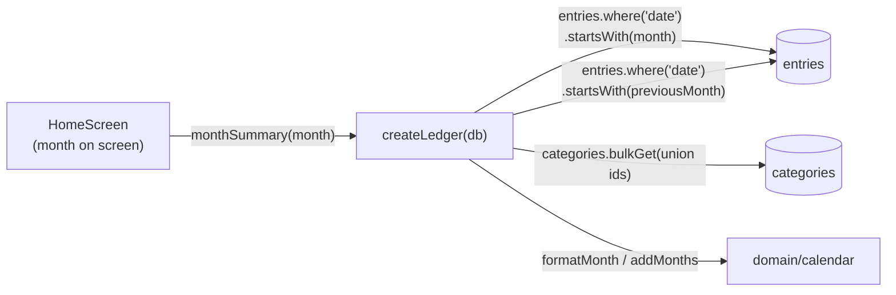

# Slice 05 Architecture — Compare with last month

**Slice scope:** the home breakdown shows each category's spending for the
month on screen beside that same category's spending for the month
immediately before it, so the user can read the change without doing the
subtraction.

**Status:** built and closed 2026-11-10 on `slice-05` (commits `7462530`,
`22e26ae`, `2dfb55a`; head `2dfb55a`), reviewed with zero findings. Slice 3 and
slice 4 were merged into `master` first (`faf2a97`); deployment is still
pending. The build matched this design, so no part of it changed at close-out.

Extends `docs/architecture/north-star.md`,
`docs/architecture/slices/slice-01-architecture.md`,
`docs/architecture/slices/slice-02-architecture.md`,
`docs/architecture/slices/slice-03-architecture.md`, and
`docs/architecture/slices/slice-04-architecture.md`. It reopens nothing they
settled; it decides only what this slice needs.

## What this slice adds

- `MonthSummary` grows the previous-month comparison: `previousMonth`,
  `previousMonthHasSpending`, and a `previousAmountMinor` on every row.
- `monthSummary(month)` computes both months from the same `entries` table in
  one read transaction. No new `Ledger` method.
- One home-screen presentation change: a two-column breakdown, the
  previous-month-empty message, and non-tappable previous-only rows.
- **No storage change**: `SCHEMA_VERSION` stays `1`; no new table, index,
  migration, or stored comparison.
- **No backup change**: `BACKUP_SCHEMA_VERSION` stays `1`; the comparison is
  derived from entries the v1 file already carries.
- **No route change**: home remains `#/` / `#/?m=YYYY-MM`. No new screen.
- **No write-path change**: adding, correcting, and removing entries are
  untouched.

There are **no endpoints**. The app remains static files plus IndexedDB
(ADR 0001); `Ledger` is still the whole application API.

## The durable question — checked, nothing to flag

This slice introduces no contract that is expensive to change after data
exists:

- The comparison is **derived at read time** from entries. No monthly total,
  no per-category comparison row, and no "previous month" field is stored, so
  there is nothing to migrate and no second source of truth to keep in sync.
- North-star already fixed the inputs: one entries collection, spending counts
  expenses only, dates are `YYYY-MM-DD`, and a month is a string prefix. The
  comparison uses those rules unchanged.
- The backup file does not grow. Restoring any v1 file reproduces the
  comparison because it reproduces the entries.
- "The month before" is the calendar month immediately before the month on
  screen, not "the previous month with data". The scope fixed that. It is a
  read-model rule: changing it later changes one query, not stored data.
- `MonthSummary` is the only home read model. Extending it adds fields but no
  new seam; the union, ordering, and month arithmetic stay behind the ledger.

The one thing that **would** be expensive later is storing aggregates (a
monthly totals table, a comparison cache, or a comparison field in the backup)
to make this screen cheaper. This slice deliberately does not do that; the
date index and in-memory grouping are sufficient at one user's volume. Adding
a cache later remains possible without a data rewrite.

**No flag is raised. No ADR is warranted:** the decision is easy to reverse,
not surprising without context, and not a trade-off against a viable
alternative. The scope handoff also records no new glossary terms; "the month
before" is ordinary language.

**Wayfinder check.** The destination is unchanged — the user can use the app
as their only ledger — and slice 5 is the next step on the existing map, not a
new effort. The scope gate re-checked the order on 2026-11-10 and found no
reason to move it. This gate surfaces no decision that needs its own ticket
and no fog that changes the route: the comparison is the smallest read-model
change that completes the vision's headline, and it is buildable now with
prior-month test entries.

## Inherited, not re-decided

- Single user, local-first, installable PWA; IndexedDB via Dexie (ADR 0001,
  0005).
- One `entries` collection with a `kind` discriminator; amounts are integer
  minor units; dates are local calendar dates; spending counts expenses only;
  balances are derived.
- Categories are flat, user-managed, archived rather than deleted. Reads join
  category names by id; reads never filter on `archived`.
- `Ledger` remains the only persistence seam; there is no repository
  interface and no fake adapter.
- Screens read through `useLiveQuery`; Dexie invalidation drives updates. No
  manual cache, event bus, or refresh button.
- Restore replaces, never merges; the backup file is the only backup and the
  only migration path across model changes.
- Correction is in place and removal is final (slice 2). This slice changes
  neither.
- Single-tab assumption; no cross-tab coordination.

## Storage — unchanged Dexie schema v1

No table, key, or index changes:

| Table | Key | Indexes | Used by this slice |
|---|---|---|---|
| `entries` | `id` | `date` | two month-prefix reads: the month on screen and the month before |
| `categories` | `id` | — | name join for the union of category ids |
| `accounts` | `id` | `createdAt` | unchanged |
| `settings` | `id` (`'app'`) | — | unchanged |

Why no new index:

- Both reads are `entries.where('date').startsWith('YYYY-MM')`. The existing
  `date` index answers both; no compound `[kind+date]` index is needed because
  the month scan is already narrow and the expense filter runs in memory.
- The comparison is two adjacent months, not a range over history. There is no
  "all months" query to optimise.
- No aggregate table and no cache. At one user and a few thousand rows, two
  index scans plus grouping is trivial. If it ever stops being true, add a
  compound index or a stored aggregate in a Dexie version bump; do not add it
  now.

The two version numbers remain independent and unchanged:

| Constant | Meaning | Today |
|---|---|---|
| `SCHEMA_VERSION` (`data/db`) | IndexedDB store/index version | `1` |
| `BACKUP_SCHEMA_VERSION` (`domain/backup`) | data-model version in backup files | `1` |

Nothing in `domain/backup` changes. The comparison is not serialized.

## Module seams



- **`data/ledger`** owns the comparison: previous-month derivation, the
  two-month read, the union, zero filling, ordering, and the
  previous-month-empty flag. These are private helpers next to
  `UNCATEGORIZED_CATEGORY_ID`, not a new module.
- **`domain/calendar`** already supplies `addMonths`, `MIN_MONTH`, and
  `formatMonth`; it gains nothing.
- **`domain`** otherwise is unchanged. The comparison is a read model, not a
  new domain concept.
- **`app` / `ui`** owns presentation only: column labels, the empty-prior
  message, tappability, and accessible names.
- **`data/db`** is unchanged and still not imported by the UI.

One adapter (Dexie) still means no repository interface and no fake adapter.
Tests cross the same `Ledger` seam callers use.

### Interfaces

```ts
// src/data/ledger.ts
export interface CategorySpend {
  categoryId: string;
  name: string;
  amountMinor: number;         // the month on screen
  previousAmountMinor: number; // the month immediately before; 0 when none
}

export interface MonthSummary {
  month: MonthKey;
  totalMinor: number;                 // sum of rows' amountMinor only
  previousMonth: MonthKey | null;     // null only at MIN_MONTH
  previousMonthHasSpending: boolean;  // any expense in the month before
  rows: CategorySpend[];              // union, ordered as below
}
```

`Ledger`'s signature is unchanged:

```ts
monthSummary(month: MonthKey): Promise<MonthSummary>;
```

Why extend `monthSummary` rather than add `monthComparison(month)`:

- Home is the only consumer. A second method would either duplicate the
  month read or leave `monthSummary` as dead production code, and the UI would
  have to join two row lists by category id.
- The comparison is the home read model now. One method keeps one seam, one
  live query, and one place where the two columns can disagree.
- The growth is three fields, not a new shape: rows keep `categoryId`, `name`,
  and `amountMinor`, so every existing invariant and read path still reads
  naturally.

`previousMonth` is `null` only for `MIN_MONTH` (`0001-01`), whose predecessor
is outside the representable range. The UI treats `null` as "no comparison
available" and renders the current month alone; it never calls `addMonths`
itself.

`previousMonthHasSpending` is returned rather than inferred in the UI so the
product rule "the month before has no spending recorded" is decided once, by
the same expense-only predicate that builds the rows. It is a fact about the
month, not a total; no previous-month total is exposed.

## Read path — `monthSummary(month)` with comparison

Inside one Dexie `r` transaction over `entries` and `categories`:

1. Reject unless `isValidMonthKey(month)` (`RangeError`, as today).
2. `const previousMonth = month === MIN_MONTH ? null : addMonths(month, -1);`
3. Read `db.entries.where('date').startsWith(month).toArray()`.
4. If `previousMonth !== null`, read
   `db.entries.where('date').startsWith(previousMonth).toArray()`; otherwise
   use an empty list.
5. Group each month separately with one private helper:

   ```ts
   function expenseTotals(entries: Entry[]): Map<string, number> {
     const totals = new Map<string, number>();
     for (const entry of entries) {
       if (entry.kind !== 'expense') {
         continue;
       }
       const categoryId = entry.categoryId ?? UNCATEGORIZED_CATEGORY_ID;
       totals.set(categoryId, (totals.get(categoryId) ?? 0) + entry.amountMinor);
     }
     return totals;
   }
   ```

6. Union the keys of both maps. Fetch names for the non-sentinel ids with
   `db.categories.bulkGet(...)`; a missing category keeps its id and is
   labelled `Uncategorized`, exactly as today. The sentinel itself is always
   `Uncategorized`.
7. Build one row per union id:
   `amountMinor = currentTotals.get(id) ?? 0`,
   `previousAmountMinor = previousTotals.get(id) ?? 0`.
8. Sort (below).
9. Return `{ month, totalMinor, previousMonth, previousMonthHasSpending,
   rows }`, where `totalMinor` is the sum of the rows' `amountMinor` and
   `previousMonthHasSpending = previousTotals.size > 0`.

The explicit read transaction is deliberate: without it, a write landing
between the two month reads could render one column from before the write and
one from after, until the live query re-runs. The transaction makes both
columns one snapshot. It changes no result and is not a new caching layer.

### Ordering

Rows with spending in the month on screen come first, largest first, with the
existing tie-breaks. Rows with nothing in the month on screen follow, largest
in the month before first:

```ts
rows.sort((left, right) => {
  const leftHasCurrent = left.amountMinor > 0;
  const rightHasCurrent = right.amountMinor > 0;
  if (leftHasCurrent !== rightHasCurrent) {
    return leftHasCurrent ? -1 : 1;
  }
  if (leftHasCurrent) {
    return (
      right.amountMinor - left.amountMinor ||
      left.name.localeCompare(right.name) ||
      left.categoryId.localeCompare(right.categoryId)
    );
  }
  return (
    right.previousAmountMinor - left.previousAmountMinor ||
    left.name.localeCompare(right.name) ||
    left.categoryId.localeCompare(right.categoryId)
  );
});
```

- The current-month order is exactly today's order. The previous-month amount
  never reorders two categories that both have current spending.
- The previous-only group is ordered by `previousAmountMinor` descending, then
  name and id for determinism. The scope asks only for "largest in the month
  before first"; the name/id tie-break matches every other read model.
- Expenses store positive magnitudes, so `amountMinor > 0` is exactly "has
  spending in the month on screen". A corrupt zero-amount expense would fall
  into the previous-only group; the write path forbids it.

### Edge cases this read model fixes

| Case | Result |
|---|---|
| Spending in both months | one row, both amounts non-zero |
| Spending only in the month on screen | one row, `previousAmountMinor: 0` |
| Spending only in the month before | one row, `amountMinor: 0`, previous amount set |
| Neither month | no rows; `totalMinor: 0`; `previousMonthHasSpending: false` |
| January | `previousMonth` is the previous December via `addMonths` |
| `MIN_MONTH` | `previousMonth: null`; no previous read; current month only |
| Previous month has income only | `previousMonthHasSpending: false`; income is not spending |
| Previous month's entry references a missing category | row under `Uncategorized` in both columns |
| Category renamed after the previous month | one row, new name in both columns |
| Category archived after the previous month | still one row in both columns; reads ignore archive state |

## Home screen

No route, no new screen, no change to month navigation. `HomeScreen` keeps
`useLiveQuery(() => ledger.monthSummary(month), [ledger, month])` and now
renders one of four states from the summary alone:

| Condition | Screen |
|---|---|
| `rows.length === 0` | Existing empty state: "No spending yet this month." plus "Add your first expense". No comparison UI. This is the both-months-empty case. |
| `previousMonth === null` | Current-month rows only, as today. No previous label and no previous-empty message. Reachable only at `MIN_MONTH`. |
| `previousMonthHasSpending` | Two-column comparison (below). |
| `!previousMonthHasSpending` and rows exist | Current-month rows as today, plus one plain line naming the month before: `No spending recorded in {formatMonth(previousMonth)}.` No previous column, so there is no column of zeros. |

State order matters: rows empty wins over the previous-month message, because
with neither month populated the scope keeps the existing empty state.

### Two-column comparison

- A header row names both columns with `formatMonth(month)` and
  `formatMonth(previousMonth)` — actual month names, not "this month"/"last
  month", because the user can move between months.
- The list keeps the existing `<ul className="category-list">` shape. Each
  row shows the category name, the month-on-screen amount, and the
  previous-month amount, in ledger order. The UI does not re-sort.
- **Rows with current spending** remain buttons. Tapping navigates to
  `#/category?m=<month>&c=<categoryId>`, exactly as today.
- **Rows with no current spending** render as disabled buttons. They show
  `$0.00` for the month on screen and the previous amount, so a drop to zero
  stays visible, and they open nothing: there are no entries for that
  category in the month on screen, and the comparison is not a second route
  into last month. A disabled button is still a list row and is still
  announced; it is not a tap target.
- The total line is unchanged and shows only `summary.totalMinor`. No
  previous-month total appears anywhere.
- The "Add expense" action remains whenever rows exist, including when the
  month on screen is empty and only previous-month rows show. The empty state
  and its "Add your first expense" prompt appear only when both months are
  empty.
- `previousAmountMinor` is ignored in the current-only states; it is `0` for
  every row there.

### Accessibility

- The visible column headers name the months. Because the breakdown is a list,
  not a table, each row's accessible name also carries both month names:

  ```tsx
  aria-label={`${row.name}, ${formatMonth(month)}: ${currentFormatted}, ${formatMonth(previousMonth)}: ${previousFormatted}`}
  ```

  This holds for both the tappable current rows and the disabled
  previous-only rows. A screen reader therefore announces which month each
  amount belongs to without relying on visual column position.
- In the current-only state, the page heading already names the month, and
  the existing `${name}, ${amount}` label is unchanged.

### Other screens

No change to `CategoryEntriesScreen`, `EntryEditorScreen`,
`AddExpenseScreen`, `CategoriesScreen`, `AccountsScreen`, or `BackupScreen`.
The comparison exists only on home. `categoryEntries` still returns the
current month's rows for a category; for a previous-only category it returns
zero rows, which is why that row is not tappable.

## Write paths — none

This slice adds no mutation and changes no existing one:

- `addExpense`, `updateExpense`, and `deleteExpense` already write `entries`.
  Dexie invalidates every live query that read `entries`, including
  `monthSummary`, so both columns update straight away. Correcting a date
  across a month boundary moves the amount between the two columns on both
  affected screens.
- `renameCategory` and `setCategoryArchived` already write `categories`.
  `monthSummary` reads `categories` inside its transaction, so a rename
  re-runs the query and both columns show the new name attached to the same
  category id. Archive state never enters the read.
- No setting, account, or backup row is touched.

## Backup and restore — unchanged

`readBackupData` dumps the entries already in the ledger;
`restoreBackup` replaces them. The comparison is recomputed from those
entries, so a backup and restore reproduce it exactly. `BACKUP_SCHEMA_VERSION`
stays `1`, and no comparison field is added to the file. Restoring an older
v1 file produces whatever comparison its entries imply, including none.

## Invariants

- **The month-on-screen amounts sum to `totalMinor`.** Rows with
  `amountMinor: 0` contribute nothing; the previous column never enters the
  total.
- **A row exists iff the category has an expense in at least one of the two
  months.** No zero/zero rows.
- **`previousMonth` is the calendar month immediately before `month`**, never
  the previous month with data; `null` only at `MIN_MONTH`.
- **The current-month ordering is unchanged.** Previous-only rows follow,
  ordered by their previous amount.
- **Spending is expenses only in both columns.** Income, transfers, and
  openings are ignored.
- **Names are joined at read time from `categories`.** Renames apply to both
  columns; archive state does not filter either column.
- **The comparison is never stored.** No table, index, backup field, or
  settings value carries it.
- **The UI does not re-sort or merge.** It renders `summary.rows` in ledger
  order.
- **Only rows with current spending are tappable.**

## How the architecture serves the acceptance criteria

| Slice acceptance | Where it is satisfied |
|---|---|
| Home shows each category's amount for the month on screen and the month before, labelled with both months | `MonthSummary.rows[].amountMinor` / `previousAmountMinor`; header labels and per-row accessible names |
| Month-on-screen amounts add up to the total; last month's do not change it | `totalMinor` sums only `amountMinor`; rows with no current spending contribute 0 |
| A category with spending in both months shows both amounts | union row with both totals |
| A category with spending only in the month on screen shows zero for the month before | `previousAmountMinor: 0`; two-column state renders `$0.00` |
| A category with spending only in the month before appears with zero on screen and last month's amount | union row with `amountMinor: 0`; previous-only row |
| A category with no spending in either month does not appear | rows are built from the union of grouped totals only |
| Rows ordered by the month on screen, largest first; previous-only rows follow, largest previous first | ledger comparator |
| Moving months compares with the immediately preceding month, including across a year boundary | `addMonths(month, -1)` in `monthSummary`; home keeps passing its route month |
| Correcting amount/category/date or removing an entry updates the comparison immediately | existing writes invalidate the live query; both months are re-read |
| Renaming shows the new name in both columns; archiving keeps a spending category in the comparison | names joined from `categories` at read time; archive state never filters reads |
| When the month before has no spending, the screen says so plainly | `previousMonthHasSpending: false` → message naming `formatMonth(previousMonth)`, no previous column |
| When the month on screen is empty but the month before is not, previous rows show with zero and adding stays available | rows exist, so the empty state is not used; "Add expense" renders; previous-only rows show `$0.00` |
| When neither month has spending, the home empty state stays | `rows.length === 0` branch |
| Tapping a category with current spending opens its entries for that month; a previous-only category has nothing to open | current rows are buttons; previous-only rows are disabled |
| A backup and restore reproduce the comparison | derived from `entries`; no file change |
| The comparison works offline | no network in any path; Dexie and static assets only |
| A screen reader announces which month each amount belongs to | per-row `aria-label` names both months; visible column headers |

## Testing

**Ledger integration tests** at the `createLedger` seam, fresh
`BudgetDatabase(uniqueName)` per test:

- A month with spending in both months returns one row per category with both
  amounts and `previousMonth` set.
- Spending only in the current month yields `previousAmountMinor: 0` and
  `previousMonthHasSpending: false` when the previous month is empty.
- Spending only in the previous month yields a row with `amountMinor: 0`, the
  previous amount, `totalMinor: 0`, and `previousMonthHasSpending: true`.
- Neither month yields `rows: []`, `totalMinor: 0`,
  `previousMonthHasSpending: false`, and a non-null `previousMonth`.
- Ordering: current rows by amount desc/name/id; previous-only rows after all
  current rows, by previous amount desc/name/id.
- January compares with the previous December; `MIN_MONTH` returns
  `previousMonth: null` and does not throw.
- `totalMinor` equals the sum of `amountMinor`; the previous amounts do not
  change it.
- Non-expense entries are ignored in both months; an income-only previous
  month sets `previousMonthHasSpending: false`.
- An entry in either month whose category is missing lands under
  `Uncategorized` in that column; the union merges the sentinel.
- Renaming a category changes the name in both columns and changes no amount;
  an archived category with spending still appears in both columns.
- `updateExpense` and `deleteExpense` change the two columns (move an entry
  across the month boundary, change its category, remove it).
- `categoryEntries(month, id).totalMinor` equals the matching row's
  `amountMinor`; a previous-only row returns `0`.
- Malformed month still throws `RangeError`.
- `SCHEMA_VERSION` and `BACKUP_SCHEMA_VERSION` remain `1`.

**Existing tests that pin the old shape are intentionally updated, not kept.**
Every exact `toEqual` on `monthSummary` gains `previousMonth`,
`previousMonthHasSpending`, and `previousAmountMinor` on each row:

- `ledger.test.ts` — the grouping, ordering, empty-month, missing-category,
  non-expense, update/move, and delete tests. The assertions' amounts and
  orders do not change; only the added comparison fields do. Tests whose
  month has a populated predecessor (for example the October→November move)
  assert the previous amount too.
- `HomeScreen.test.tsx` — existing row and total assertions continue to hold;
  add the comparison states below. No test is deleted.
- `CategoriesScreen.test.tsx`'s `monthSummary` total assertion is unchanged in
  intent; it only gains the new fields if it compares the whole object.

**UI tests (RTL, real ledger on `fake-indexeddb`, `waitFor` for live
queries):**

- Two-column state: header names both months; a category with both amounts
  shows both; a current-only category shows `$0.00` for the previous month.
- Previous-only category: appears after current rows, shows `$0.00` for the
  month on screen and the previous amount, is disabled, and clicking it
  changes no route.
- Current-month row still navigates to `#/category?m=<month>&c=<id>`.
- Previous month empty: the message names the previous month, no second
  column is rendered, and current rows keep their single amount.
- Current month empty, previous populated: total reads `$0.00`, previous rows
  render with `$0.00` current, and "Add expense" is available.
- Neither month populated: existing empty state and "Add your first expense".
- Year boundary: home at `2027-01` compares with December 2026.
- Rename and archive: the new name appears in both columns; an archived
  category with spending stays.
- Correcting an entry's amount/category/date and removing it update both
  columns through the live query.
- Accessible name of a comparison row contains both month names and both
  formatted amounts.
- Month navigation still works and still moves the comparison with it.

**Manual:** build, preview, install, go offline; with prior-month entries,
confirm both columns, the previous-empty message, the current-empty state, a
previous-only row that does not navigate, a rename, an archive, and a
correction that moves an entry across the month boundary; take a backup,
restore it in a fresh profile, and confirm the comparison matches.

## Answers to the scope handoff's open questions

| Open question | Resolution |
|---|---|
| How does the home screen read two months without changing the stored shape? | Extend `monthSummary(month)` to read both month prefixes and return both columns; no new table, index, or stored value. |
| New read model or extend the existing one? | Extend `monthSummary`; home is its only consumer, so a second method would duplicate the read or strand the old one. |
| How is "the month before" computed? | `addMonths(month, -1)`; `null` at `MIN_MONTH`, where no predecessor exists. |
| How are rows unioned and zero-filled? | Union of grouped expense totals from both months; missing side is `0`; no zero/zero rows. |
| What is the row order? | Current spending first by amount desc/name/id; previous-only rows after, by previous amount desc/name/id. |
| How does the screen know the previous month is empty? | `previousMonthHasSpending` from the expense-only grouping; the UI does not infer it from totals. |
| Which rows are tappable? | Only rows with current spending; previous-only rows are disabled buttons. |
| How are the two amounts labelled? | Visible column headers with both `formatMonth` names; per-row accessible name also carries both month names. |
| Does the headline or any total change? | No. `totalMinor` is the month on screen only; no previous-month total is exposed or rendered. |
| Confirm no schema, backup, route, or write-path change. | Confirmed. Both version constants stay `1`; home route unchanged; no mutation added or changed. |
| Does `CONTEXT.md` gain terms? | No. "The month before" is ordinary language, not a domain concept. |
| Test surface | Ledger tests for union, ordering, zero-fill, year boundary, `MIN_MONTH`, rename/archive, and live write effects; UI tests for the four home states, tappability, and accessible labels; intentional updates to every exact `monthSummary` shape assertion. |

## Deliberately deferred

- Percentage change, difference columns, arrows, trend lines, and
  "up/down" judgements.
- An overall previous-month total beside the headline.
- Charts, graphs, sparklines, and any visual trend.
- Choosing a comparison month other than the immediately preceding one;
  same-month-last-year; arbitrary ranges.
- Opening the previous month's entries from a comparison row.
- Comparison on the category entries screen or any other screen.
- Comparison across more than two months or a multi-month trend.
- Storing monthly aggregates, comparison caches, or any denormalized totals.
- Account filtering, per-account comparison, or card-type comparison.
- Configurable currency, locale, or month-label format.
- Bank sync, budgets, multi-currency, sharing, laptop view (product-wide out
  of scope).

## Decision log and reversibility

| Question | Resolution | Cost to change |
|---|---|---|
| New method or extended `monthSummary`? | Extend the existing home read model | Low — one method, one caller |
| How is the previous month represented? | `previousMonth: MonthKey \| null`; `null` at `MIN_MONTH` | Low |
| How is "previous month empty" exposed? | `previousMonthHasSpending` from expense-only grouping | Low |
| How are the two months read? | Two `date` prefix queries in one `r` transaction | Low |
| How are rows combined? | Union of grouped totals, zero-filled per side | Low |
| Row ordering | Current desc/name/id, then previous-only previous desc/name/id | Low — display only |
| Which rows navigate? | Only those with current spending; previous-only rows disabled | Low |
| Where do month labels come from? | `formatMonth` on both months; per-row accessible name | Low |
| Does storage or backup change? | No; both version constants stay `1` | Low |
| Does the UI get a new route or screen? | No | Low |
| Does `CONTEXT.md` gain terms? | No | Low |
