# Slice 06 Architecture — Track account balances

**Slice scope:** every account shows its current balance, derived from its
opening balance and every expense, income, and transfer recorded against it;
the user can set, change, or clear one opening balance per account.

**Status:** built and reviewed 2026-11-12. Built as designed; no production
divergence was found at review. `SCHEMA_VERSION` and `BACKUP_SCHEMA_VERSION`
remain `1`. Not yet merged, pushed, or deployed; that is the release step.

Extends `docs/architecture/north-star.md`,
`docs/architecture/slices/slice-01-architecture.md`,
`docs/architecture/slices/slice-02-architecture.md`,
`docs/architecture/slices/slice-03-architecture.md`,
`docs/architecture/slices/slice-04-architecture.md`,
`docs/architecture/slices/slice-05-architecture.md`,
`docs/architecture/slices/slice-07-architecture.md`, and
`docs/architecture/slices/slice-08-architecture.md`. It reopens nothing they
settled; it decides only what this slice needs.

## What this slice adds

- One account-balance read model: `listAccountBalances()`.
- One optional field on the existing account write path: `addAccount` accepts
  an opening balance and writes the account and its opening entry atomically.
- One new `Ledger` mutation: `setOpeningBalance(accountId, amountMinor |
  null)` — set, change, or clear the one starting point for an existing
  account.
- One domain helper: `parseSignedAmount` in `domain/money`, because opening
  balances are the only amount a user may enter as negative. `parseAmount`
  stays positive-only and every existing caller is unchanged.
- Accounts-screen presentation: each row gains its current balance; an
  account without an opening balance gains a non-blocking invitation; the
  add-account form gains an optional starting-point field; each row gains an
  inline set/edit starting-point form.
- **No storage change**: `SCHEMA_VERSION` stays `1`; no new table, index,
  migration, or stored balance.
- **No backup change**: `BACKUP_SCHEMA_VERSION` stays `1`; the v1 file already
  accepts `kind: 'opening'` with a signed `amountMinor`, including zero and
  negative values.
- **No route change**: Accounts remains `#/accounts`. No new screen, no
  per-account detail route.
- **No home change**: `monthSummary` and `categoryEntries` already ignore
  every non-expense kind, so opening balances cannot move the headline.
- **No settings write**: neither new path writes `settings.lastAccountId`.
  Opening a form or viewing a balance writes nothing.

There are **no endpoints**. The app remains static files plus IndexedDB
(ADR 0001); `Ledger` is still the whole application API.

## The durable question — checked, none

This gate checked every candidate that would be expensive to change once
opening-balance and balance data exist. None is new:

- **A balance is derived, never stored.** Settled in the north-star: a balance
  is always the sum of an account's entry effects. This slice adds no
  `balance` field to `Account`, no balance column, and no cache. The read
  model computes from `entries` on every call, as every other read does.
- **An opening balance is an entry, never an account field.** Settled in the
  north-star and already in `EntryKind` and `domain/backup`. This slice adds
  the first writer of `kind: 'opening'`; it does not change the stored shape.
- **Opening amounts are signed; credit balances are negative by convention.**
  Settled in the north-star and ADR 0003. A card owing $240 stores `-24000`.
  Display flips the sign and says "owed"; a positive credit balance is "in
  credit". This slice writes exactly that convention.
- **The opening entry is dated the account's creation date.** Settled in the
  north-star. The local-date derivation detail is cheap and has no
  user-visible effect; no month read looks at the opening date.
- **One opening per account.** This is a write-path invariant, not a stored
  uniqueness constraint. The balance read still sums every opening entry it
  finds, so a hand-edited backup with two cannot make the balance wrong; the
  next set/clear collapses them to one.
- **Backup compatibility.** Verified against `domain/backup`: `parseEntry`
  already accepts `opening` with any safe-integer `amountMinor` (zero and
  negative included), and `restoreBackup` clears then bulk-adds entries. No
  migration and no version bump are needed.
- **The `Ledger` surface.** `listAccountBalances` and `setOpeningBalance` are
  internal seams with no stored shape. Cheap to change.

The one thing that **would** be expensive later is storing a balance total or
an opening balance as a field on `Account`: it would create a second source of
truth, enter the backup shape, and need a migration to unwind. This slice
deliberately does neither. **No flag is raised. No ADR is warranted:** the
decision is not hard to reverse, not surprising without context, and not a
trade-off against a viable alternative — the north-star already made it.

**Domain-language check.** `CONTEXT.md` already defines **Balance** and
**Opening balance**; this slice renames neither and broadens neither. The
scope's user-facing phrase "starting point" is copy for the same concept, not
a second domain term; code and docs keep `opening`. `CONTEXT.md` is unchanged.

## Inherited, not re-decided

- Single user, local-first, installable PWA; IndexedDB via Dexie (ADR 0001,
  0005). No backend, auth, sync, or server-side validation.
- One `entries` collection with a `kind` discriminator. An opening balance is
  one row, not a field on the account and not a separate table.
- All amounts are integer minor units. `opening` is the only kind whose stored
  amount is signed; the other kinds store a positive magnitude and derive
  direction from `kind`.
- Spending counts `expense` entries only. Openings, income, and transfers
  never appear in a spending total.
- Dates are local calendar dates (`YYYY-MM-DD`); a month is a string prefix.
  The balance is current, not month-end, and takes no month argument.
- Accounts carry all balances; entries are effects on accounts. Account type
  is `checking`, `savings`, or `credit`; card type is derived from the
  account.
- `Ledger` remains the only persistence seam; there is no repository
  interface and no fake adapter. Every new entry row is inserted through
  `createEntry`; corrections and removals keep their per-kind public methods.
- Screens read through `useLiveQuery`; Dexie invalidation drives updates. No
  manual cache, event bus, or refresh button.
- Correction is in place and removal is final (slice 2). This slice adds no
  correction flow for openings beyond set/change/clear; it does not audit
  history.
- Restore replaces, never merges; the backup file is the only backup and the
  only migration path across model changes.
- Single-tab assumption; no cross-tab coordination. The write path still
  enforces one opening per account inside a transaction.
- Renaming an account is unchanged; account deletion, archiving, reordering,
  and type changes remain out of scope.

## Storage — unchanged Dexie schema v1

No table, key, or index changes:

| Table | Key | Indexes | Used by this slice |
|---|---|---|---|
| `entries` | `id` | `date` | balance read; opening lookup, insert, update, delete |
| `accounts` | `id` | `createdAt` | balance rows, account names/types, opening validation |
| `categories` | `id` | — | unchanged; balances never read or write it |
| `settings` | `id` (`'app'`) | — | currency/exponent for formatting only; **not written** |

Access paths:

| Operation | Query |
|---|---|
| Account balances | `accounts.toArray()` + `entries.toArray()`, one `r` transaction |
| Add account with opening | validate, then `accounts.add(…)` and `entries.add(…)` in one `rw` transaction |
| Set/change opening | primary key account read, `entries.toArray()` filter for openings, then update/insert |
| Clear opening | primary key account read, `entries.toArray()` filter, then delete |
| Month summary | unchanged: date prefix, then `kind === 'expense'` in memory |
| Category entries | unchanged: date prefix, then `kind === 'expense'` and category in memory |
| Income / transfer lists | unchanged: full read, then `kind` filter in memory |

Why no new index:

- The balance read needs **every** entry, because every kind affects some
  account. An `accountId` or `[accountId+kind]` index cannot narrow that read;
  it would only help a per-account query this slice does not have (the scope
  explicitly excludes a per-account movement list).
- The opening lookup in `setOpeningBalance` runs once per user action over the
  same small `entries` table. At one user and a few thousand rows, a full read
  plus in-memory filtering is trivial.
- The `date` index is unchanged. Adding an index later is a Dexie version
  bump with no data rewrite. Do not add one now.
- No aggregate table, no balance cache, and no stored opening field. Every
  balance is derived from the one entry collection.

The two version numbers remain independent and unchanged:

| Constant | Meaning | Today |
|---|---|---|
| `SCHEMA_VERSION` (`data/db`) | IndexedDB store/index version | `1` |
| `BACKUP_SCHEMA_VERSION` (`domain/backup`) | data-model version in backup files | `1` |

## Backup — unchanged v1

Opening balances are already part of the v1 data model:

- `createBackupFile` serializes every entry, including `kind: 'opening'`,
  sorted by `id`.
- `parseEntry` already accepts `opening`; it requires a safe-integer
  `amountMinor` and deliberately skips the positive-magnitude check for
  `opening`, so zero and negative values restore.
- `restoreBackup` clears and bulk-adds the `entries` table, so a restored
  opening is the same row it was before. Restoring replaces the ledger; it
  cannot add a second opening to an account that already has one.
- `readBackupData` already includes every entry.

Nothing in `domain/backup` changes. A v1 file containing opening balances
restores without migration. A v1 file made before this slice — no opening
rows — is still valid: its accounts restore with no opening entry, so their
balances are the sum of their recorded movements and the screen invites the
user to set the starting points.

The parser tolerates an optional `categoryId` or `toAccountId` on an opening
and does not enforce one-opening-per-account. This slice does not tighten
either rule: every spending and list read ignores those fields on an opening,
the balance read sums whatever openings exist, and the next set/clear
collapses duplicates. Tightening the parser would reject files v1 already
accepts, which is a compatibility change this slice does not need.

## Module seams

```mermaid
flowchart LR
  subgraph UI["React screens"]
    Accounts["AccountsScreen"]
  end
  Accounts -->|"listAccountBalances()"| L["createLedger(db)"]
  Accounts -->|"addAccount({ openingBalanceMinor })"| L
  Accounts -->|"setOpeningBalance(id, amount | null)"| L
  L -->|"accounts + entries"| DB[("BudgetDatabase\naccounts · entries")]
  L --> Calendar["domain/calendar\ntodayLocalDate"]
  Accounts --> Money["domain/money\nparseSignedAmount / formatAmount"]
  UI -. "useLiveQuery" .-> L
```



- **`data/ledger`** owns the balance read model, the opening write path, the
  one-opening collapse, the account comparator, and the opening-date
  derivation. As built, openings are inserted through `createEntry` and their
  amount is checked by `requireOpeningAmount`, both in
  `data/ledgerEntryWrite.ts`; the categorized and transfer validators live
  there too, as one `requireEntryFields`.
- **`domain/money`** gains `parseSignedAmount`; `parseAmount`, `formatAmount`,
  and `formatAmountInput` are unchanged.
- **`domain/calendar`** already supplies `todayLocalDate` and
  `isValidLocalDate`; it gains nothing.
- **`domain/types`** is unchanged. `EntryKind` already includes `opening`;
  `Account` gains no field.
- **`data/db`** is unchanged and still not imported by the UI.
- **`app` / `ui`** gains the row balance, the invitation, the optional field on
  the add form, the inline set/edit form, and the type-aware sign conversion.
  It gains no route and no new screen.
- **`domain/backup`** is unchanged.

One adapter (Dexie) still means no repository interface and no fake adapter.
Tests cross the same `Ledger` seam callers use.

### Interfaces

```ts
// src/data/ledger.ts
export interface AddAccountInput {
  name: string;
  type: AccountType;
  openingBalanceMinor?: number; // ledger-signed; omitted = no opening entry
}

export interface AccountBalanceListItem {
  id: string;
  name: string;
  type: AccountType;
  balanceMinor: number;         // signed sum of entry effects; credit < 0 = owed
  openingBalanceMinor: number;  // signed sum of opening entries; 0 when none
  hasOpeningBalance: boolean;   // an opening entry exists, even when its sum is 0
}

export interface Ledger {
  // unchanged: initialize, listAccounts, addAccount, renameAccount,
  // listCategories, addCategory, renameCategory, setCategoryArchived,
  // addExpense, updateExpense, deleteExpense, listTransfers, addTransfer,
  // updateTransfer, deleteTransfer, listIncome, addIncome, updateIncome,
  // deleteIncome, getEntry, categoryEntries, monthSummary, getSettings,
  // readBackupData, restoreBackup, markBackupSaved

  listAccountBalances(): Promise<AccountBalanceListItem[]>; // account order
  setOpeningBalance(
    accountId: string,
    amountMinor: number | null, // ledger-signed; null clears
  ): Promise<void>;
}
```

`AddAccountInput.openingBalanceMinor` is **ledger-signed**: for checking and
savings it is what the account held (negative when overdrawn); for credit it
is the stored balance effect (negative when the card owed). The Accounts form
converts the user's presentation value before calling the ledger. `undefined`
means "no opening entry"; `0` means "an opening entry of zero". The
distinction is required because the screen invites the user to set a starting
point when none exists, and an explicitly set zero must stop that invitation.

`AccountBalanceListItem.balanceMinor` and `openingBalanceMinor` are both
**ledger-signed**. The UI converts a credit amount for display and for the
form input; the ledger never has two sign conventions in one type.

`listAccounts()` is unchanged and remains the picker read used by the expense,
income, and transfer forms. A balance is deliberately not added to `Account`:
`Account` is the backup shape, and a derived field there would risk being
serialized and would make every picker read the entries table.

Why one read model and two write paths rather than a generic balance API:

- `listAccountBalances` is a real read model: it joins accounts to entry
  effects, applies the one effect rule, preserves account order, and
  distinguishes "no opening" from "opening of zero". Deleting it would move
  that switch into the screen.
- `addAccount` already owns account creation; accepting the opening there
  keeps "add an account with its starting point" atomic. A separate
  `setOpeningBalance` call after `addAccount` could leave an account without
  the opening the user asked for if the second write failed.
- `setOpeningBalance` is the only way to change an opening after creation, so
  the one-per-account rule and the creation-date rule live in one place.
- The public surface grows by two methods. There is still one persistence
  adapter and one entry collection.

### `parseSignedAmount`

```ts
// src/domain/money.ts
export function parseSignedAmount(
  input: string,
  exponent: number,
): number | null;
```

Same grammar as `parseAmount` plus an optional leading `-`. `-0` normalizes
to `0` so no negative zero reaches IndexedDB or `Intl.NumberFormat`. A bare
`-`, `--5`, and a magnitude with more fraction digits than the exponent all
return `null`. `parseAmount` keeps rejecting signs, so no existing form
silently starts accepting negatives.

## Read path — `listAccountBalances()`

Inside one Dexie `r` transaction over `accounts` and `entries`:

1. Read `accounts.toArray()` and sort with the same comparator
   `listAccounts` uses: `createdAt` ascending, then `id` ascending.
2. Read `entries.toArray()`.
3. Accumulate two maps and one set:
   - `balances: Map<string, number>` — every entry's effect.
   - `openingSums: Map<string, number>` — the signed sum of `opening`
     entries only.
   - `openingAccountIds: Set<string>` — every account with at least one
     opening entry, so an opening of zero is still "set".
4. Apply one effect table, the single place the balance convention lives:

   | kind | `accountId` effect | `toAccountId` effect |
   |---|---|---|
   | `expense` | `−amountMinor` | — |
   | `income` | `+amountMinor` | — |
   | `transfer` | `−amountMinor` | `+amountMinor` |
   | `opening` | `+amountMinor` (already signed) | — |

   A transfer whose `toAccountId` is missing still debits the source; the
   missing destination id is not an account row, so it never displays. An
   entry referencing an account that is not in `accounts` is ignored for
   display; no phantom row is created.
5. Map each account to a row:
   `balanceMinor = balances.get(id) ?? 0`,
   `openingBalanceMinor = openingSums.get(id) ?? 0`,
   `hasOpeningBalance = openingAccountIds.has(id)`.
6. Return the rows in account order.

The explicit read transaction is deliberate: without it, a write landing
between the accounts read and the entries read could render a row whose
account list and balance disagree until the live query re-runs. The
transaction makes the screen one snapshot. It changes no result and is not a
caching layer.

### Balance semantics this read model fixes

| Case | Result |
|---|---|
| Checking opens at `-5000`, income `10000` | `balanceMinor: 5000` |
| Checking opens at `-5000`, expense `2000` | `balanceMinor: -7000`; UI says overdrawn |
| Card opens at `-24000` (owed 240), expense `3000` | `balanceMinor: -27000` (owed 270) |
| Card opens at `-24000`, transfer `10000` to the card | `balanceMinor: -14000` (owed 140) |
| Card opens at `-24000`, transfer `30000` to the card | `balanceMinor: 6000`; UI says in credit |
| Card opens at `5000` (started in credit) | `balanceMinor: 5000`; UI says in credit |
| Card with no entries | `balanceMinor: 0`; UI says zero owed |
| Account with movements and no opening | balance is the movement sum; `hasOpeningBalance: false` |
| Account with an opening entry of `0` | `balanceMinor` includes 0; `hasOpeningBalance: true` |
| Future-dated entry | included; the balance is the sum of everything recorded |
| Restored file with two openings for one account | both summed; `hasOpeningBalance: true` |

The balance is **current**: it takes no month, and `monthSummary` is not
involved. Moving between months changes nothing on this screen.

## Write paths

### `addAccount` with an optional opening

`addAccount` keeps its current name/type validation and adds:

1. If `openingBalanceMinor` is present, reject unless it is a safe integer
   (`LedgerError('invalid-opening-amount')`). Zero and negative are valid.
2. Build the account exactly as today: `id = crypto.randomUUID()`,
   `createdAt = new Date().toISOString()`, trimmed name, validated type.
3. Inside one `rw` transaction over `accounts` and `entries`:
   - `accounts.add(account)`;
   - if `openingBalanceMinor !== undefined`, `createEntry({ kind: 'opening',
     date: openingDateFor(account), amountMinor: openingBalanceMinor,
     accountId: account.id })`.
4. Return the account.

An omitted opening writes no entry, preserving the existing test that adding
an account alone leaves `entries` empty. A provided zero writes one opening
row of zero. The account and its opening are one transaction: either both
exist or neither does.

### `setOpeningBalance(accountId, amountMinor | null)`

1. If `amountMinor !== null`, reject unless it is a safe integer
   (`invalid-opening-amount`).
2. Inside one `rw` transaction over `accounts` and `entries`:
   - Read the account; missing → `unknown-account`.
   - Read all entries and keep
     `kind === 'opening' && accountId === accountId`, ordered by `id`
     ascending.
   - If `amountMinor === null`, delete every kept opening and return.
   - If none exist, `createEntry` one opening dated `openingDateFor(account)`.
   - If one or more exist, update the first kept entry's `amountMinor` and
     keep its `id` and `date`; delete any extras. This is what makes a
     hand-edited backup with duplicate openings collapse to one on the next
     user action.
3. Return nothing; the Accounts live query re-renders from the new entry.

`setOpeningBalance` writes no other entry and does not touch
`settings.lastAccountId`. It does not change the account's name, type, or
`createdAt`.

### Opening entry date

```ts
function openingDateFor(account: Account): LocalDate {
  const created = new Date(account.createdAt);
  if (Number.isNaN(created.getTime())) {
    return todayLocalDate();
  }
  const date = todayLocalDate(created);
  return isValidLocalDate(date) ? date : todayLocalDate();
}
```

The north-star dates the opening at the account's creation date. `createdAt`
is an ISO instant, so the local calendar date is derived from it at write
time. No read filters on the opening date; it exists only so the entry is a
well-formed dated movement. The fallback covers a restored v1 file whose
`createdAt` is a non-date string — `parseAccount` accepts any string, and the
write path must not produce an invalid local date or throw. The timezone at
the moment of setting is the one that decides the date; that is invisible to
the user and cheap to change if a real need appears.

### One starting point per account

- `addAccount` creates at most one opening.
- `setOpeningBalance` updates the first existing opening in place and deletes
  any extras, or creates one when none exists; it never adds a second while
  one exists.
- The balance read still sums every opening it finds, so the north-star rule
  ("balance is always the sum of the account's entry effects") holds even if a
  hand-edited backup contains duplicates.
- No Dexie uniqueness constraint is added; a compound index would be a schema
  version bump for an invariant the single write path already enforces.

## Accounts screen

No route, no new screen, no month navigation. `AccountsScreen` switches its
list read to `useLiveQuery(() => ledger.listAccountBalances(), [ledger])` and
gains `useLiveQuery(() => ledger.getSettings(), [ledger])` for currency and
exponent.

### Row display

Each row shows, in this order: account name, type label, balance, then the
existing Rename control and the starting-point control.

`balanceText(row, settings)` is a private screen helper:

| Type | `balanceMinor` | Display |
|---|---|---|
| checking / savings | `> 0` | formatted amount |
| checking / savings | `0` | formatted zero |
| checking / savings | `< 0` | formatted amount (with its minus) + " overdrawn" |
| credit | `< 0` | formatted `−balanceMinor` + " owed" |
| credit | `0` | formatted zero + " owed" |
| credit | `> 0` | formatted `balanceMinor` + " in credit" |

The minus in an overdrawn checking balance comes from `formatAmount`, which
already formats negative currency. The words "overdrawn", "owed", and "in
credit" are visible text, not only an accessible label, so a screen reader
announces name, type, and balance in reading order and includes the
qualifier. The row is not a button; the balance is not tappable.

No combined total is rendered. Do not sum the rows.

### Invitation and inline form

- `!hasOpeningBalance`: the row shows
  "No starting point set. The balance is the sum of recorded movements." and
  a button "Set starting point for {name}".
- `hasOpeningBalance`: the row shows "Edit starting point for {name}".
- The invitation never blocks logging, navigation, or rename. It is a hint
  and a button, not a gate.

The inline form, revealed in the row like the existing rename form:

- Label: "Starting point for {name}".
- Hint, checking/savings: "What the account held before you started logging.
  Use a minus if it was overdrawn."
- Hint, credit: "What the card owed before you started logging. Use a minus
  if it was in credit."
- Input: text, `inputMode="decimal"`, prefilled with
  `formatAmountInput(presentedAmount(type, openingBalanceMinor), exponent)`,
  where `presentedAmount` is `-ledgerSigned` for credit and `ledgerSigned`
  otherwise.
- Save: an empty input is an error, not a silent clear — "Enter a starting
  amount, or clear it." when `hasOpeningBalance`, otherwise "Enter a starting
  amount." A non-empty input is parsed with `parseSignedAmount`; invalid →
  "Enter a valid starting amount." (the add-form wording). The parsed
  presentation value is converted back to ledger-signed (`-parsed` for credit,
  `parsed` otherwise) and passed to `setOpeningBalance`.
- Clear: shown only when `hasOpeningBalance`; calls
  `setOpeningBalance(id, null)`.
- Cancel: closes the form without writing.
- A busy ref prevents a double submit, matching the rename form.

### Add-account form

The existing name/type form gains an optional starting-point field:

- Label: "Starting point (optional)".
- Hint changes with the selected type, using the same two hint sentences as
  the inline form.
- Empty input means no opening entry (`undefined`). Non-empty input is parsed
  with `parseSignedAmount`; invalid → field error "Enter a valid starting
  amount." and no account is written.
- The parsed presentation value is converted to ledger-signed with the
  selected type and passed as `openingBalanceMinor`.
- On success the field clears with the name, and the type returns to
  `checking`, matching today.

The empty-state copy becomes "Add the accounts you spend from. You can set a
starting point now or later." The existing "Start logging" and "Restore from
backup" actions are unchanged.

### Accessibility

- Visible text carries name, type, and balance; the balance text includes
  "owed", "in credit", or "overdrawn".
- The set/edit button's accessible name includes the account name:
  `Set starting point for Visa` / `Edit starting point for Visa`.
- The form input is labelled "Starting point for {name}"; hints are
  associated with the input.
- Errors use `role="alert"`, matching the existing forms.
- Tests assert the visible balance text and the accessible names.

## Error codes

One new code:

```ts
export type LedgerErrorCode =
  | 'invalid-name'
  | 'invalid-account-type'
  | 'invalid-amount'
  | 'invalid-date'
  | 'unknown-account'
  | 'unknown-category'
  | 'unknown-entry'
  | 'unsupported-entry-kind'
  | 'duplicate-category-name'
  | 'archived-category'
  | 'unknown-to-account'
  | 'same-transfer-account'
  | 'invalid-opening-amount';   // new: opening is not a safe integer
```

`invalid-opening-amount` is separate from `invalid-amount` because the two
have opposite rules: an entry amount must be greater than zero, an opening
may be zero or negative. The UI maps it in `accountErrorMessage` to "Enter a
valid starting amount." `unknown-account` keeps its existing meaning for a
missing account on set/clear. Tests assert codes, not messages.

## What does not change

- **Home**: total, category breakdown, previous-month comparison, and month
  navigation are untouched. `monthSummary` still filters `kind === 'expense'`.
- **Lists**: `listIncome` and `listTransfers` filter their exact kind;
  `categoryEntries` filters `kind === 'expense'`. An opening never appears in
  any of them.
- **Expense, income, and transfer forms and editors**: unchanged.
- **Categories**: unchanged.
- **Backup screen**: unchanged; it already reads and writes every entry.
- **Routes**: unchanged. No `#/accounts/:id`, no balance detail.
- **Settings**: no write. `getSettings` is read for formatting.
- **`Account`**: no new field; no change to `domain/types`.
- **`parseAmount`**: still positive-only; existing callers unchanged.

## Verification

Ledger tests (`src/data/ledger.test.ts`, real `BudgetDatabase` on
`fake-indexeddb`):

- `addAccount` without an opening still writes no entry; balances show zero
  and `hasOpeningBalance: false`.
- `addAccount` with positive, zero, and negative openings writes exactly one
  opening dated the account's creation local date; `listAccountBalances`
  reports the same balance and opening sum.
- `addAccount` with an opening for a credit account stores the ledger-signed
  amount and reports the signed balance.
- `setOpeningBalance` creates one opening for an existing account; a second
  call updates the same entry id, leaves one row, and changes the balance.
- `setOpeningBalance(id, null)` deletes every opening for that account and
  restores the movement-only balance.
- `setOpeningBalance` on an unknown account throws `unknown-account` and
  writes nothing.
- A non-safe-integer opening throws `invalid-opening-amount`; zero and
  negative safe integers succeed.
- Balance effects: expense debits, income credits, transfer debits the source
  and credits the destination, opening applies as signed; a transfer to a
  credit card reduces the amount owed.
- The balance is current and ignores months; a future-dated entry is
  included.
- Opening entries never appear in `monthSummary`, `categoryEntries`,
  `listIncome`, or `listTransfers`.
- A restored v1 file with two openings for one account sums both; a
  subsequent `setOpeningBalance` collapses them to one.
- Backup round-trip: an opening survives `createBackupFile` →
  `serializeBackup` → `parseBackupFile` → `restoreBackup` exactly; an older
  v1 file without openings restores with `hasOpeningBalance: false` and
  movement-only balances; restore replaces rather than adds.

Screen tests (`src/app/screens/AccountsScreen.test.tsx`):

- Add an account with a starting point; the row shows name, type, and
  balance.
- Add an account without one; the row shows zero and the invitation.
- Checking negative shows the formatted minus and "overdrawn".
- Credit owed shows a positive amount and "owed"; zero shows "0 owed";
  overpaid shows "in credit".
- Set, change, and clear an opening from the row; the balance updates
  immediately and the invitation appears/disappears.
- Adding an expense through the ledger updates the visible balance through
  `useLiveQuery` without a refresh.
- The row's accessible text includes the account name, type, and balance
  qualifier.
- An invalid starting amount shows the field error and writes no account or
  opening.

`domain/money` tests for `parseSignedAmount`: positive, negative, zero,
`-0`, commas, excess fraction digits, a bare `-`, and exponent `0`.

## Wayfinder check

The destination is unchanged: the user can use the app as their only ledger.
Slice 6 is the next step on the existing map — the last supporting-context
gap the vision names — and it depends only on the movements now recorded.
This gate surfaces no decision that needs its own ticket and no fog that
changes the route. The only route-level fact is a release precondition, now
half done: slice 7 (income) is merged into local `master` but not pushed or
deployed, and slice 6 is cut from that merge. Both must be released together
before the live app shows balances, so the live app holds income before a
balance includes it.

## Handoff notes

- The slice is complete through review; the next step is release (merge
  `slice-06` into `master`, push, deploy). The program spec and tickets
  inherited the interfaces above, the effect table, the one-opening collapse
  rule, the opening-date fallback, the display table, and the error code, and
  the build matched them.
- No `CONTEXT.md` change: **Balance** and **Opening balance** already cover
  this slice, and "starting point" is UI copy for the same concept.
- No ADR: the stored shape is the north-star's, not a new decision.
- No `AGENTS.md` change: the new doc lives in an already-listed folder.
- Open items carried forward: release slices 7 and 6 together; slice 5's
  real-data comparison waits for December 2026; physical-phone install, real
  offline use, and real screen-reader output remain unexercised; single-tab
  assumption.
- Deliberately absent: a stored balance, a balance on the home screen, a
  combined total, a per-account movement list, direct balance editing,
  statement reconciliation, balance history or charts, credit limits or
  utilization, account deletion/archiving/type changes, multi-currency, and
  any new route or endpoint.
