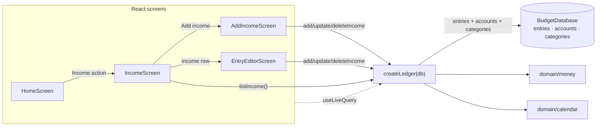

# Slice 07 Architecture — Record income

**Slice scope:** the user can record money arriving from outside their own
accounts, see it in one list, correct or remove it, and never have it counted
as spending.

**Status:** built and reviewed 2026-11-12. Built as designed; no production
divergence was found at review. `SCHEMA_VERSION` and
`BACKUP_SCHEMA_VERSION` remain `1`.

Extends `docs/architecture/north-star.md`,
`docs/architecture/slices/slice-01-architecture.md`,
`docs/architecture/slices/slice-02-architecture.md`,
`docs/architecture/slices/slice-03-architecture.md`,
`docs/architecture/slices/slice-04-architecture.md`,
`docs/architecture/slices/slice-05-architecture.md`, and
`docs/architecture/slices/slice-08-architecture.md`. It reopens nothing they
settled; it decides only what this slice needs.

## What this slice adds

- One income read model: `listIncome()`.
- Three `Ledger` mutations: `addIncome`, `updateIncome`, `deleteIncome`.
- One shared categorized-entry validation helper (renamed from the
  expense-specific one), the existing shared insert helper reused, and one
  shared newest-first entry reader, so expenses, transfers, and income keep
  one write path and one ordering rule.
- One generalized form module: `app/categorizedEntryForm.tsx`, replacing
  `app/expenseForm.tsx`, plus one extracted primitive: `app/choiceGroup.tsx`.
  The expense and transfer screens import the shared pieces under kind-neutral
  names; their behaviour and copy do not change.
- Three screens and three hash routes: the income list, the add-income form,
  and the income editor.
- One home action: a way into the income list.
- **No storage change**: `SCHEMA_VERSION` stays `1`; no new table, index,
  migration, or stored income aggregate.
- **No backup change**: `BACKUP_SCHEMA_VERSION` stays `1`; v1 already carries
  `kind: 'income'` with a positive `amountMinor` and an optional
  `categoryId`.
- **No spending read change**: `monthSummary` and `categoryEntries` already
  ignore every non-expense kind. Income is excluded by the existing
  `kind === 'expense'` predicate, not by a new filter.
- **No settings write**: `settings.lastAccountId` keeps its slice-08 meaning,
  “the last account used when adding an expense”. Income never writes it. The
  add-income form may read it to preselect an account.
- **No route change to existing screens**: home, add expense, accounts,
  categories, category entries, entry editor, transfers, and backup keep their
  current routes.

There are **no endpoints**. The app remains static files plus IndexedDB
(ADR 0001); `Ledger` is still the whole application API.

## The durable question — checked, none

This gate checked every candidate that would be expensive to change once
income data exists. None is new:

- **Income is an entry kind with a positive magnitude and a `+` effect.**
  Settled in the north-star; this slice writes exactly that shape.
- **Income carries one category from the shared category list.** Settled in
  the north-star and `CONTEXT.md`; the scope confirms it.
- **Income never counts as spending.** Settled in the north-star and already
  enforced by the existing expense-only predicates.
- **Whether income writes `settings.lastAccountId`.** Device-local, excluded
  from backups, no stored ledger shape. Cheap to change; decided below.
- **The shared form and input names.** Internal seams with no stored shape.
  Cheap to change.
- **Route shapes.** Hash routes with no stored data. Cheap to change.

No stop was required. Had this slice needed a second category list, a signed
income amount, or a separate income table, that would have been flagged rather
than decided here.

## Inherited, not re-decided

- Single user, local-first, installable PWA; IndexedDB via Dexie (ADR 0001,
  0005). No backend, auth, sync, or server-side validation.
- One `entries` collection with a `kind` discriminator. Income is one row, not
  a separate table and not a negative expense.
- An income stores a positive magnitude. Its effect is `+accountId`; the sign
  is derived from `kind`, never stored.
- An income has exactly one account and one category. No destination account,
  payee, employer, note, tax, or withholding.
- Spending counts `expense` entries only. Income, transfers, and openings
  never appear in a spending total.
- Categories are flat, shared between expenses and income, and archived rather
  than deleted. Archived categories are not offered for new entries but stay
  attached to history.
- Amounts are integer minor units; currency and exponent live in `settings`;
  formatting happens only at the display edge.
- Dates are local calendar dates (`YYYY-MM-DD`); a month is a string prefix.
- `Ledger` remains the only persistence seam; there is no repository interface
  and no fake adapter.
- Screens read through `useLiveQuery`; Dexie invalidation drives updates. No
  manual cache, event bus, or refresh button.
- Correction is in place and removal is final (slice 2). This slice applies
  both to income.
- Restore replaces, never merges; the backup file is the only backup and the
  only migration path across model changes.
- Single-tab assumption; no cross-tab coordination.
- `settings.lastAccountId` is written only by `addExpense`; transfers read it
  but never write it (slice 8). Income follows the transfer rule.

## Storage — unchanged Dexie schema v1

No table, key, or index changes:

| Table | Key | Indexes | Used by this slice |
|---|---|---|---|
| `entries` | `id` | `date` | income list, lookup, insert, update, delete |
| `accounts` | `id` | `createdAt` | account names and validation |
| `categories` | `id` | — | category names, picker, validation |
| `settings` | `id` (`'app'`) | — | currency/exponent for formatting; `lastAccountId` read-only |

Access paths:

| Operation | Query |
|---|---|
| Income list | `entries.orderBy('date').reverse().toArray()`, then filter `kind === 'income'` |
| Open one income | primary key `entries.get(id)` |
| Add | validate account and category, then `entries.add(…)` |
| Update | primary key read, then `entries.update(id, …)` |
| Delete | primary key read, then `entries.delete(id)` |
| Month summary | unchanged: date prefix, then `kind === 'expense'` in memory |
| Category entries | unchanged: date prefix, then `kind === 'expense'` and category in memory |

Why no new index:

- The income list has no month, account, or category filter. It reads the
  small `entries` table and keeps the rows with `kind === 'income'`. At one
  user and a few thousand rows, a full read plus in-memory filtering is
  trivial.
- The `date` index already provides the newest-first ordering. The read model
  sorts explicitly by `date` descending and `id` descending so ties are
  deterministic regardless of index tie-breaking.
- A `kind` index or a compound `[kind+date]` index would only help a filtered
  income query this slice does not have. Adding one later is a Dexie version
  bump with no data rewrite. Do not add it now.
- No aggregate table, no income cache, and no stored total. Every income is
  derived from the one row.

The two version numbers remain independent and unchanged:

| Constant | Meaning | Today |
|---|---|---|
| `SCHEMA_VERSION` (`data/db`) | IndexedDB store/index version | `1` |
| `BACKUP_SCHEMA_VERSION` (`domain/backup`) | data-model version in backup files | `1` |

## Backup — unchanged v1

The income row is already part of the v1 data model:

- `createBackupFile` serializes every entry, including income, sorted by `id`.
- `parseEntry` already accepts `kind: 'income'`, requires a positive safe
  integer `amountMinor` for every non-opening kind, and accepts an optional
  `categoryId`.
- `restoreBackup` clears and bulk-adds the `entries` table, so a restored
  income is the same row it was before.
- `readBackupData` already includes every entry.

Nothing in `domain/backup` changes. A v1 file containing income restores
without migration. A backup that omits income is still a valid v1 file and
restores an empty income list.

The parser accepts an income with no `categoryId`. This slice does not tighten
that rule: the app never writes such a row, the income list degrades it to
“Uncategorized”, and tightening would reject files v1 already accepts. That
would be a compatibility change this slice does not need.

## Module seams



- **`data/ledger`** owns the income read model, the three mutations, and the
  shared validation/insert/ordering helpers. As built, validation and insert
  are `requireEntryFields` and `createEntry` in
  `data/ledgerEntryWrite.ts`.
- **`domain`** is unchanged. `Entry` already has `kind: 'income'` and
  `categoryId`; `domain/money` already parses and formats amounts;
  `domain/calendar` already validates dates and defaults today.
- **`data/db`** is unchanged and still not imported by the UI.
- **`app` / `ui`** gains the list screen, the add and edit screens, the shared
  categorized-entry form, the routes, and the home action.
- **`domain/backup`** is unchanged.

One adapter (Dexie) still means no repository interface and no fake adapter.
Tests cross the same `Ledger` seam callers use.

### Interfaces

```ts
// src/data/ledger.ts
export interface CategorizedEntryInput {
  amountMinor: number;   // positive safe integer
  categoryId: string;    // required; active for a new income, or the stored category on correction
  accountId: string;     // the account the money enters
  date: LocalDate;
}

export interface IncomeListItem {
  id: string;
  date: LocalDate;
  amountMinor: number;
  categoryName: string;           // "Uncategorized" if the row is gone
  accountId: string;              // stored id; display uses the name
  accountName: string;            // "Unknown account" if the row is gone
  accountType: AccountType | null;
}

export interface Ledger {
  // unchanged: initialize, listAccounts, listAccountBalances, addAccount,
  // setOpeningBalance, renameAccount, listCategories, addCategory,
  // renameCategory, setCategoryArchived, addExpense, updateExpense,
  // deleteExpense, listTransfers, addTransfer, updateTransfer, deleteTransfer,
  // getEntry, categoryEntries, monthSummary, getSettings, readBackupData,
  // restoreBackup, markBackupSaved

  listIncome(): Promise<IncomeListItem[]>;              // date desc, then id desc
  addIncome(input: CategorizedEntryInput): Promise<Entry>;
  updateIncome(id: string, input: CategorizedEntryInput): Promise<Entry>;
  deleteIncome(id: string): Promise<Entry>;             // returns the removed snapshot
}
```

`ExpenseInput` is renamed to `CategorizedEntryInput`; expense and income
accept the same four fields. There is no compatibility alias — the type is
exported but only `data/ledger` names it, and callers pass object literals.

`IncomeListItem` deliberately has no `categoryId`. The list never links by
category and a missing category has no meaningful id; the name is the only
category fact the row needs. The editor reads the full entry through
`getEntry(id)`.

`getEntry(id)` is unchanged and is the editor's lookup. The editor checks
`entry.kind === 'income'`; a different kind is treated as “income not found”,
exactly as the expense editor treats a non-expense entry.

Why one list method and three mutations rather than a generic entry API:

- The income form has one account, one category, and no destination. An
  expense-shaped input would still be the right shape, but a generic
  `addEntry(kind, input)` would admit impossible states such as a transfer
  with a category.
- `listIncome` is a real read model: it filters the kind, joins the category
  and account, orders, and degrades missing references. Deleting it would move
  that join and filter into every caller.
- The public surface grows by four methods, but the implementation stays
  behind one seam. There is no second persistence adapter.

### Error codes

No new codes:

```ts
export type LedgerErrorCode =
  | 'invalid-name'
  | 'invalid-account-type'
  | 'invalid-amount'
  | 'invalid-date'
  | 'unknown-account'
  | 'unknown-category'
  | 'unknown-entry'
  | 'unsupported-entry-kind'
  | 'duplicate-category-name'
  | 'archived-category'
  | 'unknown-to-account'
  | 'same-transfer-account'
  | 'invalid-opening-amount'; // added in slice 06; shown here for completeness
```

Income reuses `invalid-amount`, `invalid-date`, `unknown-account`,
`unknown-category`, `archived-category`, `unknown-entry`, and
`unsupported-entry-kind`. Tests assert codes, not messages.

The UI maps codes with the shared `entryFieldErrors` helper (renamed from
`expenseFieldErrors`, then unified across kinds):

```ts
// src/app/entryFieldErrors.ts
export interface EntryFieldErrors {
  amount?: string;
  category?: string;
  account?: string;
  toAccount?: string;
  date?: string;
  form?: string;
}

export function entryFieldErrors(
  code: LedgerErrorCode,
): EntryFieldErrors | null;
```

The mapping is unchanged; income and expense attach the same codes to the
same fields.

## Write paths

### Shared validation

`requireExpenseFields` is renamed to `requireCategorizedEntryFields` and is
called inside every expense and income write transaction (later unified as
`requireEntryFields` in `data/ledgerEntryWrite.ts`). The rules are identical
for both kinds:

1. `amountMinor` is a positive safe integer (`invalid-amount`).
2. `isValidLocalDate(date)` (`invalid-date`).
3. The account exists (`unknown-account`).
4. The category exists (`unknown-category`).
5. The category is not archived, unless it is the stored category on update
   (`archived-category`).

The archived exception is what lets an income recorded under a category that
was later archived keep its label and still be corrected. Switching to a
different archived category is still refused.

The helper name changes because the rule set is no longer expense-specific.
This is an internal rename with no behaviour change for expenses.

### Shared insert

`createEntry(db, draft)` is the only call site of `entries.add` in the write
paths. `addExpense`, `addTransfer`, and `addIncome` all call it, and it runs
the kind's validator first. It guarantees that a new entry created by the app
is inserted in one place, with a fresh UUID and the shape the caller built.
Restore stays outside this helper because it bulk-replaces the whole ledger
from a validated backup.

### Shared newest-first reader

The transfer and income lists share one ordering rule. A private helper in
`data/ledger` reads and filters:

```ts
async function entriesOfKindNewestFirst(kind: EntryKind): Promise<Entry[]> {
  const entries = await db.entries.orderBy('date').reverse().toArray();
  return entries
    .filter((entry) => entry.kind === kind)
    .sort(
      (left, right) =>
        right.date.localeCompare(left.date) ||
        right.id.localeCompare(left.id),
    );
}
```

`listTransfers` is refactored to use it. The observable transfer ordering does
not change; the helper exists so the tie-break rule cannot drift between two
lists. It is private, not part of `Ledger`.

### `addIncome(input)`

One `rw` transaction over `accounts`, `categories`, and `entries`:

1. `await createEntry(db, { kind: 'income', ...input })`, which validates the
   fields and inserts one row with a fresh UUID.
2. Return the inserted entry.

No `toAccountId`, no second row, and **no settings read or write**. The
transaction does not include `settings`, so an income write cannot change the
expense form's default account.

Why income does not write `settings.lastAccountId`:

- The field is documented in slice 8 as “the last account used when adding an
  expense”. Income has one account, so writing it would silently change the
  expense form's preselection after every paycheck.
- The field is device-local and never backed up, so this is a convenience
  decision, not a data-model one.
- The add-income form may read it to preselect an account. That is a read,
  not a write.

### `updateIncome(id, input)`

One `rw` transaction over `accounts`, `categories`, and `entries`:

1. Read the entry; missing → `unknown-entry`.
2. Reject unless `kind === 'income'` (`unsupported-entry-kind`).
3. `await requireEntryFields(db, { kind: 'income', ...input },
   { allowArchivedCategoryId: existing.categoryId })`.
4. `entries.update(id, { date, amountMinor, accountId, categoryId })`; zero
   rows updated → `unknown-entry`.
5. Return the merged entry, with the original `id` and `kind`.

A correction updates the one row. It never creates a second row, never changes
`kind`, never writes `toAccountId`, and never writes settings. The stored
archived category is allowed; a different archived category is not.

### `deleteIncome(id)`

One `rw` transaction over `entries`:

1. Read the entry; missing → `unknown-entry`.
2. Reject unless `kind === 'income'` (`unsupported-entry-kind`).
3. `entries.delete(id)`.
4. Return the removed snapshot, so the caller can navigate from stored values
   rather than possibly stale form state.

Removal is final: no tombstone, no soft delete, no audit row. Spending totals
need no recalculation because every total is derived on read.

## Read path — `listIncome()`

Inside one Dexie `r` transaction over `entries`, `accounts`, and `categories`:

1. `await entriesOfKindNewestFirst('income')`.
2. Collect the unique `accountId` and `categoryId` values. A missing
   `categoryId` contributes no lookup.
3. Resolve both sets with one `accounts.bulkGet(...)` and one
   `categories.bulkGet(...)`.
4. Build one row per income:
   - category name from the category row, or `"Uncategorized"` if it is gone;
   - account name/type from the account row, or `"Unknown account"` / `null`
     if it is gone;
   - the stored `date` and `amountMinor` unchanged.
5. Return the array.

Properties:

- **Newest first.** An income dated later appears above an earlier one,
  regardless of when it was recorded. Same-day rows fall back to `id`
  descending for determinism.
- **No month filter and no pagination.** The scope explicitly excludes both.
  The whole income history is one list.
- **No total.** The list shows individual movements, not a sum. An income
  total would become a second headline; the scope keeps income out of the
  headline, so the list stays a list.
- **Live category and account labels.** Renaming a category changes the label
  on income; renaming an account changes the account label. History is not
  rewritten.
- **Archived categories still resolve.** The join reads the category row
  regardless of `archived`; the list never filters categories.
- **Missing references degrade, they do not disappear.** The row keeps its
  amount and date. The editor treats the missing side as unselected and
  requires a valid replacement before saving.
- **Account type is display-only.** It disambiguates two accounts with the
  same name; it never filters the list.
- **Empty result is `[]`.** The screen decides between “no income yet” and the
  add action.

No stored income list, no total, and no cache.

## Spending invariants — no read change

Income must not move the spending number. The existing read models already
guarantee it:

- `monthSummary` groups with `expenseTotals`, which skips every entry whose
  `kind !== 'expense'`. An income in the month on screen, or in the previous
  month, creates no row and adds nothing to `totalMinor`.
- `previousMonthHasSpending` is `previousTotals.size > 0`, where
  `previousTotals` is built by the same expense-only helper. An income in the
  previous month does not set it.
- `categoryEntries` filters `kind === 'expense'` before matching a category.
  An income labelled with the same category can never appear in a category
  list and never adds to its total.
- An income dated in an earlier month is still invisible to that month's
  spending, because the same kind filter applies to every month.

This slice therefore adds **no** field to `MonthSummary`, no income branch to
`expenseTotals`, and no new spending query. The regression tests are the
important part: income in the current and previous months must leave the home
summary byte-for-byte unchanged, and income sharing a category with expenses
must leave `categoryEntries` unchanged.

## Screens and navigation

| Route | Screen |
|---|---|
| `#/income` | Income list |
| `#/add/income` | Add income |
| `#/entry/<entryId>` | Entry editor, dispatched to the income editor by the stored kind |

```ts
// src/app/router.ts
export type Route =
  | { name: 'home'; month: MonthKey }
  | { name: 'add' }
  | { name: 'add-income' }   // new
  | { name: 'add-transfer' }
  | { name: 'accounts' }
  | { name: 'backup' }
  | { name: 'categories' }
  | { name: 'category'; month: MonthKey; categoryId: string }
  | { name: 'entry'; entryId: string }
  | { name: 'income' }       // new: list
  | { name: 'transfers' };
```

- `#/income` and `#/add/income` are exact matches.
- `#/entry/<id>` serves every kind; `EntryEditorScreen` reads the stored entry
  and renders the expense, income, or transfer editor. An empty id, a slash
  inside the id, or a decode failure falls back to home.
- `routeToHash` emits the forms above.
- `App` switches to the list, add, and entry screens. The first-run gate and
  restore flow are unchanged.

### Home

The existing bottom actions row gains one button, first in the row:

```tsx
<button type="button" onClick={() => navigate({ name: 'income' })}>
  Income
</button>
```

Nothing else on home changes. The spending total, category breakdown,
comparison columns, month controls, storage warning, and add-expense actions
keep their current behaviour. Income is reached from home, but it never enters
home's data and never gets a total or a row there.

### Income list

`IncomeScreen` reads:

- `useLiveQuery(() => ledger.listIncome(), [ledger])`
- `useLiveQuery(() => ledger.getSettings(), [ledger])`

States:

| State | Rendering |
|---|---|
| Loading | `Loading…` |
| No income | “No income yet.” + “Add your first income” button |
| Income exists | Newest-first list + “Add income” button |

Each row is a button that navigates to `#/entry/<id>`. It shows the date, the
category, the account the money arrived in, and the amount, formatted with
`formatAmount` and the settings currency/exponent. The accessible name
names all four, for example:

> Income: Salary, $2,400.00, Everyday Checking · Checking, 2026-11-12

The visible layout may put the amount last; the accessible name must not rely
on visual order alone. Account labels include the account type, matching the
expense and transfer pickers, so two cards with the same name remain
distinguishable. (The slice-02 category-entry list is the exception: it appends
the type only when two accounts share a name.)

The list has no total, no month controls, and no filters. Its empty state
offers the add action; the add screen owns the “no category to file income
under” explanation, so the list screen does not need its own category query.

### Add income

`AddIncomeScreen` reads accounts, categories, and settings. The App first-run
gate already redirects a zero-account route to Accounts, so the income screens
add no empty-accounts state of their own. With no active category it renders no
form:

> There is no category to file income under. Add or unarchive one in
> Categories.

plus a Categories button. `CategoriesScreen` is unchanged; a category added or
unarchived there appears in the income form through its live query. Otherwise
it renders the shared `CategorizedEntryFields` form with:

- amount blank;
- category unselected (the user must choose; archived categories are not
  offered);
- account preselected from `settings.lastAccountId` when that account still
  exists, otherwise the first account;
- date `todayLocalDate()`, changeable to any valid date, including an earlier
  month.

The account default is a convenience, not a rule: the user can change it, and
income is valid on any account type. Because income never writes
`lastAccountId`, the default reflects the last expense account, not the last
income account; that is the cost of leaving the expense form's default intact.

On submit:

1. Parse the amount with `parseAmount` and the settings exponent.
2. Reject an amount of zero or less, a missing category, a missing account, or
   an invalid date with field errors.
3. Call `ledger.addIncome({ amountMinor, categoryId, accountId, date })`.
4. On success, navigate to `#/income`. The live query shows the new row
   immediately; the list is the confirmation surface.
5. On `LedgerError`, map the code with `entryFieldErrors`; an
   unexpected error becomes a form-level “Could not save the income. Try
   again.”

The screen refuses an empty selection before the call for immediate feedback.
The ledger refuses it again inside the transaction, so a stale form or a
direct caller cannot write an income without a category or account. A
double-submit guard prevents two rows.

Cancel returns to `#/income` without writing.

### Income editor

`#/entry/<id>` renders `EntryEditorScreen`, which reads the stored entry and
hands it to the shared `EntryEditor` with `kind: 'income'`. A missing entry
renders “Entry not found”; an entry of another kind is dispatched to that
kind's editor. The form is seeded from the stored row:

- amount via `formatAmountInput(entry.amountMinor, exponent)`;
- category `entry.categoryId` if that category exists, else unselected with an
  error;
- account `entry.accountId` if that account exists, else unselected with an
  error;
- date `entry.date`.

Category options are the active categories plus the stored category if it is
archived, labelled with “(archived)” exactly as the expense editor does. That
is what keeps a corrected income under an archived category possible without
offering archived categories for a new choice.

Save calls `ledger.updateIncome(entry.id, input)` and then navigates to
`#/income`. The list reflects the change through its live query. An
`unknown-entry` or `unsupported-entry-kind` error means the row vanished or is
no longer income; the screen switches to “Income not found”. Other ledger
errors map to fields.

Remove uses the same in-place confirmation pattern as the expense and transfer
editors:

- the Remove button reveals a `role="group"` panel;
- the panel names the amount, the date, the category, and the account, and says
  the removal cannot be undone;
- focus moves to Cancel when the panel opens;
- Remove calls `ledger.deleteIncome(entry.id)` and navigates to `#/income`;
- a failure leaves the row in place: `unknown-entry` and
  `unsupported-entry-kind` switch to “Income not found”, any other error shows
  a form error.

Cancel and Back both return to `#/income` without writing.

### Shared categorized-entry form

`app/expenseForm.tsx` is renamed to `app/categorizedEntryForm.tsx`, and its
generic `ChoiceGroup` moves to `app/choiceGroup.tsx`. The categorized module
holds the component and the mapper, under kind-neutral names:

```ts
export interface EntryFieldErrors { … }
export function entryFieldErrors(code: LedgerErrorCode): EntryFieldErrors | null;
export function CategorizedEntryFields({ … }): JSX.Element;
```

`CategorizedEntryFields` renders amount, category, account, and date in the
same order and with the same accessible error wiring as today. `idPrefix`
becomes `'expense' | 'entry' | 'income'`.

`AddExpenseScreen` and `EntryEditorScreen` import the renamed module.
`transferForm.tsx` imports `ChoiceGroup` from `app/choiceGroup.tsx` instead of
reaching into the categorized-entry module. The affected screens and the
transfer form keep their props, copy, validation, navigation, and delete
confirmation unchanged.

The rename is a clean cutover: no compatibility re-export and no second form
module. Reusing one form is what keeps expense and income amount/category/
account/date behaviour identical instead of letting two copies drift, and
moving `ChoiceGroup` to its own module keeps the transfer form from depending
on a categorized-entry module it does not otherwise use.

**Drift-check follow-up (2026-11-13).** The shared form now has one deeper
sibling for every kind: `app/entryEditor.tsx` owns loading, the account and
category preconditions, form state, validation, submit, error mapping, removal
confirmation, focus, busy guards, and not-found rendering for add and edit.
`AddExpenseScreen`, `AddIncomeScreen`, `AddTransferScreen`, and
`EntryEditorScreen` are thin route adapters that pass navigation callbacks;
`CategorizedEntryFields` and `TransferFields` remain the field renderers. The
public `Ledger` interface, routes, copy, and spending reads are unchanged.

## Live updates

- List: `useLiveQuery(() => ledger.listIncome(), [ledger])`.
- Editor: `useLiveQuery(() => ledger.getEntry(entryId), [ledger, entryId])`
  plus the existing account, category, and settings queries.
- Add/edit screens read accounts, categories, and settings with
  `useLiveQuery`, like the expense screens.

`addIncome`, `updateIncome`, and `deleteIncome` touch `entries`; Dexie re-runs
every affected query. No manual cache, event bus, or refresh. The single-tab
assumption carries over: the editor seeds its form once from the loaded entry,
and a concurrent change from another tab is visible to live queries but not
merged into a half-edited form.

## Edge cases

| Case | Result |
|---|---|
| Income in the month on screen | Home total and category rows unchanged |
| Income in the previous month | `previousMonthHasSpending` unchanged; no comparison row |
| Income dated in an earlier month | Not in that month's spending; still in the income list |
| Income and expense share a category | Income absent from `categoryEntries`; category total unchanged |
| Transfer and income coexist | Each list filters its own kind; neither appears in the other |
| Income on a credit account | Valid; `+` effect; not spending |
| Income on a savings account | Valid |
| Amount zero or negative | `invalid-amount`; no row written |
| Invalid date | `invalid-date`; no row written |
| Missing category on add | `unknown-category`; no row written |
| Archived category on add | `archived-category`; no row written |
| Existing income under an archived category, unchanged | Allowed; label kept; correction can change other fields |
| Existing income switched to a different archived category | `archived-category`; no write |
| No active categories | Add screen explains and links to Categories; no form |
| No income | List explains and offers “Add your first income” |
| Missing account on restore | List shows “Unknown account”; editor requires a replacement |
| Missing category on restore | List shows “Uncategorized”; editor requires a replacement |
| Stray `toAccountId` on an income row | Ignored by the list and every spending read; the app never writes one |
| Category renamed | List shows the new name; the row is not rewritten |
| Category archived | List keeps the label; editor offers the stored category as “(archived)” |
| Two accounts with the same name | Both appear with their type; selection is by id |
| Two incomes on the same day | Ordered by id descending, deterministically |
| Backup and restore | Income round-trips exactly; v1 schema unchanged |
| Offline | All reads and writes are local; no network path |

## Invariants the program design and tests must preserve

- An income is exactly one row with `kind: 'income'`, a positive
  `amountMinor`, `accountId`, and `categoryId`, and no `toAccountId` written by
  the app.
- `addIncome` requires a category and an account. Archived categories are
  refused for new income and for switching an existing income; the stored
  archived category is allowed on correction.
- `monthSummary` and `categoryEntries` never include an income.
- The home total, category rows, and `previousMonthHasSpending` are unchanged
  by adding, correcting, or removing income in the current or previous month.
- A category's entry list and total are unchanged by income sharing its
  category.
- `listIncome` is newest first by `date`, then `id`, joins category and
  account names at read time, and degrades missing references without dropping
  the row.
- `updateIncome` changes the one row and never creates a second row or changes
  `id`, `kind`, or `toAccountId`.
- `deleteIncome` removes the one row and leaves spending unchanged.
- Backup and restore reproduce income exactly under
  `BACKUP_SCHEMA_VERSION = 1`.
- No Dexie schema version bump, no new index, and no settings write from any
  income path.
- Each income row's accessible name states the category, account, amount, and
  date.
- Expense and transfer behaviour is unchanged after the shared form, input,
  validation, ordering, and choice-group renames.

## Decision log

| Decision | Choice | Reversibility |
|---|---|---|
| Income storage | One `entries` row with `kind: 'income'`; no `incomes` table | Low; north-star already settled it |
| Income amount | Positive magnitude; effect is `+accountId`; no signed income | Low; north-star |
| Category | Required from the shared list; archived refused for new, stored archived allowed on correction | Low; scope plus existing helper |
| Income mutations | `addIncome`, `updateIncome`, `deleteIncome`; no generic public entry mutation | Low; public surface only |
| Income list | `listIncome()` returns all income, newest first; no total, month filter, or pagination | Low; read model only |
| Settings | Income paths never write `lastAccountId`; the add form may read it | Low; device-local, not backed up |
| Routes | `#/income`, `#/add/income`, `#/entry/<id>` | Low; hash routes |
| Shared input | `ExpenseInput` renamed to `CategorizedEntryInput` | Low; internal type |
| Shared validation | `requireExpenseFields` renamed to `requireCategorizedEntryFields`, later unified as `requireEntryFields`; same rules | Low; private helper |
| Shared form | `app/expenseForm.tsx` renamed to `app/categorizedEntryForm.tsx`; expense and income use it | Low; internal seam |
| Categorized add/edit behavior | One `app/entryEditor.tsx` owns the form lifecycle for every kind; the route screens are adapters | Low; internal seam |
| Shared primitive | `ChoiceGroup` moved to `app/choiceGroup.tsx`; categorized-entry and transfer forms import it | Low; internal seam |
| Shared ordering | Private `entriesOfKindNewestFirst`; transfer and income lists use it | Low; private helper |
| Indexing | No new index; date index plus in-memory kind filter | Low; add later in a Dexie bump |
| Backup | v1 unchanged; income already round-trips | Low; no data-model change |

## Wayfinder check

The destination is unchanged: the user can use the app as their only ledger.
Slice 7 is the next movement on the existing map — record the money arriving
from outside the user's own accounts, after transfers completed the outflow
side and before balances. The 2026-11-12 scope gate already confirmed the
remaining route as 7 income → 6 balances; this architecture does not move it.

This gate surfaced no new decision that needs its own ticket and no fog that
changes the route. The income row is the smallest change that lets a paycheck
stop being missing from the ledger, and it is buildable now with the existing
entry model, category list, backup format, and spending reads.

## Domain-model check

`CONTEXT.md` already defines **Income** as money entering an account from
outside the user's own accounts, with a category. **Category**, **Active
category**, and **Archived category** already cover expenses and income. This
slice uses those definitions unchanged.

“Income list” is an ordinary description of the screen, not a new glossary
term. This gate adds no term. No ADR is warranted: the durable income
semantics — one entry kind, positive magnitude, one shared category, never
spending — were already recorded in the north-star; the rest is slice-scoped.
