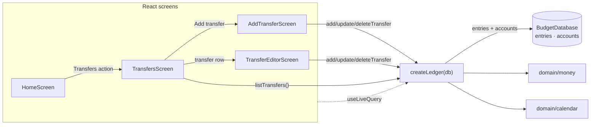

# Slice 08 Architecture — Record transfers

**Slice scope:** the user can record, view, correct, and remove a movement of
money between two of their own accounts, and that movement never counts as
spending.

**Status:** built and closed 2026-11-12. Built as designed; no production
divergence was found at close-out. `SCHEMA_VERSION` and
`BACKUP_SCHEMA_VERSION` remain `1`.

Extends `docs/architecture/north-star.md`,
`docs/architecture/slices/slice-01-architecture.md`,
`docs/architecture/slices/slice-02-architecture.md`,
`docs/architecture/slices/slice-03-architecture.md`,
`docs/architecture/slices/slice-04-architecture.md`, and
`docs/architecture/slices/slice-05-architecture.md`. It reopens nothing they
settled; it decides only what this slice needs.

## What this slice adds

- One transfer read model: `listTransfers()`.
- Three `Ledger` mutations: `addTransfer`, `updateTransfer`, `deleteTransfer`.
- One private transfer validation helper and one private entry-insert helper,
  so `addExpense` and `addTransfer` still share a single place that writes
  `entries`.
- Three screens and three hash routes: the transfers list, the add-transfer
  form, and the transfer editor.
- One home action: a way into the transfers list.
- **No storage change**: `SCHEMA_VERSION` stays `1`; no new table, index,
  migration, or stored transfer aggregate.
- **No backup change**: `BACKUP_SCHEMA_VERSION` stays `1`; v1 already carries
  `kind: 'transfer'`, `accountId`, and `toAccountId`, and restore already
  replaces the whole `entries` table.
- **No spending read change**: `monthSummary` and `categoryEntries` already
  ignore every non-expense kind. Transfers are excluded because of the
  existing `kind === 'expense'` predicate, not because of a new filter.
- **No settings write**: `settings.lastAccountId` remains the last account
  used when adding an *expense*. A transfer has two accounts, so neither is
  written there. The add form may read it to preselect the source; it never
  updates it.
- **No route change to existing screens**: home, add expense, accounts,
  categories, category entries, entry editor, and backup keep their current
  routes.

There are **no endpoints**. The app remains static files plus IndexedDB
(ADR 0001); `Ledger` is still the whole application API.

## The durable question — flagged and resolved

One decision in this slice is expensive to reverse after data exists: the
stored field that names a transfer's source account.

- `docs/architecture/north-star.md` named it `fromAccountId` in the
  entry-kind table, while its own ER diagram and the built `Entry` type use
  `accountId`. The table was corrected at close-out.
- `docs/program-design/slices/slice-01-spec.md` already resolved the
  mismatch: “The transfer source is `accountId`… Slice 8 can rename the field
  only with a schema migration.” The backup validator already accepts
  `kind: 'transfer'` with `accountId` + `toAccountId`.

Because renaming after the first transfer is recorded would require a Dexie
and backup data-model migration, this gate stopped and asked rather than
deciding unilaterally.

**Decision:** keep `accountId` as the transfer source and `toAccountId` as the
destination. Consequences:

- No Dexie migration and no `BACKUP_SCHEMA_VERSION` bump.
- Every entry kind keeps one primary account field; a transfer is the only
  kind that also carries a destination.
- The north-star table's `fromAccountId` was stale prose. The ER diagram
  already said `accountId`; the table and prose were corrected to `accountId`
  at close-out.
- No ADR is added. The choice is already recorded in the slice-01 spec; this
  gate only confirms it. A new ADR would restate an existing decision rather
  than introduce one.

Everything else this slice decides is reversible at slice cost. No other
contract is expensive to change after transfers exist.

## Inherited, not re-decided

- Single user, local-first, installable PWA; IndexedDB via Dexie (ADR 0001,
  0005). No backend, auth, sync, or server-side validation.
- One `entries` collection with a `kind` discriminator. Transfers are one row,
  not two postings and not a separate table.
- A transfer stores a positive magnitude. Its effect is `−accountId`,
  `+toAccountId`; the sign is derived from `kind`, never stored.
- A transfer has no category, tag, note, or payee.
- Spending counts `expense` entries only. Transfers, income, and openings
  never appear in a spending total.
- Amounts are integer minor units; currency and exponent live in `settings`;
  formatting happens only at the display edge.
- Dates are local calendar dates (`YYYY-MM-DD`); a month is a string prefix.
- Categories are flat and archived rather than deleted. Transfers never
  reference one.
- `Ledger` remains the only persistence seam; there is no repository interface
  and no fake adapter.
- Screens read through `useLiveQuery`; Dexie invalidation drives updates. No
  manual cache, event bus, or refresh button.
- Correction is in place and removal is final (slice 2). This slice applies
  both to transfers.
- Restore replaces, never merges; the backup file is the only backup and the
  only migration path across model changes.
- Single-tab assumption; no cross-tab coordination.

## Storage — unchanged Dexie schema v1

No table, key, or index changes:

| Table | Key | Indexes | Used by this slice |
|---|---|---|---|
| `entries` | `id` | `date` | transfer list, lookup, insert, update, delete |
| `accounts` | `id` | `createdAt` | source/destination names and validation |
| `categories` | `id` | — | unchanged; transfers never read or write it |
| `settings` | `id` (`'app'`) | — | currency/exponent for formatting only; **not written** |

Access paths:

| Operation | Query |
|---|---|
| Transfer list | `entries.orderBy('date').reverse().toArray()`, then filter `kind === 'transfer'` |
| Open one transfer | primary key `entries.get(id)` |
| Add | validate accounts, then `entries.add(…)` |
| Update | primary key read, then `entries.update(id, …)` |
| Delete | primary key read, then `entries.delete(id)` |
| Month summary | unchanged: date prefix, then `kind === 'expense'` in memory |
| Category entries | unchanged: date prefix, then `kind === 'expense'` and category in memory |

Why no new index:

- The transfer list has no month, account, or category filter. It reads the
  small `entries` table and keeps the rows with `kind === 'transfer'`. At one
  user and a few thousand rows, a full read plus in-memory filtering is
  trivial.
- The `date` index already provides the newest-first ordering. The read model
  sorts explicitly by `date` descending and `id` descending so ties are
  deterministic regardless of index tie-breaking.
- A `kind` index or a compound `[kind+date]` index would only help a filtered
  transfer query this slice does not have. Adding one later is a Dexie version
  bump with no data rewrite. Do not add it now.
- No aggregate table, no transfer cache, and no stored balance. Every transfer
  is derived from the one row.

The two version numbers remain independent and unchanged:

| Constant | Meaning | Today |
|---|---|---|
| `SCHEMA_VERSION` (`data/db`) | IndexedDB store/index version | `1` |
| `BACKUP_SCHEMA_VERSION` (`domain/backup`) | data-model version in backup files | `1` |

## Backup — unchanged v1

The transfer row is already part of the v1 data model:

- `createBackupFile` serializes every entry, including transfers, sorted by
  `id`.
- `parseEntry` already accepts `kind: 'transfer'`, requires a non-empty
  `toAccountId`, and requires a positive safe-integer `amountMinor`.
- `restoreBackup` clears and bulk-adds the `entries` table, so a restored
  transfer is the same row it was before.
- `readBackupData` already includes every entry.

Nothing in `domain/backup` changes. A v1 file containing transfers restores
without migration. A backup that omits transfers is still a valid v1 file and
restores an empty transfers list.

The parser tolerates an optional `categoryId` on any kind, including a
transfer. This slice does not tighten that rule: a restored transfer with a
stray `categoryId` is still ignored by every spending read, and the transfer
editor never writes one. Tightening the parser would reject files that v1
already accepts, which is a compatibility change this slice does not need.

## Module seams



- **`data/ledger`** owns the transfer read model, transfer validation, the
  three mutations, and the shared entry-insert helper. The helpers are
  private, next to `requireExpenseFields`, not a new module.
- **`domain`** is unchanged. `Entry` already has `kind: 'transfer'`,
  `accountId`, and `toAccountId`; `domain/money` already parses and formats
  amounts; `domain/calendar` already validates dates and defaults today.
- **`data/db`** is unchanged and still not imported by the UI.
- **`app` / `ui`** gains the list screen, the add and edit screens, a shared
  transfer field component, the routes, and the home action.
- **`domain/backup`** is unchanged.

One adapter (Dexie) still means no repository interface and no fake adapter.
Tests cross the same `Ledger` seam callers use.

### Interfaces

```ts
// src/data/ledger.ts
export interface TransferInput {
  amountMinor: number;   // positive safe integer
  accountId: string;     // source account
  toAccountId: string;   // destination account; must differ from accountId
  date: LocalDate;
}

export interface TransferListItem {
  id: string;
  date: LocalDate;
  amountMinor: number;
  accountId: string;              // source
  accountName: string;            // "Unknown account" if the row is gone
  accountType: AccountType | null;
  toAccountId: string;            // destination
  toAccountName: string;          // "Unknown account" if the row is gone
  toAccountType: AccountType | null;
}

export interface Ledger {
  // unchanged: initialize, listAccounts, addAccount, renameAccount,
  // listCategories, addCategory, renameCategory, setCategoryArchived,
  // addExpense, updateExpense, deleteExpense, getEntry, categoryEntries,
  // monthSummary, getSettings, readBackupData, restoreBackup,
  // markBackupSaved

  listTransfers(): Promise<TransferListItem[]>; // date desc, then id desc
  addTransfer(input: TransferInput): Promise<Entry>;
  updateTransfer(id: string, input: TransferInput): Promise<Entry>;
  deleteTransfer(id: string): Promise<Entry>;   // returns the removed snapshot
}
```

`getEntry(id)` is unchanged and is the editor's lookup. The editor checks
`entry.kind === 'transfer'`; a different kind is treated as “transfer not
found”, exactly as the expense editor treats a non-expense entry.

Why one list method and three mutations rather than a generic entry API:

- The transfer form has two account pickers, no category, and a
  same-account rule. An expense-shaped `EntryInput` would force callers to
  construct impossible states.
- `listTransfers` is a real read model: it filters the kind, joins both
  accounts, orders, and degrades missing references. Deleting it would move
  that join and filter into every caller.
- The public surface grows by four methods, but the implementation stays
  behind one seam. There is no second persistence adapter.

### Error codes

```ts
export type LedgerErrorCode =
  | 'invalid-name'
  | 'invalid-account-type'
  | 'invalid-amount'
  | 'invalid-date'
  | 'unknown-account'
  | 'unknown-category'
  | 'unknown-entry'
  | 'unsupported-entry-kind'
  | 'duplicate-category-name'
  | 'archived-category'
  | 'unknown-to-account'       // new: transfer destination is gone
  | 'same-transfer-account';   // new: source and destination are the same
```

`unknown-account` keeps its existing meaning: the primary/source account is
missing. `unknown-to-account` is the destination-specific code so the form can
attach the error to the right picker. `same-transfer-account` is form-level:
neither picker alone is wrong. Tests assert codes, not messages.

The UI maps the new codes in a `transferFieldErrors` helper:

```ts
// src/app/transferForm.tsx
export interface TransferFieldErrors {
  amount?: string;
  account?: string;
  toAccount?: string;
  date?: string;
  form?: string;
}

export function transferFieldErrors(
  code: LedgerErrorCode,
): TransferFieldErrors | null;
```

## Write paths

### Shared entry insert

The north star requires one entry write path. The existing `addExpense` is the
expense form of that path. This slice introduces one private helper in
`data/ledger` and makes both creation paths call it:

```ts
async function insertEntry(entry: Entry): Promise<Entry> {
  await db.entries.add(entry);
  return entry;
}
```

`insertEntry` is the only call site of `entries.add` in the add paths. It does
not replace the kind-specific validation; it guarantees that a new entry
created by the app is inserted in one place, with a fresh UUID and the shape
the caller built. `addExpense` keeps its existing behaviour, including the
`settings.lastAccountId` write. `addTransfer` does not write settings. Restore
is deliberately outside this helper: it uses `entries.bulkAdd` because it
replaces the whole ledger from a validated backup.

This is an internal refactor, not a new public seam. `addExpense` will call
`insertEntry`. If the program design splits that mechanical change into its
own ticket, the end state is the same: every entry created through the add
path goes through one helper, never through a screen.

### Transfer validation

`requireTransferFields(input)` runs inside the write transaction and is the
only place these rules live:

1. `amountMinor` is a positive safe integer (`invalid-amount`).
2. `isValidLocalDate(date)` (`invalid-date`).
3. `input.accountId !== input.toAccountId` (`same-transfer-account`).
4. The source account exists (`unknown-account`).
5. The destination account exists (`unknown-to-account`).

The same-account check runs before the account reads because it is a property
of the input, not of stored rows. A transfer to or from a credit account is
valid; account type never enters the rule.

### `addTransfer(input)`

One `rw` transaction over `accounts` and `entries`:

1. `await requireTransferFields(input)`.
2. Build one row:
   `{ id: crypto.randomUUID(), kind: 'transfer', date, amountMinor,
   accountId: input.accountId, toAccountId: input.toAccountId }`.
3. `await insertEntry(entry)`.
4. Return the inserted entry.

No `categoryId`, no `settings` write, no second row. The source is
`accountId`; the destination is `toAccountId`.

### `updateTransfer(id, input)`

One `rw` transaction over `accounts` and `entries`:

1. Read the entry; missing → `unknown-entry`.
2. Reject unless `kind === 'transfer'` (`unsupported-entry-kind`).
3. `await requireTransferFields(input)`.
4. `entries.update(id, { date, amountMinor, accountId, toAccountId })`.
5. Return the merged entry, with the original `id` and `kind`.

A correction updates the one row, so both sides change together. It never
creates a second row, never changes `kind`, and never writes a category. It
does not touch `settings.lastAccountId`.

### `deleteTransfer(id)`

One `rw` transaction over `entries`:

1. Read the entry; missing → `unknown-entry`.
2. Reject unless `kind === 'transfer'` (`unsupported-entry-kind`).
3. `entries.delete(id)`.
4. Return the removed snapshot, so the caller can navigate from stored values
   rather than possibly stale form state.

Removal is final: no tombstone, no soft delete, no audit row. Spending totals
need no recalculation because every total is derived on read.

## Read path — `listTransfers()`

Inside one Dexie `r` transaction over `entries` and `accounts`:

1. Read the entries in newest-first order. The `date` index supplies the
   primary order; filter to `kind === 'transfer'`.
2. Sort explicitly by `date` descending, then `id` descending, so same-day
   transfers are deterministic and match the other list read model's
   tie-break.
3. Collect the union of `accountId` and `toAccountId` values.
4. Resolve them with one `accounts.bulkGet(...)`.
5. Build one row per transfer:
   - source name/type from the source account, or
     `"Unknown account"` / `null` if it is gone;
   - destination name/type from the destination account, or
     `"Unknown account"` / `null` if it is gone;
   - the stored `date` and `amountMinor` unchanged.
6. Return the array.

Properties:

- **Newest first.** A transfer dated later appears above an earlier one,
  regardless of when it was recorded. Same-day rows fall back to `id`
  descending for determinism.
- **No month filter and no pagination.** The scope explicitly excludes both.
  The whole transfer history is one list.
- **No total.** The list shows individual movements, not a sum. A total would
  invite the user to read it as spending or as a balance; neither is in this
  slice.
- **No category join.** Transfers have none.
- **Missing accounts degrade, they do not disappear.** The row keeps its
  amount and date and shows `"Unknown account"`, matching the entry-list
  convention from slice 2. The editor treats the missing side as unselected
  and requires a valid replacement before saving.
- **Renamed accounts show their current name.** The join is at read time, so
  history is not rewritten.
- **Account type is display-only.** It disambiguates two accounts with the
  same name; it never filters the list.
- **Empty result is `[]`.** The screen decides between “no transfers yet” and
  “you need two accounts”.

## Spending invariants — no read change

Transfers must not move the spending number. The existing read models already
guarantee it:

- `monthSummary` groups with `expenseTotals`, which skips every entry whose
  `kind !== 'expense'`. A transfer in the month on screen, or in the previous
  month, creates no row and adds nothing to `totalMinor`.
- `previousMonthHasSpending` is `previousTotals.size > 0`, where
  `previousTotals` is built by the same expense-only helper. A transfer in the
  previous month does not set it.
- `categoryEntries` filters `kind === 'expense'` before matching a category.
  A transfer can never appear in a category list.
- A transfer dated in an earlier month is still invisible to that month's
  spending, because the same kind filter applies to every month.

This slice therefore adds **no** field to `MonthSummary`, no transfer branch
to `expenseTotals`, and no new spending query. The regression test is the
important part: a transfer in the current and previous months must leave the
home summary byte-for-byte unchanged.

## Screens and navigation

| Route | Screen |
|---|---|
| `#/transfers` | Transfers list |
| `#/transfers/new` | Add transfer |
| `#/transfers/<entryId>` | Transfer editor (correct or remove) |

```ts
// src/app/router.ts
export type Route =
  | { name: 'home'; month: MonthKey }
  | { name: 'add' }
  | { name: 'accounts' }
  | { name: 'backup' }
  | { name: 'categories' }
  | { name: 'category'; month: MonthKey; categoryId: string }
  | { name: 'entry'; entryId: string }
  | { name: 'transfers' }                 // new
  | { name: 'add-transfer' }              // new
  | { name: 'transfer'; entryId: string }; // new
```

- `#/transfers` is exact. `#/transfers/new` is checked before
  `#/transfers/<id>`, so `new` is never parsed as an id.
- `#/transfers/<id>` decodes the id like `#/entry/<id>`; an empty id, a slash
  inside the id, or a decode failure falls back to home.
- `routeToHash` emits the three forms above.
- `App` switches to the three screens. The first-run gate and restore flow are
  unchanged.

### Home

The existing bottom actions row gains one button:

```tsx
<button type="button" onClick={() => navigate({ name: 'transfers' })}>
  Transfers
</button>
```

Nothing else on home changes. The spending total, category breakdown,
comparison columns, month controls, storage warning, and add-expense actions
keep their current behaviour. A transfer is reached from home, but it never
enters home's data.

### Transfers list

`TransfersScreen` reads:

- `useLiveQuery(() => ledger.listTransfers(), [ledger])`
- `useLiveQuery(() => ledger.listAccounts(), [ledger])`

States:

| State | Rendering |
|---|---|
| Loading | `Loading…` |
| Fewer than two accounts | “You need two accounts to record a transfer.” + Accounts button. Existing transfers, if any, still render below. |
| No transfers, at least two accounts | “No transfers yet.” + “Add your first transfer” button |
| Transfers exist | Newest-first list + “Add transfer” button |

Each row is a button that navigates to `#/transfers/<id>`. It shows the date,
the source account, the destination account, and the amount. The accessible
name names the direction explicitly, for example:

> Transfer from Checking to Visa, $240.00, 2026-11-11

The visible layout may use a `From → To` line and a separate amount; the
accessible name must not rely on visual order alone. Account labels include the
account type, matching the expense pickers, so two cards with the same name
remain distinguishable.

### Add transfer

`AddTransferScreen` reads accounts and settings. With fewer than two accounts
it renders the same “add another account” message and an Accounts button, no
form. Otherwise it renders the shared `TransferFields` form with:

- amount blank;
- source preselected from `settings.lastAccountId` when that account still
  exists, otherwise the first account;
- destination preselected as the first account different from the source;
- date `todayLocalDate()`, changeable to any valid date, including an earlier
  month;
- no category field.

On submit:

1. Parse the amount with `parseAmount` and the settings exponent.
2. Reject an amount of zero or less, a missing source, a missing destination,
   the same account on both sides, or an invalid date with field errors.
3. Call `ledger.addTransfer({ amountMinor, accountId, toAccountId, date })`.
4. On success, navigate to `#/transfers`. The live query shows the new row
   immediately.
5. On `LedgerError`, map the code with `transferFieldErrors`; an unexpected
   error becomes a form-level “Could not save the transfer. Try again.”

The screen refuses the same account before the call for immediate feedback.
The ledger refuses it again inside the transaction, so a stale form or a
direct caller cannot create a self-transfer.

### Transfer editor

`TransferEditorScreen` reads `ledger.getEntry(entryId)`, accounts, and
settings. A missing entry or a non-transfer entry renders “Transfer not
found”. Otherwise the form is seeded from the stored row:

- amount via `formatAmountInput(entry.amountMinor, exponent)`;
- source `entry.accountId` if that account exists, else unselected with an
  error;
- destination `entry.toAccountId` if that account exists, else unselected
  with an error;
- date `entry.date`.

Save calls `ledger.updateTransfer(entry.id, input)` and then navigates to
`#/transfers`. The list reflects the change through its live query. An
`unknown-entry` or `unsupported-entry-kind` error means the row vanished or is
no longer a transfer; the screen switches to “Transfer not found”. Other
ledger errors map to fields.

Remove uses the same in-place confirmation pattern as the expense editor:

- the Remove button reveals a `role="group"` panel;
- the panel names the amount, the date, the source account, and the
  destination account, and says the removal cannot be undone;
- focus moves to Cancel when the panel opens;
- Remove calls `ledger.deleteTransfer(entry.id)` and navigates to
  `#/transfers`;
- a failure leaves the row in place and shows a form error.

Cancel and Back both return to `#/transfers` without writing.

### Shared transfer fields

`app/transferForm.tsx` holds `TransferFields`, `TransferFieldErrors`, and
`transferFieldErrors`, mirroring `app/expenseForm.tsx`:

- amount: text input with `inputMode="decimal"`, the same parse/format rules as
  an expense;
- source: `ChoiceGroup` labelled “From account”;
- destination: `ChoiceGroup` labelled “To account”;
- date: date input, same validation and accessible error wiring as the expense
  form.

It reuses the existing `ChoiceGroup` from `app/expenseForm.tsx`; that component
is already generic over `{ id, label }`. It does not reuse `ExpenseFields`,
because a transfer has no category and has two accounts.

## Live updates

- List: `useLiveQuery(() => ledger.listTransfers(), [ledger])`.
- Editor: `useLiveQuery(() => ledger.getEntry(entryId), [ledger, entryId])`
  plus the existing account and settings queries.
- Add/edit screens read accounts and settings with `useLiveQuery`, like the
  expense screens.

`addTransfer`, `updateTransfer`, and `deleteTransfer` touch `entries`; Dexie
re-runs every affected query. No manual cache, event bus, or refresh. The
single-tab assumption carries over: the editor seeds its form once from the
loaded entry, and a concurrent change from another tab is visible to live
queries but not merged into a half-edited form.

## Edge cases

| Case | Result |
|---|---|
| Transfer in the month on screen | Home total and category rows unchanged |
| Transfer in the previous month | `previousMonthHasSpending` unchanged; no comparison row |
| Transfer dated in an earlier month | Not in that month's spending; still in the transfers list |
| Paying a credit card | Valid; source checking, destination credit card; not spending |
| Moving money back from savings | Valid; source savings, destination checking |
| Credit card as source | Valid; account type never restricts the rule |
| Same account on both sides | `same-transfer-account`; no row written |
| Amount zero or negative | `invalid-amount`; no row written |
| Invalid date | `invalid-date`; no row written |
| Source account missing on restore | List shows “Unknown account”; editor requires a replacement |
| Destination account missing on restore | List shows “Unknown account”; editor requires a replacement |
| Account renamed | List shows the new name; the row is not rewritten |
| Fewer than two accounts | List explains and links to Accounts; add screen renders no form |
| Two accounts with the same name | Both appear with their type; selection is by id, though the labels may look identical |
| Transfer row carries a stray category | Ignored by spending and the transfer list; editor never writes one |
| Backup and restore | Transfer round-trips exactly; v1 schema unchanged |
| Offline | All reads and writes are local; no network path |

## Invariants the program design and tests must preserve

- A transfer is exactly one row with `kind: 'transfer'`, a positive
  `amountMinor`, `accountId` as source, `toAccountId` as destination, and no
  `categoryId` written by the app.
- `accountId !== toAccountId` for every transfer the app writes.
- `monthSummary` and `categoryEntries` never include a transfer.
- The home total and category rows are unchanged by adding, correcting, or
  removing a transfer in the current or previous month.
- `listTransfers` is newest first by `date`, then `id`, and degrades missing
  accounts without dropping the row.
- `updateTransfer` changes the one row and both sides together; it never
  creates a second row.
- `deleteTransfer` removes the one row and leaves spending unchanged.
- Backup and restore reproduce transfers exactly under
  `BACKUP_SCHEMA_VERSION = 1`.
- The transfer row's accessible name states direction, amount, and date.
- No Dexie schema version bump and no new index.

## Decision log

| Decision | Choice | Reversibility |
|---|---|---|
| Transfer storage | One `entries` row with `kind: 'transfer'`; no `transfers` table | Low; north-star already settled it |
| Source field | `accountId`; destination `toAccountId`; no migration | High if reversed; user-confirmed, slice-01 spec already recorded it |
| Entry creation | Private `insertEntry` shared by `addExpense` and `addTransfer`; no public generic `createEntry` | Low; internal seam |
| Transfer mutations | `addTransfer`, `updateTransfer`, `deleteTransfer`; no generic entry mutation | Low; public surface only |
| Transfer list | `listTransfers()` returns an array; no month filter, no total, no pagination | Low; read model only |
| Routes | `#/transfers`, `#/transfers/new`, `#/transfers/<id>` | Low; hash routes |
| Settings | Transfer write paths never write `lastAccountId`; the add form may read it to preselect the source | Low; field keeps its expense meaning |
| Indexing | No new index; date index plus in-memory kind filter | Low; add later in a Dexie bump |
| Backup | v1 unchanged; transfers already round-trip | Low; no data-model change |

## Wayfinder check

The destination is unchanged: the user can use the app as their only ledger.
Slice 8 is the next movement on the existing map — record the money that moves
between the user's own accounts before income and balances. The scope gate
already reordered the remaining route to 8 → 7 → 6; this architecture does not
move it.

This gate surfaced no new decision that needs its own ticket and no fog that
changes the route. The one flagged item — the source field name — was resolved
in this session. The transfer row is the smallest change that lets a card
payment stop being either a false expense or a missing movement, and it is
buildable now with the existing entry model, backup format, and spending
reads.

## Domain-model check

`CONTEXT.md` already defines **Transfer** as money moving between two of the
user's own accounts, not income, not expense, never categorised, and a
credit-card payment is a transfer. This slice uses that definition unchanged.

“Source account” and “destination account” are ordinary descriptions of the
two sides, not new glossary terms. The scope handoff records no new terms, and
this gate adds none. No ADR is warranted: the durable field decision was
already recorded in the slice-01 spec, and the rest is slice-scoped.
