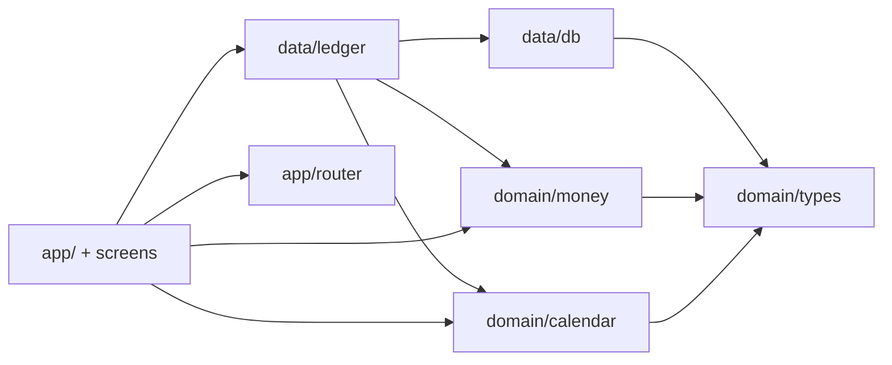

# Slice 01 Program Design Spec — Log spending and see this month by category

- **Gate:** Slice Program Design (workflow step 5)
- **Sources:** `docs/product/slices/slice-01-scope.md`,
  `docs/architecture/north-star.md`,
  `docs/architecture/slices/slice-01-architecture.md`, ADRs 0001/0003/0004/0005,
  `CONTEXT.md`
- **Implementation state:** not built. `src/` contains only `.gitkeep`; no
  `package.json` or tooling exists yet.
- **Endpoints:** none. This is a static PWA; the persistence seam described in
  §9 is the entire application API.

Type shapes, validation rules, and call stacks are included here because they
are the contract. File paths are limited to the module map; visual styling is
deliberately left to the build tickets.

---

## 1. Problem Statement

Individual purchases are remembered, but their monthly shape is not. A
spreadsheet can hold the numbers, yet it turns every purchase into a data-entry
chore and every review into a manual pivot table. The user stops logging in
week three, so the spreadsheet answers nothing.

The user needs to record a purchase at the counter, in seconds, and see this
month's spending by category immediately — on the phone, without a connection,
an account, or a sign-in.

## 2. Solution

An installable, local-first PWA with three screens:

1. **Accounts** — the first-run setup where the user names the accounts they
   spend from and chooses checking, savings, or credit card. No balance is
   required.
2. **Add expense** — one form with amount, category, account, and date. The
   date defaults to today and the last-used account is preselected.
3. **Home** — the current month's total and category breakdown, largest first,
   with previous/next month controls and an add action.

All data lives in IndexedDB on the phone. Saving an expense updates the home
screen through Dexie live queries, with no refresh. The service worker
precaches the app shell so the app opens and records expenses offline after the
first load.

## 3. User Stories

### First-run setup

1. As a first-time user, I want the app to take me straight to account setup,
   so that I can start without hunting through settings.
2. As a first-time user, I want to name an account and choose checking,
   savings, or credit card, so that spending is attributed to the right place.
3. As a first-time user, I want to start without entering a balance, so that
   setup takes seconds rather than a reconciliation exercise.
4. As a first-time user, I want to add several accounts before logging
   anything, so that every purchase has a home.
5. As a first-time user, I want a clear "Start logging" action once at least
   one account exists, so that I know setup is finished.
6. As a returning user, I want to add another account later, so that a new card
   or bank account is covered.
7. As a returning user, I want to correct a mistyped account name, so that my
   history stays readable.
8. As a user, I want duplicate account names to be allowed, so that two cards
   can share a nickname such as "Visa".

### Logging an expense

9. As a phone user, I want an add action on the home screen, so that logging is
   one tap away.
10. As a phone user, I want the date to default to today, so that the common
    case needs no date interaction.
11. As a phone user, I want the last-used account preselected, so that a repeat
    expense is faster.
12. As a phone user, I want to pick from a starter set of categories, so that I
    can log immediately without creating categories first.
13. As a phone user, I want to enter cents with either `.` or `,`, so that my
    phone keyboard's decimal key works.
14. As a phone user, I want an invalid amount rejected with an inline message,
    so that I can fix it without losing the rest of the form.
15. As a phone user, I want to choose a date other than today, so that I can
    record a forgotten purchase.
16. As a phone user, I want to save with one button, so that the flow stays
    under ten seconds.
17. As a phone user, I want repeated taps on save not to create duplicates, so
    that I do not double-log an expense.
18. As a phone user, I want to cancel and return home, so that I am never
    trapped in the form.
19. As a phone user, I want clear field-level errors, so that I know exactly
    what to fix when a save fails.

### Seeing the month

20. As a user, I want the home screen to name the month it is showing, so that
    I know what I am looking at.
21. As a user, I want the total spent this month, so that I see the headline
    number immediately.
22. As a user, I want the breakdown by category largest first, so that the
    biggest driver is obvious.
23. As a user, I want the category rows to add up to the total, so that I trust
    the number.
24. As a user, I want credit-card spending counted exactly like checking
    spending, so that the total reflects all spending.
25. As a user, I want an empty state that tells me how to add the first
    expense, so that a blank month is not a dead end.
26. As a user, I want to go to the previous month, so that I can review
    history.
27. As a user, I want to go to the next month, so that I can return to the
    current month.
28. As a user, I want a backdated expense to appear in its own month, so that
    history is correct even when I log late.
29. As a user, I want the total and breakdown to update immediately after
    saving, so that I see the effect without a refresh.
30. As a user, I want amounts shown in the app's one currency with the correct
    number of decimals, so that values are unambiguous.
31. As a user, I want to reach account management from home, so that I can add
    or rename an account at any time.

### Installed and offline

32. As a phone user, I want to install the app to my home screen, so that it
    opens like an app rather than a browser tab.
33. As a phone user, I want to log an expense with no connection, so that a bad
    signal at the counter does not block me.
34. As a phone user, I want the app to keep working after the first load, so
    that the ledger is always available.
35. As a user, I want my data to stay on my phone, so that I do not need an
    account, sign-in, or server.
36. As a user, I want the app to request persistent storage, so that the
    browser is less likely to evict my ledger.

### Trust and accessibility

37. As a screen-reader user, I want labelled fields, buttons, and month
    controls, so that I can log an expense and navigate months.
38. As a user, I want month controls disabled at the representable calendar
    bounds, so that the app never shows an invalid month.
39. As a user, I want a save failure caused by stale data to tell me which
    field to fix, so that I can recover without reloading.

## 4. System Shape

### 4.1 Module map

| Module | Responsibility | May import |
|---|---|---|
| `src/domain/types.ts` | Row and union types shared by domain, data, and UI | nothing project-local |
| `src/domain/money.ts` | Decimal-string ↔ integer minor-unit parsing and currency formatting | `types` |
| `src/domain/calendar.ts` | Local-date validation, month arithmetic, month labels | `types` |
| `src/data/db.ts` | Dexie database class and schema v1 | `types`, `dexie` |
| `src/data/seed.ts` | The nine starter categories as data | `types` |
| `src/data/ledger.ts` | The only persistence seam: seeding, validation, transactions, reads | `types`, `db`, `money`, `calendar` |
| `src/app/router.ts` | Hash-route parsing, route encoding, navigation, `useHashRoute` | `calendar` |
| `src/app/pwa.ts` | Service-worker registration and persistent-storage request | browser APIs, `virtual:pwa-register` |
| `src/app/App.tsx` | Boot-ready shell, first-run gate, screen switch | `router`, `ledger`, screens |
| `src/app/screens/HomeScreen.tsx` | Month total, category breakdown, month controls, add/accounts entry points | `ledger`, `money`, `calendar`, `router` |
| `src/app/screens/AddExpenseScreen.tsx` | Add-expense form and its state machine | `ledger`, `money`, `calendar`, `router` |
| `src/app/screens/AccountsScreen.tsx` | Account list, add form, inline rename, start-logging action | `ledger`, `router` |
| `src/main.tsx` | Database/ledger construction, `initialize()`, boot-error screen, React mount | `db`, `ledger`, `pwa`, `App` |
| `src/test/setup.ts` | `fake-indexeddb/auto` and jest-dom matchers | test-only |

Dependency direction is one-way:



Rules:

- No UI module imports `data/db` or `dexie`.
- No domain module imports `data/` or `app/`.
- The UI crosses persistence only through the `Ledger` interface.
- There is no repository interface and no fake adapter. Tests use a real
  `BudgetDatabase` on `fake-indexeddb`.
- `data/seed.ts` contains only data; it has no functions and no Dexie import.

### 4.2 Endpoints

There are **no HTTP endpoints**, no `fetch` calls, no server-side validation,
and no sync. Hosting serves static files; all reads and writes are IndexedDB
operations behind `createLedger(db)`.

The operations in §9 are the application's complete API surface. They are
in-process async functions, not network routes.

## 5. Domain Types

```ts
// src/domain/types.ts
export type AccountType = 'checking' | 'savings' | 'credit';
export type EntryKind = 'expense' | 'income' | 'transfer' | 'opening';
export type LocalDate = string; // YYYY-MM-DD
export type MonthKey = string;  // YYYY-MM

export interface Account {
  id: string;        // UUID
  name: string;      // trimmed, 1..60 characters
  type: AccountType;
  createdAt: string; // ISO instant; ordering only
}

export interface Category {
  id: string;        // stable string; seed ids are cat_*
  name: string;      // display name
  archived: boolean;
}

export interface Entry {
  id: string;              // UUID
  kind: EntryKind;
  date: LocalDate;
  amountMinor: number;     // integer minor units
  accountId: string;       // primary/source account
  categoryId?: string;     // expense/income only
  toAccountId?: string;    // transfer destination only
}

export interface Settings {
  id: 'app';
  currency: string;         // ISO 4217 code
  currencyExponent: number; // minor-unit exponent; 2 for CAD
  lastAccountId?: string;
}
```

Notes:

- `Entry` is the north-star union. Slice 1 writes only
  `kind: 'expense'` and never sets `toAccountId`.
- The transfer source is `accountId`. The north-star prose's `fromAccountId`
  is not a separate property; it names the same field. No second source field
  is added.
- `amountMinor` is positive for every kind except `opening`; slice 1 only
  writes positive expenses.
- `LocalDate` and `MonthKey` are aliases, not branded types. Validation
  functions are the gate.
- `Settings.id` is the literal `'app'`; there is exactly one settings row.

## 6. Money Contract

```ts
// src/domain/money.ts
export function parseAmount(input: string, exponent: number): number | null;

export function formatAmount(
  amountMinor: number,
  currency: string,
  exponent: number,
  locale?: string,
): string;
```

Both functions require `exponent` to be an integer in `0..6`. An invalid
exponent is a programming error and throws `RangeError`. `formatAmount` also
requires `amountMinor` to be a safe integer; otherwise it throws `RangeError`.
`parseAmount` returns `null` for every input that is not a valid decimal
amount; it does not throw for bad text.

### 6.1 `parseAmount` grammar

1. Trim leading and trailing whitespace with `String.prototype.trim`.
2. For `exponent === 0`, accept only ASCII digits: `^\d+$`.
3. For `exponent > 0`, accept `^(\d+)(?:[.,](\d+))?$` and require the
   fractional digit count to be at most `exponent`.
4. The whole part must contain at least one digit. The separator, if present,
   must be followed by at least one digit.
5. Convert to minor units as
   `Number(whole) * 10 ** exponent + Number(fraction.padEnd(exponent, '0'))`.
6. Return the result only if it is a safe integer; otherwise return `null`.

Accepted:

| Input (exponent 2) | Result | Why |
|---|---|---|
| `12` | `1200` | no fraction |
| `12.3` | `1230` | one decimal, padded |
| `12,34` | `1234` | comma is a decimal separator |
| `0` | `0` | parses; the write path rejects zero |
| `0.00` | `0` | parses; the write path rejects zero |
| ` 12,34 ` | `1234` | surrounding whitespace trimmed |
| `00012.30` | `1230` | leading zeros allowed |

Rejected (return `null`):

| Input | Why |
|---|---|
| `12.345` | more fraction digits than the exponent |
| `1,234.56` | grouping separators are not accepted |
| `1.234,56` | more than one separator |
| `1,2,3` | more than one separator |
| `-1`, `+1` | signs are not accepted |
| `.5`, `5.` | whole and fraction parts are both required |
| `` (empty), `   ` | no digits |
| `1 000` | internal whitespace |
| `1e3` | exponent notation |
| `NaN`, `Infinity` | not digit strings |
| a value above `Number.MAX_SAFE_INTEGER` | not a safe integer |

`exponent === 0` accepts `12` and rejects `12.5`, `12,0`, `12.`.

### 6.2 `formatAmount`

- Uses
  `new Intl.NumberFormat(locale, { style: 'currency', currency, currencyDisplay: 'symbol', minimumFractionDigits: exponent, maximumFractionDigits: exponent })`.
- Formats `amountMinor / 10 ** exponent`.
- `locale === undefined` means the runtime default locale. Tests always pass
  an explicit locale.
- Negative amounts are rendered by `Intl` with the locale's negative pattern.
- Examples with `locale = 'en-CA'`, `currency = 'CAD'`:
  - `formatAmount(1234, 'CAD', 2, 'en-CA')` → `$12.34`
  - `formatAmount(0, 'CAD', 2, 'en-CA')` → `$0.00`
  - `formatAmount(1200, 'CAD', 0, 'en-CA')` → `$1,200`
  - `formatAmount(-1234, 'CAD', 2, 'en-CA')` → `-$12.34`
- The function is display-only. No arithmetic on the formatted string is
  permitted.

## 7. Calendar Contract

```ts
// src/domain/calendar.ts
export const MIN_MONTH: MonthKey; // '0001-01'
export const MAX_MONTH: MonthKey; // '9999-12'

export function todayLocalDate(now?: Date): LocalDate;
export function monthOf(date: LocalDate): MonthKey;
export function addMonths(month: MonthKey, delta: number): MonthKey;
export function formatMonth(month: MonthKey, locale?: string): string;
export function isValidLocalDate(value: string): boolean;
export function isValidMonthKey(value: string): boolean;
```

`isValidMonthKey` is a sixth export added by this spec so route parsing and
month navigation share one validator. It does not change the five behaviors
the architecture named.

### 7.1 Semantics

- `todayLocalDate(now = new Date())` reads local `getFullYear()`,
  `getMonth()`, and `getDate()` and zero-pads to `YYYY-MM-DD`. It never uses
  UTC. An invalid `Date` throws `RangeError`.
- `monthOf(date)` returns `date.slice(0, 7)` after validating `date`; an
  invalid date throws `RangeError`.
- `isValidLocalDate(value)` accepts only `^\d{4}-\d{2}-\d{2}$` with year
  `0001..9999`, month `01..12`, and a day that exists in that month. Leap years
  use the Gregorian rule: divisible by 4, except centuries not divisible by
  400. It does not use `Date.parse` or `new Date(value)`.
- `isValidMonthKey(value)` accepts only `^\d{4}-(0[1-9]|1[0-2])$` with year
  `0001..9999`.
- `addMonths(month, delta)` requires a valid month and an integer `delta`. It
  computes `year * 12 + (month - 1) + delta`; if the result is outside
  `MIN_MONTH..MAX_MONTH`, it throws `RangeError`. It does not clamp.
- `formatMonth(month, locale)` requires a valid month. It builds a local
  `Date` at noon on the first day using `setFullYear(year, month - 1, 1)` (not
  the two-digit-year-sensitive constructor), then formats with
  `Intl.DateTimeFormat(locale, { month: 'long', year: 'numeric' })`.
  `locale === undefined` means the runtime default. Example:
  `formatMonth('2026-11', 'en-CA')` → `November 2026`.

### 7.2 Boundary behavior

- Home disables the previous control at `MIN_MONTH` and the next control at
  `MAX_MONTH`; it never calls `addMonths` outside the range.
- A route month outside the range is malformed and falls back to the current
  month (§10).
- An expense date outside `0001-01-01..9999-12-31` is invalid and rejected by
  the ledger.

## 8. Storage Contract

```ts
// src/data/db.ts
import Dexie, { type Table } from 'dexie';
import type { Account, Category, Entry, Settings } from '../domain/types';

export const SCHEMA_VERSION = 1;

export class BudgetDatabase extends Dexie {
  accounts!: Table<Account, string>;
  categories!: Table<Category, string>;
  entries!: Table<Entry, string>;
  settings!: Table<Settings, string>;

  constructor(name = 'budget') {
    super(name);
    this.version(SCHEMA_VERSION).stores({
      accounts: 'id, createdAt',
      categories: 'id',
      entries: 'id, date',
      settings: 'id',
    });
  }
}
```

| Table | Primary key | Indexes | Slice-1 row shape |
|---|---|---|---|
| `accounts` | `id` | `createdAt` | `{ id, name, type, createdAt }` |
| `categories` | `id` | none | `{ id, name, archived }` |
| `entries` | `id` | `date` | `{ id, kind, date, amountMinor, accountId, categoryId? }` |
| `settings` | `id` | none | `{ id: 'app', currency, currencyExponent, lastAccountId? }` |

Invariants:

- Database name defaults to `budget`; tests pass a unique name.
- There is no index on `accountId`, `categoryId`, `kind`, or `archived` in
  slice 1.
- No stored balances, monthly totals, or caches.
- `entries.date` is the only filter index; `accounts.createdAt` is used only
  for ordering.
- No Dexie `populate` hook. Seeding is `initialize()`.

### 8.1 Starter categories

`src/data/seed.ts` exports `STARTER_CATEGORIES` as a readonly array of
`Category` rows with `archived: false`:

| id | name |
|---|---|
| `cat_groceries` | Groceries |
| `cat_eating_out` | Eating out |
| `cat_transport` | Transport |
| `cat_housing` | Housing |
| `cat_bills` | Bills |
| `cat_shopping` | Shopping |
| `cat_health` | Health |
| `cat_fun` | Fun |
| `cat_other` | Other |

Ids are stable and opaque. User-created categories in slice 4 will use UUIDs;
nothing in slice 1 parses the id format.

### 8.2 `initialize()` algorithm

`initialize()` runs once at boot, before the first render, and is idempotent
for sequential calls:

1. Open one `rw` transaction over `settings` and `categories`.
2. Read `settings.get('app')`. If absent, add
   `{ id: 'app', currency: 'CAD', currencyExponent: 2 }`. If present, leave it
   untouched, including `lastAccountId`.
3. For each starter category, read by id. If absent, add the row with
   `archived: false`. If present, leave it untouched — including a row that a
   later slice archived or renamed.
4. Do not create accounts.

Sequential idempotence is guaranteed. Concurrent `initialize()` calls from
multiple tabs are outside this slice's single-tab model; the user runs one
installed app instance.

## 9. Ledger Contract

```ts
// src/data/ledger.ts
import type {
  Account, AccountType, Category, Entry, LocalDate, MonthKey, Settings,
} from '../domain/types';
import type { BudgetDatabase } from './db';

export interface AddAccountInput {
  name: string;
  type: AccountType;
}

export interface AddExpenseInput {
  amountMinor: number;
  categoryId: string;
  accountId: string;
  date: LocalDate;
}

export interface CategorySpend {
  categoryId: string;
  name: string;
  amountMinor: number;
}

export interface MonthSummary {
  month: MonthKey;
  totalMinor: number;
  rows: CategorySpend[]; // amount desc, then name asc, then id asc
}

export type LedgerErrorCode =
  | 'invalid-name'
  | 'invalid-account-type'
  | 'invalid-amount'
  | 'invalid-date'
  | 'unknown-account'
  | 'unknown-category';

export class LedgerError extends Error {
  readonly name = 'LedgerError';
  constructor(readonly code: LedgerErrorCode, message: string) {
    super(message);
  }
}

export interface Ledger {
  initialize(): Promise<void>;
  listAccounts(): Promise<Account[]>;
  addAccount(input: AddAccountInput): Promise<Account>;
  renameAccount(id: string, name: string): Promise<void>;
  listCategories(): Promise<Category[]>;
  addExpense(input: AddExpenseInput): Promise<Entry>;
  monthSummary(month: MonthKey): Promise<MonthSummary>;
  getSettings(): Promise<Settings>;
}

export function createLedger(db: BudgetDatabase): Ledger;
```

`createLedger` returns a plain object of closures over `db`. No class, no
`this`, no repository interface.

### 9.1 API surface

| Operation | Input | Success | Failure | Tables written |
|---|---|---|---|---|
| `initialize()` | none | `void` | IndexedDB error | `settings`, `categories` |
| `listAccounts()` | none | `Account[]` ordered by `createdAt` asc, then `id` asc | IndexedDB error | none |
| `addAccount(input)` | `{ name, type }` | new `Account` | `invalid-name`, `invalid-account-type` | `accounts` |
| `renameAccount(id, name)` | id, raw name | `void` | `invalid-name`, `unknown-account` | `accounts` |
| `listCategories()` | none | `Category[]` ordered by `name` asc, then `id` asc; includes archived | IndexedDB error | none |
| `addExpense(input)` | `{ amountMinor, categoryId, accountId, date }` | inserted `Entry` | `invalid-amount`, `invalid-date`, `unknown-account`, `unknown-category` | `entries`, `settings` |
| `monthSummary(month)` | `MonthKey` | `MonthSummary` | `RangeError` for malformed month | none |
| `getSettings()` | none | `Settings` | plain `Error` if `initialize()` has not run | none |

### 9.2 `addAccount`

1. Trim the name.
2. Reject if the trimmed name is empty or longer than 60 characters →
   `LedgerError('invalid-name')`.
3. Reject unless `type` is exactly `checking`, `savings`, or `credit` →
   `LedgerError('invalid-account-type')`.
4. Create `{ id: crypto.randomUUID(), name: trimmed, type, createdAt: new Date().toISOString() }`.
5. Add the row inside a `rw` transaction over `accounts`.
6. Return the row.

Duplicate names are allowed. There is no opening entry. `lastAccountId` is not
changed.

### 9.3 `renameAccount`

1. Trim the name.
2. Reject if empty or longer than 60 characters → `LedgerError('invalid-name')`.
3. In a `rw` transaction over `accounts`, update the row by id with the trimmed
   name.
4. If no row was updated → `LedgerError('unknown-account')`.
5. Return `void`.

Entries reference `accountId`, so no entry is rewritten. No audit trail.

### 9.4 `addExpense`

This is the only function that writes an `Entry` in slice 1. It runs entirely
inside one `rw` transaction over `accounts`, `categories`, `entries`, and
`settings`, with this validation order:

1. Reject unless `amountMinor` is a positive safe integer
   (`Number.isSafeInteger(amountMinor) && amountMinor > 0`) →
   `LedgerError('invalid-amount')`.
2. Reject unless `isValidLocalDate(date)` →
   `LedgerError('invalid-date')`.
3. Read the account by `accountId`; if absent →
   `LedgerError('unknown-account')`.
4. Read the category by `categoryId`; if absent →
   `LedgerError('unknown-category')`.
5. Insert
   `{ id: crypto.randomUUID(), kind: 'expense', date, amountMinor, accountId, categoryId }`.
6. Read `settings.get('app')`. If absent, throw a plain
   `Error('Ledger not initialized')`; the transaction aborts, so no entry is
   written.
7. Put the settings row back with `lastAccountId = accountId`.
8. Return the inserted entry.

The first failing check wins. For example, `amountMinor = 0` with an unknown
account reports `invalid-amount`, not `unknown-account`.

Deliberately absent: duplicate detection, edit/delete, balance updates,
archived-category rejection, and write paths for other kinds. An archived
category is accepted in slice 1 because nothing can archive one until slice 4;
the future slice must decide whether to reject it.

### 9.5 `monthSummary`

1. Require `isValidMonthKey(month)`; otherwise throw `RangeError`.
2. Read `db.entries.where('date').startsWith(month).toArray()` — index-backed.
3. Keep only `kind === 'expense'`.
4. Group by `categoryId`. A missing or `undefined` category id uses the
   sentinel `__uncategorized__`.
5. Sum `amountMinor` per group.
6. Fetch the referenced category rows with `bulkGet`. A missing row keeps the
   group and labels it `Uncategorized`; a real category keeps its stored name,
   archived or not.
7. Build rows `{ categoryId, name, amountMinor }`.
8. Sort rows by `amountMinor` descending, then `name` ascending, then
   `categoryId` ascending.
9. Compute `totalMinor` as the sum of the rows, so the rows always add up to
   the total.
10. Return `{ month, totalMinor, rows }`.

An empty month returns `{ month, totalMinor: 0, rows: [] }`. There is no
account filter: every expense counts, including credit-card expenses. Account
type never enters the query. No monthly totals are stored.

### 9.6 `getSettings` and `list*`

- `getSettings()` reads `settings.get('app')`. If absent, it throws a plain
  `Error('Ledger not initialized')`. This is a programmer error; boot order
  guarantees it cannot happen in the app.
- `listAccounts()` reads all rows and sorts by `createdAt` ascending, then
  `id` ascending. ISO instants sort lexicographically; the id tie-break makes
  the order deterministic when two accounts are created in the same
  millisecond.
- `listCategories()` reads all rows, including archived, and sorts by `name`
  ascending using `localeCompare`, then `id` ascending. There is no archived
  filter in slice 1.

### 9.7 Transactions and concurrency

| Operation | Transaction tables | Mode |
|---|---|---|
| `initialize` | `settings`, `categories` | `rw` |
| `addAccount` | `accounts` | `rw` |
| `renameAccount` | `accounts` | `rw` |
| `addExpense` | `accounts`, `categories`, `entries`, `settings` | `rw` |
| reads | none | read-only |

IndexedDB serializes the write transactions. Two simultaneous `addExpense`
calls both succeed with distinct UUIDs; `lastAccountId` is last-writer-wins.
There is no cross-tab coordination in this slice.

## 10. Routing Contract

```ts
// src/app/router.ts
export type Route =
  | { name: 'home'; month: MonthKey }
  | { name: 'add' }
  | { name: 'accounts' };

export function parseHash(hash: string, today?: LocalDate): Route;
export function routeToHash(route: Route): string;
export function navigate(route: Route, options?: { replace?: boolean }): void;
export function useHashRoute(): Route;
```

### 10.1 Hash grammar

| Hash | Route |
|---|---|
| `''`, `'#'`, `'#/'` | home, current month |
| `'#/?m=2026-11'` | home, November 2026 |
| `'#/?m=2026-11&x=1'` | home, November 2026; other params ignored |
| `'#/?m=2026-13'` | home, current month (malformed `m`) |
| `'#/?m=2026-11&m=2025-01'` | home, November 2026 (first `m` wins) |
| `'#/add'` | add |
| `'#/add?m=2026-11'` | add; query ignored |
| `'#/accounts'` | accounts |
| `'#/accounts?x=1'` | accounts; query ignored |
| `'#/nope'`, `'#/add/'`, `'#//'` | home, current month (unknown route) |

Parsing rules:

- Strip one leading `#`.
- Split on the first `?`. The path is case-sensitive.
- `/add` and `/accounts` match exactly; a trailing slash is unknown.
- Any other path, including empty, is home.
- For home, parse the query with `URLSearchParams`; use the first `m`.
  Accept it only if `isValidMonthKey(m)`. Otherwise use
  `monthOf(todayLocalDate())`.
- The URL is not rewritten when a malformed month or unknown route falls back.
  The fallback is a rendering decision, not a redirect.

### 10.2 Encoding and navigation

- `routeToHash({ name: 'home', month })` → `#/?m=<month>` (always explicit).
- `routeToHash({ name: 'add' })` → `#/add`.
- `routeToHash({ name: 'accounts' })` → `#/accounts`.
- `navigate(route)` assigns `window.location.hash = routeToHash(route)`.
  This adds a history entry and fires `hashchange`.
- `navigate(route, { replace: true })` calls
  `window.location.replace(routeToHash(route))`. This replaces the current
  history entry and fires `hashchange`, so the back button does not return to
  a route the gate immediately rejects.
- Assigning the current hash is a no-op; no event fires and no re-render is
  required.
- `useHashRoute` holds `parseHash(window.location.hash)` in `useState` and
  re-parses on every `hashchange`; it also re-parses once when the effect
  mounts. It does not poll and does not use `useSyncExternalStore`.

### 10.3 Navigation rules

| Trigger | Destination |
|---|---|
| App opens at `#/` | home, current month |
| First-run gate with zero accounts | accounts, via `replace` |
| Home "Add expense" / empty-state CTA | add |
| Home "Accounts" | accounts |
| Home previous | home, `addMonths(month, -1)`, disabled at `MIN_MONTH` |
| Home next | home, `addMonths(month, +1)`, disabled at `MAX_MONTH` |
| Add save success | home, `monthOf(entry.date)` |
| Add cancel | home, current month |
| Accounts "Start logging" | home, current month |
| Accounts screen after first account is added | stays on accounts; gate is gone; "Start logging" appears |

## 11. Boot and Call Stacks

### 11.1 Boot

```text
main.tsx
  const db = new BudgetDatabase()
  const ledger = createLedger(db)
  try:
    await ledger.initialize()
  catch error:
    render <BootError error={error} />
    return
  createRoot(root).render(<StrictMode><App ledger={ledger} /></StrictMode>)
  void requestPersistentStorage()   // fire-and-forget
  registerPwa()                     // fire-and-forget
```

- `initialize()` completes before the first app render.
- A boot failure renders a plain error screen with the text
  "Budget couldn't open its local data." and a "Reload" button calling
  `location.reload()`. There is no retry loop and no partial app.
- `requestPersistentStorage()` and `registerPwa()` never block rendering and
  never surface failures in the UI.
- `StrictMode` is on in development; `initialize()` is outside React, so it is
  not double-run by StrictMode.

### 11.2 First-run gate

```text
App(ledger)
  const route = useHashRoute()
  const accounts = useLiveQuery(() => ledger.listAccounts(), [ledger])

  useEffect:
    if accounts !== undefined
       && accounts.length === 0
       && route.name !== 'accounts':
      navigate({ name: 'accounts' }, { replace: true })

  if accounts === undefined: return <Loading />
  if accounts.length === 0 && route.name !== 'accounts': return <Loading />

  switch route.name:
    'home'     -> <HomeScreen ledger={ledger} month={route.month} />
    'add'      -> <AddExpenseScreen ledger={ledger} />
    'accounts' -> <AccountsScreen ledger={ledger} />
```

- `undefined` from `useLiveQuery` means "not loaded yet"; it is never treated
  as an empty list.
- The gate is derived from account count, not a persisted setup flag.
- With zero accounts, every route except `accounts` is replaced. A deep link
  to `#/add` is therefore lost; after setup the user taps "Start logging" and
  then "Add expense".
- Adding the first account makes `accounts.length > 0`; the gate condition
  becomes false and the screen stays on accounts. No automatic navigation.
- There is no runtime React error boundary in slice 1. Live-query failures are
  programmer errors; boot failure is the only handled fatal path.

### 11.3 Home render and month navigation

```text
HomeScreen(ledger, month)
  const summary = useLiveQuery(() => ledger.monthSummary(month), [ledger, month])
  const settings = useLiveQuery(() => ledger.getSettings(), [ledger])

  if summary === undefined || settings === undefined: return <Loading />

  render:
    <h1>{formatMonth(month)}</h1>
    total = formatAmount(summary.totalMinor, settings.currency, settings.currencyExponent)
    <p>Spent <strong>{total}</strong></p>
    if summary.rows.length === 0:
      empty state with add CTA
    else:
      <ul> rows: name + formatAmount(row.amountMinor, ...) </ul>
    previous button: disabled when month === MIN_MONTH
    next button: disabled when month === MAX_MONTH
    add button: navigate({ name: 'add' })
    accounts link: navigate({ name: 'accounts' })
```

The month comes only from the route. There is no separate month state. Changing
the month changes the `useLiveQuery` dependency and therefore the query.

### 11.4 Add-expense submit

The screen loads accounts, categories, and settings before rendering the form.
The form is a child component that mounts only when all three queries have
resolved, so its initial state is computed once with `useState`:

```text
AddExpenseScreen(ledger)
  accounts   = useLiveQuery(() => ledger.listAccounts(), [ledger])
  categories = useLiveQuery(() => ledger.listCategories(), [ledger])
  settings   = useLiveQuery(() => ledger.getSettings(), [ledger])
  if any undefined: return <Loading />
  if accounts.length === 0: return "Add an account before logging an expense." + link
  if categories.length === 0: return "No categories are available." + disabled form
  return <AddExpenseForm accounts categories settings ledger />

AddExpenseForm initial state:
  amountText: ''
  categoryId: null
  accountId: settings.lastAccountId exists in accounts
               ? settings.lastAccountId
               : accounts[0]?.id ?? null
  date: todayLocalDate()
  errors: {}
  submitting: false
  submittingRef: useRef(false)   // synchronous lock, not a render value
```

This avoids a `useEffect` race where a late-arriving settings/account query
could overwrite a choice the user already made.

Submit:

```text
onSubmit(event):
  event.preventDefault()
  if submittingRef.current: return
  errors = {}

  amountMinor = parseAmount(amountText, settings.currencyExponent)
  if amountMinor === null || amountMinor <= 0:
    errors.amount = "Enter an amount greater than zero."
  if categoryId === null:
    errors.category = "Choose a category."
  if accountId === null:
    errors.account = "Choose an account."
  if !isValidLocalDate(date):
    errors.date = "Choose a valid date."

  if errors is non-empty:
    setErrors(errors); return

  submittingRef.current = true
  setSubmitting(true)
  try:
    entry = await ledger.addExpense({ amountMinor, categoryId, accountId, date })
    navigate({ name: 'home', month: monthOf(entry.date) })
  catch error:
    if error instanceof LedgerError:
      setErrors(mapLedgerError(error.code))
    else:
      setErrors({ form: "Could not save the expense. Try again." })
  finally:
    submittingRef.current = false
    setSubmitting(false)
```

- The save button is `type="submit"` and disabled while `submitting`.
- `submittingRef` is set synchronously before the first `await`, so a second
  event that fires before React re-renders still sees the lock. The `submitting`
  state exists only to drive the disabled attribute and label.
- Field errors clear when the corresponding field changes.
- A successful save navigates away; the form does not need a reset path.
- The UI pre-validates for field-level messages, but the ledger remains the
  source of truth and its errors are still mapped.

### 11.5 Accounts add and rename

```text
AccountsScreen(ledger)
  accounts = useLiveQuery(() => ledger.listAccounts(), [ledger])
  if undefined: return <Loading />

  render:
    <h1>Accounts</h1>
    if accounts.length === 0: intro copy
    list rows: name, type label, "Rename"
    <AccountForm ledger />
    if accounts.length > 0: "Start logging" -> home current

AccountForm:
  state: name='', type='checking', submitting=false, error=null
  busyRef: useRef(false)
  submit:
    if busyRef.current: return
    busyRef.current = true
    setSubmitting(true)
    try:
      await ledger.addAccount({ name, type })
      reset name='', type='checking', error=null
    catch LedgerError:
      map code to inline error
    finally:
      busyRef.current = false
      setSubmitting(false)

Rename row:
  click "Rename" -> editingId=id, draftName=account.name, renameError=null
  renamingRef: useRef(false)
  Enter or "Save":
    if renamingRef.current: return
    renamingRef.current = true
    setRenaming(true)
    try:
      await ledger.renameAccount(id, draftName)
      editingId=null
    catch LedgerError:
      map code to inline error
    finally:
      renamingRef.current = false
      setRenaming(false)
  Escape or "Cancel": editingId=null, renameError=null
```

- The account list updates through the live query after add/rename.
- Adding an account does not navigate.
- Duplicate names are accepted.
- There is no delete control and no balance field.

### 11.6 Live updates

```text
addExpense transaction commits
  -> Dexie notifies live queries that read entries/settings
  -> HomeScreen's monthSummary query re-runs
  -> App's listAccounts query re-runs (settings change is irrelevant to it)
  -> AccountsScreen's listAccounts query re-runs
  -> AddExpenseScreen is unmounted by the route change
```

No manual cache, event bus, refresh button, or query invalidation exists.
`useLiveQuery` is the only subscription mechanism.

### 11.7 PWA boot

```text
after first render:
  requestPersistentStorage():
    if navigator.storage?.persist exists:
      void navigator.storage.persist().catch(() => undefined)
  registerPwa():
    registerSW({ immediate: true })
```

The persist result is ignored in slice 1. The storage warning is slice 3.

## 12. UI Contract

### 12.1 Global states

| State | Rendering |
|---|---|
| Boot in progress | Nothing is rendered until `initialize()` resolves; the browser shows the static HTML shell. |
| Boot failed | Error screen: "Budget couldn't open its local data." + "Reload". |
| Live query loading | Text `Loading…`; no empty state, no forms. |
| Zero accounts | Accounts screen, forced by the gate. |
| Ready | The route's screen. |

Visual styling is ticket-level. The following structure and behavior are not.

### 12.2 Home screen

- `<h1>` contains `formatMonth(month)`.
- Total line contains the label `Spent` and the formatted total.
- Category rows are a list; each row shows the category name and the formatted
  amount. Rows are already sorted by the ledger.
- Empty state: text `No spending yet this month.` and a button
  `Add your first expense`.
- Non-empty state: a primary button `Add expense`.
- Month controls: buttons labelled `Previous month` and `Next month`
  (accessible names), disabled at `MIN_MONTH` / `MAX_MONTH`.
- Accounts link: `Accounts`.
- No account filter, no last-month comparison, no charts.

### 12.3 Add-expense screen

- `<h1>` is `Add expense`.
- Amount field: `<input type="text" inputMode="decimal" autoComplete="off">`,
  label `Amount`. Text input, not `type="number"`, so both `.` and `,` reach
  the parser unchanged.
- Category field: a radio-style group of buttons, one per category from
  `listCategories`, labelled with the category name. No default selection.
  Each button uses `aria-pressed`. Buttons are `type="button"` so they do not
  submit the form.
- Account field: a radio-style group of buttons, one per account, labelled
  `<name> · <type label>` where type label is `Checking`, `Savings`, or
  `Credit card`. Default is `lastAccountId` if it exists, otherwise the first
  account in `listAccounts` order.
- Date field: `<input type="date">`, label `Date`, value `todayLocalDate()` at
  form mount. No min/max.
- Save button: `Save`, `type="submit"`, disabled while submitting.
- Cancel button: `Cancel`, navigates to home, current month.
- Field errors render next to the field and are referenced by
  `aria-describedby`. A form-level error uses `role="alert"`.
- The form is single-column and usable with one thumb; controls have visible
  focus states and a minimum 44×44 CSS-pixel hit area.

### 12.4 Accounts screen

- `<h1>` is `Accounts`.
- Empty state intro: `Add the accounts you spend from. You can start without a
  balance.`
- Each account row shows the name and the type label, plus a `Rename` button.
- Rename mode replaces the row's name with a text input prefilled with the
  current name, plus `Save` and `Cancel` buttons. Enter saves; Escape cancels.
- Add form: name input labelled `Account name`; type select labelled
  `Account type` with options `Checking`, `Savings`, `Credit card`; submit
  button `Add account`. Default type is `Checking`. The name input and the
  rename input set `maxLength={60}`; the ledger still validates the trimmed
  length.
- Once at least one account exists, a `Start logging` button is visible and
  navigates home, current month.
- No delete, no balance, no archived state.

### 12.5 Error mapping

| `LedgerErrorCode` | Surface | User-facing text |
|---|---|---|
| `invalid-name` | add account / rename account | `Enter an account name of 60 characters or fewer.` |
| `invalid-account-type` | add account | `Choose a valid account type.` |
| `invalid-amount` | add expense amount | `Enter an amount greater than zero.` |
| `invalid-date` | add expense date | `Choose a valid date.` |
| `unknown-account` | add expense account | `That account no longer exists. Choose another.` |
| `unknown-account` | rename account | `That account no longer exists.` |
| `unknown-category` | add expense category | `That category no longer exists. Choose another.` |
| unexpected error | add expense | `Could not save the expense. Try again.` |
| unexpected error | add/rename account | `Could not save the account. Try again.` |

Tests assert the `code`, never the message text. The copy table is the source
for UI tests that assert accessible names.

## 13. PWA Contract

### 13.1 Vite plugin

```ts
VitePWA({
  registerType: 'autoUpdate',
  manifest: {
    name: 'Budget',
    short_name: 'Budget',
    description: 'A local-first ledger for this month’s spending.',
    start_url: '/',
    scope: '/',
    display: 'standalone',
    background_color: '#ffffff',
    theme_color: '#0f172a',
    icons: [
      { src: 'icons/icon-192.png', sizes: '192x192', type: 'image/png', purpose: 'any' },
      { src: 'icons/icon-512.png', sizes: '512x512', type: 'image/png', purpose: 'any' },
      { src: 'icons/maskable-512.png', sizes: '512x512', type: 'image/png', purpose: 'maskable' },
    ],
  },
  workbox: {
    globPatterns: ['**/*.{js,css,html,svg,png,ico,woff2}'],
    navigateFallback: 'index.html',
    runtimeCaching: [],
    cleanupOutdatedCaches: true,
  },
})
```

### 13.2 Shell and icons

- `index.html` has `<div id="root">`, `<title>Budget</title>`, a mobile
  viewport meta tag, and `<link rel="apple-touch-icon" href="/icons/apple-touch-icon-180.png">`.
- Static assets:
  - `public/icons/icon-192.png`
  - `public/icons/icon-512.png`
  - `public/icons/maskable-512.png`
  - `public/icons/apple-touch-icon-180.png`
- iOS status-bar metadata is build detail; it does not change behavior.

### 13.3 Offline and updates

- Workbox precaches the built shell and uses `navigateFallback: 'index.html'`.
- There is no runtime caching and no network call in application code.
- After the first successful load, every read and write is IndexedDB; the app
  opens and records expenses offline.
- `registerSW({ immediate: true })` from `virtual:pwa-register` is called once
  after first render. There is no update prompt; `autoUpdate` is the policy.
- Auto-update is safe while the schema stays at v1. Future schema changes are
  forward-only Dexie upgrades paired with the export `schemaVersion` in slice
  3.
- `navigator.storage.persist()` is requested once at boot if available; its
  result is not surfaced in this slice.
- No storage warning, no backup UI, no export.

## 14. Tooling and Project Setup

The repo is empty of code, so the first build ticket establishes this baseline.

### 14.1 Dependencies

Runtime:

- `react`, `react-dom`
- `dexie`, `dexie-react-hooks`

Development:

- `typescript`, `vite`, `@vitejs/plugin-react`
- `vite-plugin-pwa`
- `vitest`, `jsdom`
- `@testing-library/react`, `@testing-library/user-event`,
  `@testing-library/jest-dom`
- `fake-indexeddb`

No router, state manager, form library, validation library, CSS framework, or
date library is added.

### 14.2 Scripts

| Script | Command |
|---|---|
| `dev` | `vite` |
| `build` | `tsc --noEmit && vite build` |
| `preview` | `vite preview` |
| `test` | `vitest run` |
| `test:watch` | `vitest` |
| `typecheck` | `tsc --noEmit` |

### 14.3 TypeScript and Vite

- `tsconfig.json`: `strict: true`, `noUncheckedIndexedAccess: true`,
  `verbatimModuleSyntax: true`, `jsx: "react-jsx"`, `target: "ES2022"`,
  `lib: ["ES2022", "DOM", "DOM.Iterable"]`, `moduleResolution: "bundler"`.
- `vite.config.ts`: `defineConfig` from `vitest/config`, React plugin, plus
  the PWA plugin from §13.1.
- `src/vite-env.d.ts` references `vite/client` and `vite-plugin-pwa/client` so
  `virtual:pwa-register` and asset imports typecheck.
- Vitest config: `environment: 'jsdom'`,
  `setupFiles: ['./src/test/setup.ts']`, `globals: false`; tests import
  `describe`, `it`, `expect`, and `vi` from `vitest`.
- `src/test/setup.ts` imports `fake-indexeddb/auto` and
  `@testing-library/jest-dom/vitest`.
- One plain global stylesheet (`src/styles.css`); no CSS modules or framework.

## 15. Testing Decisions

### 15.1 Seams

The slice has three test seams, all established by the architecture:

1. **Domain pure functions** — `money.ts` and `calendar.ts`.
2. **Ledger integration** — `createLedger(real BudgetDatabase)` with a fresh
   database per test.
3. **UI integration** — `App` rendered with a real ledger on
   `fake-indexeddb`, plus the pure router functions.

No new seam is introduced. There is no repository interface, no mocked ledger,
and no mock of Dexie internals. `fake-indexeddb` is the system boundary.

### 15.2 What makes a good test here

- Test external behavior at the highest seam that can observe it.
- Assert `LedgerError.code`, not message text.
- Use known-good literals and worked examples, not values recomputed the way
  the implementation computes them.
- Do not assert private helpers, call counts, or call order.
- Use `waitFor` for live-query updates; never sleep.
- Use explicit locales in money/calendar tests; never depend on the CI locale
  for exact formatted strings.
- Use explicit months and dates in UI tests; do not depend on the wall clock
  except for the "date defaults to today" assertion, which compares against
  `todayLocalDate()`.
- No fake timers and no `setTimeout`/`sleep` in tests.
- Each test gets a unique database name
  (`budget-test-${crypto.randomUUID()}`) and deletes it in `afterEach`.
- If the installed jsdom version does not expose `crypto.randomUUID`, the test
  setup supplies it from `node:crypto`. This is a test-only polyfill; the app
  uses Web Crypto directly.

### 15.3 Module coverage

**`money.ts` unit tests**

- `parseAmount`: the accepted and rejected table in §6.1; exponent 0; exponent
  2; leading zeros; whitespace; safe-integer overflow.
- `formatAmount`: exponent 0 and 2, zero, negative, explicit `en-CA`; invalid
  exponent and unsafe amount throw.

**`calendar.ts` unit tests**

- `todayLocalDate` with a local `Date` near midnight; zero padding.
- `monthOf` valid and invalid.
- `addMonths` forward/backward across year boundaries; 12-month steps;
  `MIN_MONTH`/`MAX_MONTH` throws; non-integer delta throws.
- `isValidLocalDate`: leap day, non-leap Feb 29, century leap years (1900
  false, 2000 true), month 13, day 32, wrong padding, year 0000, trailing
  space.
- `isValidMonthKey`: valid, month 00/13, wrong padding, year 0000.
- `formatMonth`: `2026-11` with `en-CA` → `November 2026`; year boundary.

**`router.ts` unit tests**

- The full hash table in §10.1.
- `routeToHash` for all three route shapes.
- Malformed `m` and unknown routes fall back without rewriting the hash.

**`ledger.ts` integration tests**

- `initialize` seeds nine categories and CAD settings; a second call is a
  no-op; an archived/renamed existing category is not overwritten.
- `listAccounts` ordering; `listCategories` ordering including archived.
- `addAccount`: trim; empty/whitespace/61-character name → `invalid-name`;
  invalid type → `invalid-account-type`; duplicate names allowed; UUID and ISO
  `createdAt`; no opening entry.
- `renameAccount`: trim; empty → `invalid-name`; unknown id →
  `unknown-account`; entries still reference the id and are unchanged.
- `addExpense`: one expense written; `lastAccountId` updated; every invalid
  input produces the matching code; validation order (for example, zero amount
  plus unknown account → `invalid-amount`); archived category accepted.
- `monthSummary`: totals across checking and credit; grouping; largest-first
  order with name/id tie-breaks; rows sum to total; other months excluded;
  backdated entry in its month; empty month; missing category becomes
  `Uncategorized`; non-expense rows are ignored.
- `getSettings`: returns the seeded row; missing row throws a plain `Error`.

The non-expense and missing-category cases need raw `db.entries.add` fixtures
because slice 1's write path cannot produce them. This is fixture setup, not a
mock; the read model is still exercised through the `Ledger` seam.

**UI tests (RTL, real ledger, `waitFor`)**

- First run with zero accounts forces the accounts screen, including a deep
  link to `#/add`.
- Adding an account reveals `Start logging`; clicking it reaches home.
- Adding a second account and renaming it updates the list.
- Add flow: amount, category, account, save → home shows the new total and
  category row.
- Date defaults to `todayLocalDate()`.
- Last-used account is preselected on the next add.
- Backdated expense lands on its month, not the current one.
- Previous/next month changes the heading and the query.
- Empty month shows the empty state and CTA.
- Credit-card expense counts in the total.
- Zero amount shows the amount error and writes nothing.
- Unknown category/account from a stale form maps to the right field error
  (seed the form, then delete the row before submit).
- Save button is disabled while submitting; no duplicate entry after a rapid
  double click.
- Month controls are disabled at `MIN_MONTH` / `MAX_MONTH`.

**Manual verification**

- `npm run build`, `npm run preview`, install on a phone or mobile emulation,
  go offline, add an expense, verify the total.
- Repeat with a backdated date and a credit account.
- Verify the installed app opens standalone and that a second launch works
  offline.

### 15.4 Prior art

None. This is the first slice and the first test suite; it establishes the
patterns above for later slices.

## 16. Prototype Check

A throwaway logic prototype (`/tmp/slice-01-prototype.ts`, run with `bun`) was
used to sanity-check the state model before locking it in. It was not committed
and is not part of the app.

What it simulated:

- Zero-account boot with `#/` and `#/add` → forced to `#/accounts`.
- Existing-account boot → home current month; add form preselects
  `lastAccountId`, defaults to today, and leaves category unset.
- Zero-amount submit → field error, no write.
- Valid backdated `12,34` submit → home at the entry's month, `lastAccountId`
  updated, one expense written.
- Double submit → ignored.
- Month stepping across a year boundary.
- Malformed month and unknown route fallbacks.
- The `parseAmount` accepted/rejected table, including exponent 0.

Result: all 31 checks passed. Verdict: the gate/route/form state model
composes without contradictory states, and the initial-state-after-queries
design avoids the late-query race. The decisions in §11 reflect the prototype.

No visual UI prototype was built. The scope fixes the flow and the form
contents; the remaining visual choices are ticket-level and do not change the
state model.

## 17. Open Questions Resolved

| Area | Question | Resolution |
|---|---|---|
| API | Are there HTTP endpoints? | No. The `Ledger` operations are the only API. |
| API | Is there a repository interface or fake adapter? | No. One Dexie adapter; tests use a real database on `fake-indexeddb`. |
| Types | Is transfer source `accountId` or `fromAccountId`? | `accountId`. `fromAccountId` is prose for the same field; no second property. |
| Types | Does `EntryKind` include `opening`? | Yes, per the north star. `CONTEXT.md`'s three-kind list is stale (see §19). |
| Types | Is `Settings.id` a string or literal? | Literal `'app'`. |
| Types | Are `LocalDate`/`MonthKey` branded? | No; aliases plus validators. |
| Money | Which decimal separators are accepted? | One `.` or one `,`; never both; no grouping separators. |
| Money | Are signs accepted? | No. |
| Money | Is zero parseable? | Yes, as `0`; `addExpense` rejects it. |
| Money | How many decimals? | At most `currencyExponent`; fewer are padded; more are rejected. |
| Money | What about exponent 0? | Only digits; no separator. |
| Money | What happens on an invalid exponent? | `RangeError` (programmer error). |
| Money | Default formatting locale? | Runtime default; tests pass an explicit locale. |
| Money | Is formatting exact for large amounts? | Display-only division; amounts are safe integers and exponent ≤ 6. |
| Calendar | What is "today"? | Local calendar date from local getters, never UTC. |
| Calendar | How are invalid dates validated? | Gregorian arithmetic, not `Date.parse`. |
| Calendar | What are the month bounds? | `0001-01`..`9999-12`; controls disable at the bounds; `addMonths` throws outside. |
| Calendar | How is a month label built? | Local noon on the first, `setFullYear`, `Intl` month+year. |
| Calendar | Is `isValidMonthKey` added? | Yes, a sixth calendar export, shared by router and navigation. |
| Storage | Which tables and indexes? | Exactly §8; no extra indexes. |
| Storage | When is seeding run? | `initialize()` at boot, idempotently, before first render. |
| Storage | Does seeding overwrite an archived/renamed category? | No. Existing rows are never touched. |
| Storage | Does `initialize()` create accounts? | No; zero accounts is the first-run gate. |
| Ledger | Account name rules? | Trim; 1..60 characters; duplicates allowed. |
| Ledger | Account type rules? | Exactly `checking`, `savings`, or `credit`. |
| Ledger | Does adding an account create an opening entry? | No; slice 6 adds opening balances. |
| Ledger | Does adding an account change `lastAccountId`? | No; only `addExpense` does. |
| Ledger | Rename semantics? | Update the account row; entries reference the id; no audit. |
| Ledger | Expense validation order? | Amount → date → account → category. |
| Ledger | Is an archived category rejected? | No in slice 1; nothing can archive one yet. |
| Ledger | Is there duplicate detection? | No. |
| Ledger | What updates `lastAccountId`? | `addExpense`, inside its transaction. |
| Ledger | What if settings are missing during `addExpense`? | Plain `Error`; transaction aborts; no entry. |
| Ledger | What does `monthSummary` count? | `kind === 'expense'` only; all accounts, including credit. |
| Ledger | How are missing categories labelled? | `Uncategorized`; the row is kept so the total invariant holds. |
| Ledger | What is the row sort? | Amount desc, name asc, category id asc. |
| Ledger | Is `totalMinor` recomputed? | Yes, from rows. |
| Ledger | Are monthly totals stored? | No. |
| Routing | What are the routes? | `#/`, `#/?m=YYYY-MM`, `#/add`, `#/accounts`. |
| Routing | Unknown route or malformed `m`? | Render home/current; do not rewrite the URL. |
| Routing | Is the router a dependency? | No; `useState` + `hashchange`. |
| Routing | First-run redirect: push or replace? | `location.replace` (replace). |
| Routing | After save? | Home at `monthOf(entry.date)`, with explicit `?m=`. |
| Routing | Cancel/back target? | Home, current month. |
| UI | When is the add form initialized? | After accounts/categories/settings resolve, via a child `useState` initializer. |
| UI | Account default when `lastAccountId` is missing? | First account in `createdAt`/`id` order. |
| UI | Category default? | None. |
| UI | Amount input type? | Text with `inputMode="decimal"`, not `type="number"`. |
| UI | Category/account controls? | Radio-style button chips with `aria-pressed`. |
| UI | Double submit? | Synchronous `useRef` lock plus a disabled button while submitting. |
| UI | What is `undefined` from `useLiveQuery`? | Loading, never empty. |
| UI | Runtime error boundary? | None in slice 1; boot failure is handled. |
| UI | Visual styling? | Ticket-level; structure, copy, and states are fixed here. |
| PWA | Update policy? | `autoUpdate`; no prompt. |
| PWA | Persist result? | Ignored; warning is slice 3. |
| PWA | Runtime caching? | None. |
| PWA | Icons? | 192/512/maskable 512/apple-touch 180. |
| Tooling | Router/state/form/CSS libraries? | None; plain React, hash routing, plain CSS. |
| Testing | Are ledger/Dexie internals mocked? | No; real ledger on `fake-indexeddb`. |
| Testing | Fake timers? | No; explicit dates/months, real clock only for the today default. |

## 18. Out of Scope

- Editing or deleting entries; the per-category entry list — slice 2.
- Export/import, `schemaVersion` file, backup UI, storage warning — slice 3.
- Adding, renaming, or archiving categories; category management UI — slice 4.
- Last-month comparison — slice 5.
- Account balances, opening balances, balance display — slice 6.
- Income — slice 7.
- Transfers, including credit-card payments — slice 8.
- Account deletion.
- Settings screen, currency change, locale setting, multi-currency.
- Bank sync, CSV import, OCR, recurring templates, budgets, forecasts,
  investments, sharing, auth, sync, laptop view.
- Custom categories in slice 1.
- Any `opening`, `income`, or `transfer` write path; any `toAccountId` write.
- Any HTTP endpoint, server-side validation, or network data call.
- Runtime error boundary, analytics, telemetry, migration tooling.
- Visual design system, CSS framework, component library.

## 19. Further Notes

- **Glossary drift:** `CONTEXT.md` defines `Entry` as exactly one of three
  kinds (expense, income, transfer), while the north star and slice
  architecture include `opening` as a fourth. This spec follows the north star:
  `EntryKind` includes `opening`. `CONTEXT.md` should be updated at the next
  domain-modeling pass; it is not edited by this gate.
- **North-star naming:** the north-star table says `fromAccountId` for a
  transfer, while its ER diagram and the slice architecture use `accountId`.
  This spec treats `accountId` as the source and adds no `fromAccountId`
  property. Slice 8 can rename the field only with a schema migration.
- **Write-path naming:** the north star calls the single entry write path
  `createEntry`; slice 1 calls its form `addExpense`. `addExpense` is the
  slice-1 implementation of that rule and the only entry writer. Later kinds
  extend it rather than adding a second path.
- **Single tab:** the product is one phone and one installed app instance.
  Cross-tab live-query coordination and concurrent `initialize()` calls are
  outside this slice.
- **No migration yet:** schema v1 is the first schema. Slice 3 pairs any
  forward-only Dexie upgrade with the export `schemaVersion`.
- **No storage warning yet:** `navigator.storage.persist()` is requested, but
  the UI does not report the result until slice 3.
- **Boot failure:** the only handled fatal path is a failed `initialize()`.
  A live-query rejection is treated as a programmer error; there is no React
  error boundary in this slice.
- **Docs:** this spec is the implementation contract for the ticket breakdown.
  If the build discovers a contradiction, the spec is updated in the same
  change rather than silently diverging.
