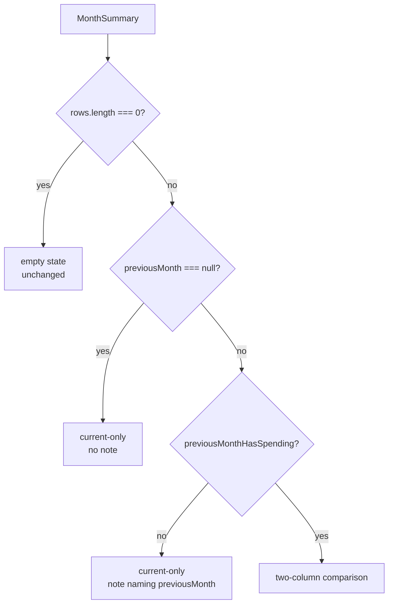

# Slice 05 Program Design Spec — Compare with last month

- **Gate:** Slice Program Design (workflow step 5).
- **Status:** built and closed 2026-11-10 on `slice-05` (commits `7462530`,
  `22e26ae`, `2dfb55a`), reviewed with zero findings, merged into `master`
  (`128a45f`) and deployed on 2026-11-11. The build matched this spec; no
  divergence was found at close-out.
- **Sources:** `docs/product/slices/slice-05-scope.md`,
  `docs/architecture/north-star.md`,
  `docs/architecture/slices/slice-05-architecture.md`, ADRs 0001/0005,
  `CONTEXT.md`, and the current `src/` read paths.
- **Endpoints:** none. The app is static files plus IndexedDB (ADR 0001);
  `Ledger` is the whole application API. This slice adds no route, no network
  call, and no new screen.
- **Prototype:** two throwaway checks — a read-model harness and a 3-variant UI
  prototype — resolved four details the architecture left open. What was tried
  and what changed is recorded in §9.

---

## 1. Problem Statement

The home screen shows one month at a time. It answers "what did I spend?" but
not "is that more or less than usual?" A category's amount with nothing beside
it forces the user to remember last month or open a spreadsheet to know whether
the number moved. The vision's headline is not one month's breakdown; it is
this month's breakdown **with last month beside it**.

## 2. Solution

The home breakdown shows each category's spending for the month on screen and
for the calendar month immediately before it, side by side and labelled with
both months. A category appears when it has spending in either month, with `0`
on the side that has none. Current-month amounts still sum to the month total;
the previous-month column never enters it. When the previous month has no
spending, the screen says so in one line instead of drawing a column of zeros.
When the month on screen has no spending but the previous month does, the rows
still render with `0` for the current month so the drop is visible.

The comparison is derived at read time from the existing `entries` table. No
table, index, schema version, backup version, route, or write path changes.
`monthSummary(month)` grows three fields; `HomeScreen` grows one presentation
state.

## 3. User Stories

### Seeing last month beside this month

1. As a user, I want each category's amount for the month on screen shown beside
   that category's amount for the month before, so that I can read the change
   without subtracting.
2. As a user, I want both amounts labelled with the months they cover, so that
   I always know which column is which.
3. As a user, I want the month's total to remain the total for the month on
   screen, so that last month's amounts never change what I spent this month.
4. As a user, I want the comparison to follow the month I am viewing, so that
   moving to an earlier or later month compares it with the month before that
   one.
5. As a user, I want January compared with the previous December, so that the
   year boundary is not a gap.
6. As a user, I want the two amounts shown as plain numbers with no arrows,
   percentages, or difference column, so that I read the change myself.
7. As a user, I want no overall last-month total beside the headline, so that
   the headline stays the month on screen.
8. As a user, I want the comparison only on home, so that every other screen
   keeps its current job.

### Which categories appear

9. As a user, I want a category to appear when it has spending in either month,
   so that a drop to nothing stays visible.
10. As a user, I want a category with spending in both months to show both
    amounts, so that the size of the change is visible.
11. As a user, I want a category with spending only in the month on screen to
    show `0` for the month before, so that a new cost is obvious.
12. As a user, I want a category with spending only in the month before to
    appear with `0` for the month on screen, so that a stopped cost is obvious.
13. As a user, I want a category with no spending in either month to be absent,
    so that the breakdown has no empty rows.
14. As a user, I want income, transfers, and opening balances excluded from both
    columns, so that "spending" means the same thing it always did.

### Ordering

15. As a user, I want rows with spending in the month on screen first, largest
    first, so that the month I am viewing leads.
16. As a user, I want categories with nothing in the month on screen to follow,
    largest in the month before first, so that the biggest drop is easy to find.
17. As a user, I want the current-month order to be exactly what it was before
    this slice, so that the previous column never reorders my usual breakdown.

### Moving between months

18. As a user, I want the previous and next month controls to keep working
    unchanged, so that navigation does not acquire a second mode.
19. As a user, I want the comparison to recompute when I move months, so that
    the two columns always describe the month on screen and its predecessor.
20. As a user, I want the earliest representable month to show the current month
    alone, so that the app does not fail at the calendar boundary.

### Empty months

21. As a user, I want one plain line naming the previous month when it has no
    spending, so that a missing comparison is not mistaken for a column of
    zeros.
22. As a user, I want the current month's rows to keep their single amount in
    that state, so that the screen does not grow a second column with nothing
    in it.
23. As a user, I want the month-before rows to still show when the month on
    screen is empty, so that a month with no spending yet still explains the
    drop.
24. As a user, I want the usual "Add expense" action available whenever rows
    exist, including when only previous-month rows show, so that I can record
    the first expense of the new month.
25. As a user, I want the existing empty state and "Add your first expense"
    prompt when neither month has spending, so that the first-run experience is
    unchanged.

### Correcting, renaming, archiving

26. As a user, I want correcting an entry's amount, category, or date to update
    both columns immediately, so that the comparison never disagrees with the
    entries.
27. As a user, I want removing an entry to update both columns immediately, so
    that a removed cost disappears from both sides.
28. As a user, I want renaming a category to show the new name in both columns,
    so that one label is used everywhere.
29. As a user, I want an archived category with spending to remain in the
    comparison, so that archiving never hides history.
30. As a user, I want adding, correcting, and removing entries to work exactly
    as before, so that this slice adds reading, not new write rules.

### Tapping

31. As a user, I want a category with spending in the month on screen to remain
    tappable and open that category's entries for that month, so that the
    comparison does not remove an existing path.
32. As a user, I want a category with no spending in the month on screen to have
    no tap target, so that I am not sent to an empty list.
33. As a user, I want the comparison to add no second route into last month's
    entries, so that moving to that month remains the only way to see them.

### Backup, offline, and accessibility

34. As a user, I want a backup and restore to reproduce the comparison exactly,
    so that the comparison needs no extra saved state.
35. As a user, I want the comparison to work with no connection, so that the
    home screen behaves like the rest of the app.
36. As a screen-reader user, I want each row's accessible name to include both
    month names and both amounts, so that I do not have to infer column
    position.
37. As a screen-reader user, I want a previous-only row to be announced with its
    name and disabled state, so that I know it is not a tap target.
38. As a user, I want the visible column headers to name both months, so that
    the two amounts are distinguishable at a glance.

## 4. Seams and Call Stacks

### 4.1 One seam

The slice crosses the existing `Ledger` seam only:

| Module | Responsibility in this slice |
|---|---|
| `data/ledger` | Owns the comparison: previous-month derivation, both month reads, union, zero-fill, names, ordering, and the previous-month-empty flag. Adds two private helpers next to `UNCATEGORIZED_CATEGORY_ID`; no new module. |
| `domain/calendar` | Supplies `MIN_MONTH`, `addMonths`, and `formatMonth`. Gains nothing. |
| `app/screens/HomeScreen` | Owns presentation: which of the four states to render, the header, the note, tappability, and accessible names. Calls `monthSummary` once per month; never reads Dexie. |
| `data/db` | Unchanged. Still not imported by the UI. |
| `domain/backup` | Unchanged. The comparison is not serialized. |
| `app/router` | Unchanged. Home remains `#/` and `#/?m=YYYY-MM`. |

`Ledger`'s method surface is unchanged:

```ts
monthSummary(month: MonthKey): Promise<MonthSummary>;
```

No `monthComparison(month)`, no second read model, no repository interface, no
fake adapter. Tests cross the same seam callers use.

### 4.2 Read call stack

| Step | Caller | Callee | Effect |
|---|---|---|---|
| 1 | React render | `HomeScreen({ ledger, month })` | Receives the route month. |
| 2 | `HomeScreen` | `useLiveQuery(() => ledger.monthSummary(month), [ledger, month])` | Subscribes to `entries` and `categories` reads. |
| 3 | `useLiveQuery` | `createLedger(db).monthSummary(month)` | Enters the read model. |
| 4 | `monthSummary` | `isValidMonthKey(month)` | Throws `RangeError` before any read when malformed. |
| 5 | `monthSummary` | `db.transaction('r', db.entries, db.categories, …)` | Opens one read snapshot over both tables. |
| 6 | transaction body | `month === MIN_MONTH ? null : addMonths(month, -1)` | Derives the comparison month without calling `addMonths` at the lower bound. |
| 7 | transaction body | `entries.where('date').startsWith(month).toArray()` | Reads the month on screen through the existing `date` index. |
| 8 | transaction body | `entries.where('date').startsWith(previousMonth).toArray()` | Reads the month before; skipped when `previousMonth` is `null`. |
| 9 | transaction body | `expenseTotals(currentEntries)`, `expenseTotals(previousEntries)` | Groups expenses by category id, sentinel for a missing `categoryId`. |
| 10 | transaction body | `categories.bulkGet(namedIds)` | Joins current names for every non-sentinel id in the union. |
| 11 | transaction body | union → rows → `compareSummaryRows` → `totalMinor` | Builds the summary. |
| 12 | `HomeScreen` | render | Picks one of four states from the summary alone. |

The explicit `r` transaction is required, not decorative: without it a write
landing between steps 7 and 8 could render one column from before the write and
one from after until the live query re-runs. Dexie queues a write behind the
read transaction and invalidates the query afterwards, so the next render is
consistent again. This adds no cache and changes no result.

### 4.3 Write invalidation call stack

| Write | Table touched | What re-runs | Visible effect |
|---|---|---|---|
| `addExpense` / `updateExpense` / `deleteExpense` | `entries` | `monthSummary` live query | Both columns recompute. A date correction across a month boundary moves the amount between columns on both affected months. |
| `renameCategory` | `categories` | `monthSummary` live query | Both columns show the new name attached to the same category id; no amount changes. |
| `setCategoryArchived` | `categories` | `monthSummary` live query | No read filters on `archived`; a category with spending stays in both columns. |
| `restoreBackup` | all tables | `monthSummary` live query | The comparison is recomputed from the restored entries. |

No write path is added or changed.

## 5. Implementation Decisions — Data Contract

### 5.1 Types

```ts
// src/data/ledger.ts
export interface CategorySpend {
  categoryId: string;
  name: string;
  amountMinor: number;         // the month on screen
  previousAmountMinor: number; // the month immediately before; 0 when none
}

export interface MonthSummary {
  month: MonthKey;
  totalMinor: number;                 // sum of rows' amountMinor only
  previousMonth: MonthKey | null;     // null only at MIN_MONTH
  previousMonthHasSpending: boolean;  // any expense in the month before
  rows: CategorySpend[];              // union, ordered as §5.5
}
```

`Ledger.monthSummary` keeps its name and signature. `CategorySpend` keeps its
existing fields and gains `previousAmountMinor`, so every existing consumer
that reads `categoryId`, `name`, and `amountMinor` reads naturally.

### 5.2 `monthSummary(month)` algorithm

```ts
async monthSummary(month) {
  if (!isValidMonthKey(month)) {
    throw new RangeError('Invalid month key');
  }

  return db.transaction('r', db.entries, db.categories, async () => {
    const previousMonth = month === MIN_MONTH ? null : addMonths(month, -1);

    const currentEntries = await db.entries
      .where('date')
      .startsWith(month)
      .toArray();
    const previousEntries =
      previousMonth === null
        ? []
        : await db.entries
            .where('date')
            .startsWith(previousMonth)
            .toArray();

    const currentTotals = expenseTotals(currentEntries);
    const previousTotals = expenseTotals(previousEntries);

    const categoryIds = [
      ...new Set([...currentTotals.keys(), ...previousTotals.keys()]),
    ];
    const namedIds = categoryIds.filter(
      (id) => id !== UNCATEGORIZED_CATEGORY_ID,
    );
    const categories = await db.categories.bulkGet(namedIds);
    const names = new Map<string, string>();
    categories.forEach((category, index) => {
      const categoryId = namedIds[index];
      if (category && categoryId !== undefined) {
        names.set(categoryId, category.name);
      }
    });

    const rows: CategorySpend[] = categoryIds.map((categoryId) => ({
      categoryId,
      name:
        categoryId === UNCATEGORIZED_CATEGORY_ID
          ? UNCATEGORIZED_LABEL
          : (names.get(categoryId) ?? UNCATEGORIZED_LABEL),
      amountMinor: currentTotals.get(categoryId) ?? 0,
      previousAmountMinor: previousTotals.get(categoryId) ?? 0,
    }));
    rows.sort(compareSummaryRows);

    return {
      month,
      totalMinor: rows.reduce((sum, row) => sum + row.amountMinor, 0),
      previousMonth,
      previousMonthHasSpending: previousTotals.size > 0,
      rows,
    };
  });
}
```

Implementation constraints that are not negotiable:

- The transaction mode is `'r'` and both `db.entries` and `db.categories` are
  listed. `bulkGet` on `categories` inside the transaction requires the table
  in the scope.
- The two month reads are `where('date').startsWith(...)`. No new index, no
  range query, no `toCollection().filter(...)`.
- `previousMonth` is computed before either read and is `null` exactly at
  `MIN_MONTH`. `addMonths` is never called at that bound because it throws below
  year 1.
- `totalMinor` is summed from `rows` after zero-fill, not from the raw maps, so
  the invariant "the current amounts add up to the total" holds by construction.
- No read filters on `archived`, `accountId`, or `kind` beyond the expense
  filter inside `expenseTotals`.

### 5.3 Private helpers

Both are module-level functions in `data/ledger`, next to
`UNCATEGORIZED_CATEGORY_ID`; neither is exported.

```ts
function expenseTotals(entries: Entry[]): Map<string, number> {
  const totals = new Map<string, number>();
  for (const entry of entries) {
    if (entry.kind !== 'expense') {
      continue;
    }
    const categoryId = entry.categoryId ?? UNCATEGORIZED_CATEGORY_ID;
    totals.set(categoryId, (totals.get(categoryId) ?? 0) + entry.amountMinor);
  }
  return totals;
}
```

```ts
function compareSummaryRows(left: CategorySpend, right: CategorySpend): number {
  const leftHasCurrent = left.amountMinor > 0;
  const rightHasCurrent = right.amountMinor > 0;
  if (leftHasCurrent !== rightHasCurrent) {
    return leftHasCurrent ? -1 : 1;
  }
  if (leftHasCurrent) {
    return (
      right.amountMinor - left.amountMinor ||
      left.name.localeCompare(right.name) ||
      left.categoryId.localeCompare(right.categoryId)
    );
  }
  return (
    right.previousAmountMinor - left.previousAmountMinor ||
    left.name.localeCompare(right.name) ||
    left.categoryId.localeCompare(right.categoryId)
  );
}
```

`expenseTotals` deliberately does not filter on `amountMinor > 0`. Reachable
expenses are always positive (§5.6), so the filter would be dead code. A
corrupt zero-amount expense would still create a key and count as "spending
recorded"; it cannot arrive through the write path or a restore.

### 5.4 Field semantics

| Field | Exact meaning |
|---|---|
| `month` | The validated `MonthKey` passed in, unchanged. |
| `previousMonth` | `month === MIN_MONTH ? null : addMonths(month, -1)`. The calendar month immediately before, never "the previous month with data". |
| `previousMonthHasSpending` | `previousTotals.size > 0`. True when at least one `kind === 'expense'` entry exists in the previous month. Income, transfers, and openings never set it. `false` when `previousMonth` is `null`. |
| `totalMinor` | Sum of `rows[].amountMinor`. The previous column never contributes. |
| `rows` | One row per category id present in either month's expense totals. No zero/zero rows for reachable data. |
| `rows[].amountMinor` | Current month's expense total for that category, or `0` when it has none. |
| `rows[].previousAmountMinor` | Previous month's expense total for that category, or `0` when it has none. `0` for every row when `previousMonth` is `null`. |
| `rows[].name` | Sentinel id → `UNCATEGORIZED_LABEL`; otherwise the current `categories.name`, or `UNCATEGORIZED_LABEL` when the category row is missing. Archive state is ignored. |
| `rows[].categoryId` | The grouping key. A missing category id is preserved, not rewritten to the sentinel (§5.6). |

### 5.5 Ordering

The comparator in §5.3 is the whole rule:

1. Rows with `amountMinor > 0` come before rows with `amountMinor === 0`.
2. Within the current group: `amountMinor` descending, then `name` ascending via
   `localeCompare`, then `categoryId` ascending.
3. Within the previous-only group: `previousAmountMinor` descending, then
   `name` ascending, then `categoryId` ascending.

Consequences:

- The current-month order is byte-for-byte today's order. The previous amount
  never reorders two categories that both have current spending.
- `localeCompare` is display-only; the order is never serialized. A different
  device locale may order equal amounts differently; that is acceptable and
  pre-existing.
- The comparator is total: two rows cannot share `categoryId`, so the final
  tie-break always decides.

### 5.6 Edge cases

| Case | Result |
|---|---|
| Spending in both months | One row, both amounts non-zero. |
| Spending only in the month on screen | One row, `previousAmountMinor: 0`; `previousMonthHasSpending` reflects the whole previous month, not this row. |
| Spending only in the month before | One row, `amountMinor: 0`, previous amount set. |
| Neither month | `rows: []`, `totalMinor: 0`, `previousMonthHasSpending: false`, `previousMonth` still set (unless `MIN_MONTH`). |
| January | `previousMonth` is the previous December via `addMonths`. |
| `MIN_MONTH` | `previousMonth: null`; no previous read; `previousMonthHasSpending: false`; current month only. |
| `MAX_MONTH` | `previousMonth` is the previous November; no special case. |
| Previous month has income only | `previousMonthHasSpending: false`; income creates no row and no amount. |
| Entry in either month references a missing category | The id is kept; the row is labelled `Uncategorized`. If both months reference the same missing id, it is one row. |
| Missing category id **and** an entry with no `categoryId` | Two distinct rows, both labelled `Uncategorized`, keyed by the missing id and the sentinel respectively. This preserves today's `monthSummary` behaviour. It is unreachable through the product: categories are archived, never deleted, and a restored file's category ids come from the same file. |
| Category renamed after the previous month | One row; the current name appears in both columns. |
| Category archived after the previous month | Still one row in both columns; reads ignore archive state. |
| Zero-amount expense | Unreachable: `addExpense`/`updateExpense` reject `amountMinor <= 0`, and `restoreBackup` rejects a non-opening entry with `amountMinor <= 0`. If one existed, it would create a key and set `previousMonthHasSpending` in its month. |

### 5.7 Errors and bounds

- Malformed `month` → `RangeError('Invalid month key')`, thrown before the
  transaction opens. Unchanged from today.
- `monthSummary` has no new error code. Missing categories, missing entries, and
  archived categories are data, not errors.
- `MIN_MONTH` and `MAX_MONTH` are handled without throwing.

## 6. Implementation Decisions — Presentation

### 6.1 State derivation

`HomeScreen` derives exactly one state from the summary, in this order:

```ts
type HomeBreakdown =
  | { kind: 'empty' }
  | { kind: 'current-only'; note: string | null }
  | { kind: 'comparison'; previousMonth: MonthKey };

function homeBreakdown(summary: MonthSummary): HomeBreakdown {
  if (summary.rows.length === 0) {
    return { kind: 'empty' };
  }
  if (summary.previousMonth === null) {
    return { kind: 'current-only', note: null };
  }
  if (!summary.previousMonthHasSpending) {
    return {
      kind: 'current-only',
      note: `No spending recorded in ${formatMonth(summary.previousMonth)}.`,
    };
  }
  return { kind: 'comparison', previousMonth: summary.previousMonth };
}
```

The helper is module-local to `HomeScreen`; it is presentation logic, not a new
seam. The comparison variant carries the narrowed `MonthKey`, so the render does
not need a non-null assertion or a second null check. `current-only` covers two
visual states, distinguished by `note`; together with `empty` and `comparison`
that is the architecture's four-state table. The order is normative:



Consequences:

- `rows.length === 0` wins over every other condition. With neither month
  populated the existing empty state remains, as the scope requires.
- The note is rendered only in the third state. `MIN_MONTH` gets the
  current-only layout with no note, because there is no month to name.
- The two-column header is rendered only in the fourth state. There is no
  column of zeros in the previous-empty state.

### 6.2 Markup by state

All states keep the existing page heading, storage warning, month controls,
`Spent {total}` line, and bottom action row. Only the breakdown subtree changes.

**Empty** (unchanged):

```tsx
<div className="empty-state">
  <p>No spending yet this month.</p>
  <button type="button" className="button-primary" onClick={() => navigate({ name: 'add' })}>
    Add your first expense
  </button>
</div>
```

**Current-only** (rendered when `breakdown.kind === 'current-only'`; note may be
`null`):

```tsx
{breakdown.note === null ? null : (
  <p className="comparison-note">{breakdown.note}</p>
)}
<ul className="category-list">
  {summary.rows.map((row) => {
    const current = formatAmount(
      row.amountMinor,
      settings.currency,
      settings.currencyExponent,
    );
    return (
      <li key={row.categoryId}>
        <button
          type="button"
          aria-label={`${row.name}, ${current}`}
          onClick={() =>
            navigate({ name: 'category', month, categoryId: row.categoryId })
          }
        >
          <span>{row.name}</span>
          <span>{current}</span>
        </button>
      </li>
    );
  })}
</ul>
<div className="actions">
  <button type="button" className="button-primary" onClick={() => navigate({ name: 'add' })}>
    Add expense
  </button>
</div>
```

The note sits directly below the `Spent` line and above the list. It explains
why the rows have one amount before the user reads them; a footnote after the
list would be read after the user has already noticed the missing column.

**Comparison** (rendered when `breakdown.kind === 'comparison'`):

```tsx
<div className="home-comparison">
  <div className="comparison-header">
    <span />
    <span>{formatMonth(month)}</span>
    <span>{formatMonth(breakdown.previousMonth)}</span>
  </div>
  <ul className="category-list">
    {summary.rows.map((row) => {
      const current = formatAmount(
        row.amountMinor,
        settings.currency,
        settings.currencyExponent,
      );
      const previous = formatAmount(
        row.previousAmountMinor,
        settings.currency,
        settings.currencyExponent,
      );
      const tappable = row.amountMinor > 0;
      return (
        <li key={row.categoryId}>
          <button
            type="button"
            disabled={!tappable}
            aria-label={`${row.name}, ${formatMonth(month)}: ${current}, ${formatMonth(breakdown.previousMonth)}: ${previous}`}
            onClick={
              tappable
                ? () =>
                    navigate({
                      name: 'category',
                      month,
                      categoryId: row.categoryId,
                    })
                : undefined
            }
          >
            <span className="comparison-name">{row.name}</span>
            <span className="comparison-amount">{current}</span>
            <span className="comparison-amount">{previous}</span>
          </button>
        </li>
      );
    })}
  </ul>
  <div className="actions">
    <button type="button" className="button-primary" onClick={() => navigate({ name: 'add' })}>
      Add expense
    </button>
  </div>
</div>
```

`breakdown.previousMonth` is a non-null `MonthKey` by construction; the render
must not call `addMonths`, and must not recompute the previous month.

The header is a plain `div`, not a table and not an ARIA grid. It names the
columns visually; the per-row accessible name carries the month association
(§6.6). The first header cell is intentionally empty: there is no "Category"
column label in the product copy.

### 6.3 Copy

| Element | Exact text |
|---|---|
| Previous-empty note | `No spending recorded in {formatMonth(previousMonth)}.` — including the final period, no quotation marks. |
| Empty state | Unchanged: `No spending yet this month.` and `Add your first expense`. |
| Total line | Unchanged: `Spent` plus the formatted `totalMinor`. |
| Header cells | `formatMonth(month)` and `formatMonth(previousMonth)` — full month and year, never "this month" / "last month". |
| Add action | Unchanged: `Add expense`. |

No new copy for the comparison itself: the two amounts are numbers under their
month labels. No percentage, arrow, or delta label.

### 6.4 Layout and CSS

The prototype showed that per-row `max-content` columns misalign: each row's
button is its own grid, so a wider amount in one row shifts that row's columns
relative to the others. The spec locks **fixed shared amount columns** and
`white-space: nowrap` on the labels.

```css
.home-comparison {
  --amount-column: 5.75rem;
}

.comparison-note {
  margin: 0 0 1rem;
  color: #475569;
}

.home-comparison .comparison-header,
.home-comparison .category-list li button {
  display: grid;
  grid-template-columns:
    minmax(0, 1fr) var(--amount-column) var(--amount-column);
  column-gap: 0.5rem;
  align-items: baseline;
}

.home-comparison .comparison-header {
  padding: 0 0 0.35rem;
  font-size: 0.75rem;
  color: #475569;
  text-align: right;
  white-space: nowrap;
}

.home-comparison .comparison-header span:first-child {
  text-align: left;
}

.home-comparison .comparison-amount {
  text-align: right;
  white-space: nowrap;
  font-variant-numeric: tabular-nums;
}

.home-comparison .comparison-name {
  overflow-wrap: anywhere;
}

/* Place this after the base rules above. The existing dark block in
   styles.css appears earlier and would lose on source order. */
@media (prefers-color-scheme: dark) {
  .home-comparison .comparison-header,
  .comparison-note {
    color: #94a3b8;
  }
}
```

- The existing `.category-list li` flex row and border are kept; only the
  button's inner layout changes, scoped under `.home-comparison`.
- The header's columns align with the button's content box because neither the
  `li` nor the button has horizontal padding.
- Amount columns are fixed at `5.75rem`, so every row aligns regardless of its
  own amounts. Amounts wider than the column (above roughly `CA$9,999.99` at
  the default font size) overhang left into the gap; they are never clipped or
  ellipsized, and the page does not scroll horizontally. This is a display-only
  limitation for extreme values.
- At 320px the name column is roughly 90px and long names wrap; at 360px and
  above the layout is comfortable. The app's existing `max-width: 30rem` shell
  is unchanged.

### 6.5 Tappability and navigation

- **Comparison state:** a row with `amountMinor > 0` is an enabled button that
  navigates to `#/category?m=<month>&c=<categoryId>`. A row with
  `amountMinor === 0` is a native `disabled` button with no `onClick`; it
  renders the formatted zero amount (`formatAmount(0, …)`) for the current
  month and the previous amount.
- **Current-only states:** every row has `amountMinor > 0` (the union contains
  only current totals), so every row is enabled and keeps today's single-amount
  label and navigation.
- **Empty state:** no rows.
- Disabled is the native `disabled` attribute, not `aria-disabled`, and not a
  no-op handler on an enabled button. It removes the row from the tab order,
  which is intended: there is no action to take. The row remains in the
  accessibility tree and in the list (§9).
- No row navigates to the previous month. Moving the month control is the only
  way to reach that month's entries.

### 6.6 Accessibility

- In the comparison state, every row's accessible name is exactly:

  ```text
  {name}, {formatMonth(month)}: {current}, {formatMonth(previousMonth)}: {previous}
  ```

  The same template applies to enabled and disabled rows. A screen reader
  announces which month each amount belongs to without relying on visual column
  position.
- In the current-only states, the existing accessible name is unchanged:
  `{name}, {current}`. The page heading names the month.
- The visible header is plain text naming both months. It is not `aria-hidden`
  and it does not use `role="row"`/`role="columnheader"`; the list is not a
  table, and per-row labels carry the association.
- The note is a plain `<p>`. It is not a live region: it describes a stable
  state, and the live query re-render is not an event the user needs announced.
- Month controls keep their `aria-label`s (`Previous month`, `Next month`) and
  disabled bounds.

### 6.7 What the UI must not do

- Must not call `addMonths` to derive the previous month.
- Must not sort or merge `summary.rows`; ledger order is rendered as returned.
- Must not sum `previousAmountMinor` into the total or display a previous-month
  total.
- Must not infer "previous month empty" from amounts; it reads
  `previousMonthHasSpending`.
- Must not filter rows by `amountMinor` or `previousAmountMinor`; the ledger's
  union already decides which rows exist, including previous-only rows with
  `amountMinor: 0`.
- Must not read Dexie or import `data/db`.
- Must not add a route, a screen, a settings value, or a backup field.

## 7. Invariants

- The current-month amounts sum to `totalMinor`; the previous column never
  enters it.
- A row exists iff its category has an expense in at least one of the two
  months. No zero/zero rows for reachable data.
- `previousMonth` is the calendar month immediately before `month`, or `null`
  at `MIN_MONTH`.
- `previousMonthHasSpending` is true iff the previous month has at least one
  expense, regardless of category or amount.
- Current-month ordering is unchanged by this slice. Previous-only rows follow,
  ordered by their previous amount.
- Spending is expenses only in both columns.
- Names are joined at read time from `categories`; renames apply to both
  columns; archive state filters neither.
- The comparison is never stored. No table, index, backup field, or settings
  value carries it.
- The UI renders `summary.rows` in ledger order and does not merge.
- Only rows with current spending are tappable.
- `SCHEMA_VERSION` and `BACKUP_SCHEMA_VERSION` remain `1`.

## 8. Testing Decisions

### 8.1 What makes a good test here

- Exercise the highest existing seam: `createLedger` for data behavior,
  `HomeScreen` for presentation. No new seam, no exported test-only helper.
- Assert external behavior: returned summaries, rendered rows, accessible names,
  disabled state, route changes. Do not assert private helper names, call counts,
  or Dexie internals.
- Build expected month labels with `formatMonth(...)` and expected money strings
  with `formatAmount(...)`; never hardcode a currency symbol or a locale month
  name.
- Use fixed dates (`2026-10`, `2026-11`, `2027-01`) and a fresh
  `BudgetDatabase(uniqueName)` per test, following the existing `monthSummary`
  tests.
- Each test should fail for a plausible implementation bug: wrong union, wrong
  zero-fill, wrong group order, wrong flag, wrong label, wrong tappability.

### 8.2 Seams

| Seam | Existing test file | Why it is the right level |
|---|---|---|
| `createLedger(db).monthSummary` | `src/data/ledger.test.ts` (`describe('monthSummary')`, `openDatabase()` per test) | The read model is the whole data contract; tests cross the same call the UI makes. |
| `HomeScreen` | `src/app/screens/HomeScreen.test.tsx` (real ledger on `fake-indexeddb`, `HomeHarness`, `waitFor`) | The four states, labels, and tappability are user-visible behavior. |

No test calls `expenseTotals` or `compareSummaryRows` directly.

### 8.3 Ledger tests

Add a comparison group inside the existing `monthSummary` describe block:

1. Both months populated: one row per category, both amounts, `previousMonth`
   set, `previousMonthHasSpending: true`, `totalMinor` equals the current
   amounts only.
2. Current month only: `previousAmountMinor: 0` on every row,
   `previousMonthHasSpending: false`.
3. Previous month only: rows with `amountMinor: 0`, `totalMinor: 0`,
   `previousMonthHasSpending: true`.
4. Neither month: `rows: []`, `totalMinor: 0`,
   `previousMonthHasSpending: false`, non-null `previousMonth`.
5. Ordering: current rows by amount desc, then name, then id; previous-only rows
   after all current rows, by previous amount desc, then name, then id. Use a
   fixture with two equal current amounts and two equal previous amounts so the
   tie-breaks are exercised.
6. January compares with the previous December.
7. `MIN_MONTH` returns `previousMonth: null`, `previousMonthHasSpending: false`,
   and does not throw. `MAX_MONTH` returns a non-null predecessor.
8. `totalMinor` equals `rows.reduce(sum of amountMinor)`; a previous-only row
   does not change it.
9. Income, transfer, and opening entries are ignored in both months; a
   previous month containing only income sets `previousMonthHasSpending:
   false`.
10. A missing category id keeps its id and is labelled `Uncategorized`; an entry
    with no `categoryId` lands on the sentinel; the two are distinct rows.
11. Rename: the new name appears in both columns, amounts unchanged. Archive: a
    category with spending still appears in both columns.
12. `updateExpense` moving an entry across the month boundary changes both
    months' summaries; changing its category moves the amount; `deleteExpense`
    removes it from both columns.
13. `categoryEntries(month, id).totalMinor` equals the matching row's
    `amountMinor`; a previous-only row returns `0` rows and `0` total.
14. Malformed month still throws `RangeError`.
15. `SCHEMA_VERSION` and `BACKUP_SCHEMA_VERSION` remain `1` (existing assertions
    or a direct check).

### 8.4 UI tests

Using `HomeScreen` with a real ledger:

1. **Comparison:** header contains both `formatMonth` labels; a category with
   both amounts shows both; a current-only category shows the formatted zero
   for the previous month; a previous-only category shows the formatted zero
   for the current month and the previous amount.
2. **Previous-only row:** rendered after current rows, `toBeDisabled()`, and
   activation (`fireEvent.click`) leaves `window.location.hash` unchanged.
3. **Enabled row:** navigates to `#/category?m=2026-11&c=cat_groceries`.
4. **Previous month empty:** the note text names the previous month; no
   `.comparison-header` is rendered; current rows keep their single amount.
5. **Current month empty, previous populated:** total reads the formatted zero;
   the header and both columns render; every row is disabled; `Add expense` is
   available; the empty state is absent.
6. **Neither month populated:** the existing empty state and `Add your first
   expense` render; no comparison UI.
7. **`MIN_MONTH`:** current rows render with the single-amount label and no
   note; no header.
8. **Year boundary:** home at `2027-01` shows December 2026 previous amounts.
9. **Accessible names:** a comparison row's name contains both month labels and
   both formatted amounts; a disabled previous-only row carries the same
   template.
10. **Live rename and archive:** after `renameCategory`, both columns show the
    new name; after `setCategoryArchived`, a spending category remains.
11. **Live correction and removal:** after `updateExpense` moves an entry across
    the boundary, both columns update through `waitFor`; after `deleteExpense`,
    the row/amount disappears.
12. **Month navigation:** moving to the previous month moves the comparison with
    it (the previous column becomes the month before that one).

### 8.5 Existing tests to update

- `src/data/ledger.test.ts`: every exact `toEqual` on a `MonthSummary` gains
  `previousMonth`, `previousMonthHasSpending`, and `previousAmountMinor` on each
  row. The existing amount and order assertions do not change. Tests whose
  fixture month has a populated predecessor assert the previous amount too
  (notably the October→November move test).
- `src/app/screens/HomeScreen.test.tsx`: existing tests seed only the current
  month, so they render the previous-empty state. Their single-amount row labels
  and `getAllByRole('listitem')` assertions remain valid. No test is deleted.
- `src/app/screens/CategoriesScreen.test.tsx`: only `totalMinor` is asserted
  from `monthSummary`; unchanged.
- `src/app/App.test.tsx`: total assertions are unchanged.

No new test file is required.

### 8.6 Manual verification

Build and preview, install, go offline. With prior-month entries, confirm: both
columns, the previous-empty note, the current-empty state with `Add expense`, a
previous-only row that does not navigate, a rename, an archive, a correction
that moves an entry across the month boundary, and a backup/restore in a fresh
profile reproducing the comparison. Check one phone width and one desktop width;
the comparison must not scroll horizontally.

### 8.7 Deliberately not asserted

- The exact CSS pixel widths, font sizes, or colors. The layout contract is the
  grid structure and the absence of horizontal overflow, not a screenshot.
- The number of Dexie transactions or the order of `bulkGet` calls.
- `localeCompare` ordering across locales. The order is display-only and not
  serialized.
- A zero-amount expense, which no reachable path can create.

## 9. Prototype Log

Two throwaway prototypes were run before this spec was written. Both were
removed after the decisions were captured; no prototype code belongs on main.

### 9.1 Read-model prototype

A vitest harness implemented `expenseTotals`, the union/zero-fill, the
comparator, and the four-state derivation as pure functions, plus one real
Dexie `r` transaction over `fake-indexeddb` with two `startsWith` reads and a
`bulkGet`. Ten cases: both months, current-only, previous-only, neither,
ordering with ties, January, `MIN_MONTH`, income-only previous, missing category
ids, and the two-prefix transaction.

What it settled:

- The union/zero-fill/ordering/flags produce exactly the architecture's table.
- The `MIN_MONTH` guard is required: `addMonths('0001-01', -1)` throws, so the
  null check must happen before the call.
- Two `startsWith` reads and a `bulkGet` work inside one `r` transaction.
- A missing category id and the sentinel are **distinct** rows, both labelled
  `Uncategorized`, which is today's behaviour. The spec records this explicitly
  instead of letting two engineers choose between preserving and merging.

### 9.2 UI prototype

A static HTML page rendered three structurally different two-column layouts at
360px and 320px: (A) a shared header row over a three-column grid, (B) stacked
per-row labels with no header, and (C) labelled cards with the months repeated
inside each row. It included long category names, a large amount, and
previous-only rows rendered as disabled buttons. DOM measurements and an
accessibility snapshot were taken for each.

What it settled:

- **B and C were rejected** because they repeat the month label on every row and
  have no single header row; the architecture requires the header to name both
  columns, and the repetition adds noise without adding clarity.
- **A's first implementation was wrong**: per-row `max-content` columns are
  computed per row, so a wider amount shifted that row's columns (measured: the
  amount cells started at different x positions). Fixed shared columns
  (`5.75rem`) aligned every row (measured: identical x positions) with no
  horizontal page scroll at 320px or 360px.
- Full month labels wrap inside a narrow column; `white-space: nowrap` plus
  `font-size: 0.75rem` keeps the header on one line.
- A disabled button remains in the accessibility tree with its full
  `aria-label` and a `[disabled]` state, and remains a list item. This confirms
  native `disabled` is the right choice for previous-only rows.
- The previous-empty note reads better above the list than below it. The
  prototype also showed why the architecture forbids a zero column in that
  state: a rendered second column of zeros looks like data.
- The current-empty state (total `$0.00`, all rows disabled, `Add expense`
  present) reads as intended, not as a broken screen.

## 10. Out of Scope

- Percentage change, difference columns, arrows, trend lines, and "up/down"
  judgements.
- An overall previous-month total beside the headline.
- Charts, graphs, sparklines, and any visual trend.
- Choosing a comparison month other than the immediately preceding one;
  same-month-last-year; arbitrary ranges.
- Opening the previous month's entries from a comparison row.
- Comparison on the category entries screen or any other screen.
- Comparison across more than two months or a multi-month trend.
- Storing monthly aggregates, comparison caches, or any denormalized totals.
- Account filtering, per-account comparison, or card-type comparison.
- Configurable currency, locale, or month-label format.
- Any schema, index, backup-version, route, or write-path change.
- Bank sync, budgets, multi-currency, sharing, or a laptop view.

## 11. Further Notes

- **Reversibility.** Every decision here is low-cost to change: one read model,
  one caller, display-only ordering, no stored data. Removing the comparison
  means reverting one method body and one screen subtree.
- **No ADR.** The slice introduces no expensive-to-change contract, no new
  storage, and no new module boundary. The architecture gate already recorded
  this; this spec adds no decision that needs its own record.
- **No glossary change.** "The month before" is ordinary language; `CONTEXT.md`
  gains nothing.
- **Known display limits.** Fixed amount columns fit roughly `CA$9,999.99` at
  the default font size; wider amounts overhang into the gap without clipping
  or horizontal scroll. At 320px long names wrap. Neither affects data or
  behavior.
- **Corrupt-data edge.** Two rows labelled `Uncategorized` are possible only
  when a restored file contains both a missing category id and an entry with no
  category id. The product cannot create that state; the spec preserves today's
  behaviour rather than adding a normalization rule to the read model.
- **Transaction guarantee.** The `r` transaction is the only thing preventing a
  torn two-column render under a concurrent write. If a future change drops it,
  the columns can disagree until the live query re-runs; the test suite cannot
  easily reproduce that race, so the spec treats the transaction as a contract,
  not an optimization.
