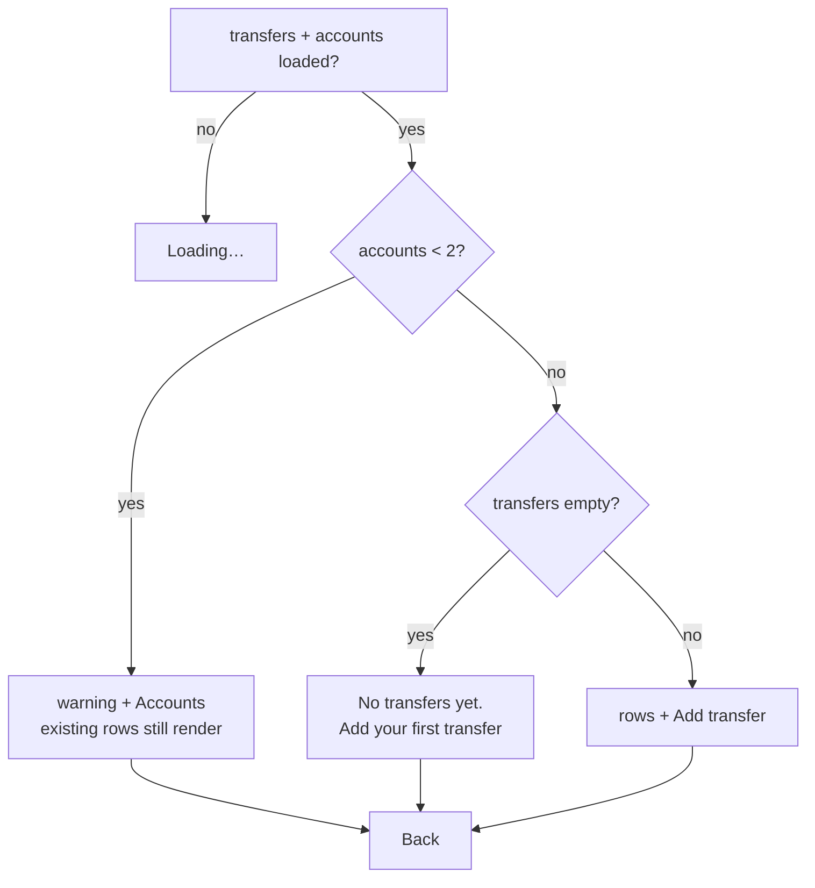

# Slice 08 Program Design Spec — Record transfers

- **Gate:** Slice Program Design (workflow step 5).
- **Status:** built and closed 2026-11-12. Implemented as specified; no
  production divergence was found at close-out.
- **Sources:** `docs/product/slices/slice-08-scope.md`,
  `docs/architecture/slices/slice-08-architecture.md`,
  `docs/architecture/north-star.md`, `docs/architecture/slices/slice-01-architecture.md`,
  `docs/architecture/slices/slice-02-architecture.md`,
  `docs/architecture/slices/slice-05-architecture.md`,
  `docs/program-design/slices/slice-01-spec.md`,
  `docs/program-design/slices/slice-02-spec.md`,
  `docs/program-design/slices/slice-05-spec.md`, `CONTEXT.md`, and the
  current `src/` code.
- **Endpoints:** none. The app is static files plus IndexedDB (ADR 0001);
  `Ledger` is the whole application API. This slice adds no network call, no
  server validation, and no new persistence seam.
- **Prototype:** one throwaway state-model reducer. It settled the only open
  state question: what happens when one account picker is changed to the
  account already selected on the other side. §9 records what was tried and
  what changed.

---

## 1. Problem Statement

The user moves money between their own accounts: checking to savings, or
checking to a credit card to pay it off. The app can record spending, but not
those movements. Recording a card payment as an expense inflates the month's
spending; leaving it out makes the ledger incomplete and the card's history
impossible to reconcile. A transfer is not spending.

## 2. Solution

The user records one movement between two different accounts: the account the
money leaves, the account it arrives in, the amount, and the date. The date
defaults to today and can be changed, including to an earlier month. No
category is asked for. Saving writes exactly one `entries` row with
`kind: 'transfer'`; the movement is not two postings.

A Transfers action on home opens a single newest-first list showing the date,
both accounts, and the amount. Opening a row lets the user correct the amount,
either account, or the date, or remove the transfer after a confirmation that
names the amount, the date, and both accounts. Corrections update the one row,
so both sides change together; removal is final.

Transfers never enter the home total, the category breakdown, the comparison
with last month, or the category entries screen. The existing expense-only
predicates already guarantee that. No table, index, schema version, backup
version, route on an existing screen, or settings write changes.

## 3. User Stories

### Recording a transfer

1. As a user, I want to record money moving from one of my accounts to another,
   so that my ledger holds the movement.
2. As a user, I want to choose the account the money leaves, so that the
   direction is explicit.
3. As a user, I want to choose the account the money arrives in, so that the
   destination is explicit.
4. As a user, I want the two accounts to be different, so that a self-transfer
   is impossible.
5. As a user, I want the app to refuse a transfer whose two accounts are the
   same, so that the ledger never contains a meaningless movement.
6. As a user, I want the amount to be greater than zero, so that a zero
   movement is not recorded.
7. As a user, I want to enter the amount the same way as an expense, so that I
   do not learn a second amount format.
8. As a user, I want the date to default to today, so that the common case is
   one less step.
9. As a user, I want to change the date, including to an earlier month, so that
   I can record a past movement.
10. As a user, I want no category on a transfer, so that I am not asked for a
    reason that does not exist.
11. As a user, I want to pay a credit card from checking as a transfer, so that
    the payment is not counted as spending.
12. As a user, I want to move money to savings as a transfer, so that the
    movement is recorded without a category.
13. As a user, I want to move money back from savings as a transfer, so that
    both directions are possible.
14. As a user, I want a credit card to be usable on either side, so that
    account type never blocks a valid movement.
15. As a user, I want saving to show the transfer in the list, so that I know
    it was recorded.
16. As a user, I want the transfer to be one movement, not two, so that
    correcting it changes both sides together.
17. As a user, I want saving a transfer not to change which account is
    preselected for the next expense, so that the expense form keeps its
    meaning.
18. As a user, I want a transfer to be recorded with no tag, note, or payee, so
    that the record stays simple.

### Finding and reading transfers

19. As a user, I want a Transfers action on home, so that recording a transfer
    is part of the same short flow as recording a purchase.
20. As a user, I want the transfers list newest first, so that recent movements
    are easy to find.
21. As a user, I want each row to show the date, both accounts, and the amount,
    so that I can identify the movement.
22. As a user, I want account labels to include the account type, so that two
    cards with the same name are distinguishable.
23. As a user, I want an empty list message, so that I know no transfers exist.
24. As a user, I want an “add your first transfer” action in the empty state, so
    that the empty state is actionable.
25. As a user, I want a clear message when I have fewer than two accounts, so
    that I know why I cannot record a transfer.
26. As a user, I want a link to Accounts from that message, so that I can add
    the missing account.
27. As a user, I want existing transfers to remain visible even with fewer than
    two accounts, so that a restored ledger is not hidden.
28. As a user, I want the list to show the whole transfer history, so that I do
    not have to navigate month by month.
29. As a user, I want the list to show no total, so that I do not mistake
    movements for spending or for a balance.
30. As a user, I want a transfer dated in a future month to appear above
    today's transfers, so that the list is ordered by the date I chose.
31. As a user, I want a Back action from the list, so that I can return to home
    without relying on the browser.

### Correcting a transfer

32. As a user, I want to open a transfer from the list, so that I can correct
    it.
33. As a user, I want to change the amount, either account, or the date, so
    that the stored movement matches reality.
34. As a user, I want a correction to update the one row and both sides, so
    that no second row is created.
35. As a user, I want the list to update immediately after a correction, so
    that I do not need to refresh.
36. As a user, I want Back and Cancel to leave the transfer unchanged, so that
    opening the editor is safe.
37. As a user, I want a correction that changes the date to move the row within
    the list, so that the newest-first order stays true.
38. As a user, I want a missing source account to show as “Unknown account” and
    require a replacement before saving, so that a transfer is never saved to
    nowhere.
39. As a user, I want a missing destination account to do the same, so that
    both sides are always valid.
40. As a user, I want a restored self-transfer to be flagged and blocked until
    corrected, so that the app never writes an invalid transfer.

### Removing a transfer

41. As a user, I want to remove a transfer, so that a mistaken movement can be
    deleted.
42. As a user, I want removal to ask for confirmation naming the amount, the
    date, and both accounts, so that I do not delete the wrong row.
43. As a user, I want focus to move to Cancel when the confirmation opens, so
    that I can dismiss it without hunting.
44. As a user, I want removal to be final, so that the ledger does not keep
    hidden tombstones.
45. As a user, I want a failed removal to leave the row in place and show an
    error, so that I can retry.

### Spending, backups, and offline

46. As a user, I want transfers never to appear in the home total, so that
    paying a card is not spending.
47. As a user, I want transfers never to appear in the category breakdown, so
    that spending categories stay clean.
48. As a user, I want a transfer dated in an earlier month not to affect that
    month's spending, so that history stays correct.
49. As a user, I want correcting or removing a transfer not to change a
    spending total, so that the headline is stable.
50. As a user, I want a transfer in the previous month not to create a
    comparison row, so that last-month spending is unchanged.
51. As a user, I want a backup to include transfers, so that my ledger is
    complete.
52. As a user, I want restore to reproduce transfers exactly, so that no
    movement is lost.
53. As a user, I want transfers to work offline, so that the app works on a
    phone with no connection.

### Accessibility

54. As a screen-reader user, I want each row to announce the direction, the
    amount, and the date, so that I do not rely on visual layout.
55. As a screen-reader user, I want the confirmation panel to name the amount,
    the date, and both accounts, so that I know what I am removing.
56. As a screen-reader user, I want field errors associated with their inputs,
    so that I know which field to correct.
57. As a screen-reader user, I want the same-account error announced as a form
    error, so that I understand neither picker alone is wrong.

## 4. Seams and Call Stacks

### 4.1 One seam

The slice crosses the existing `Ledger` seam only. There is no repository
interface, no fake adapter, no new persistence module, and no test-only export.

| Module | Responsibility in this slice |
|---|---|
| `data/ledger` | Owns `TransferInput`, `TransferListItem`, the two new error codes, `listTransfers`, `addTransfer`, `updateTransfer`, `deleteTransfer`, private `requireTransferFields`, and private `insertEntry`. `addExpense` is mechanically switched to `insertEntry`. |
| `domain/types` | Unchanged. `Entry` already has `kind: 'transfer'`, `accountId`, and `toAccountId`. |
| `domain/money` | Unchanged. `parseAmount`, `formatAmount`, and `formatAmountInput` are reused. |
| `domain/calendar` | Unchanged. `isValidLocalDate`, `todayLocalDate`, and `monthOf` are reused. |
| `domain/backup` | Unchanged. v1 already accepts and carries transfers. |
| `data/db` | Unchanged. Still not imported by the UI. |
| `app/router` | Gains three `Route` members, three `parseHash` branches, and three `routeToHash` cases. Existing routes are unchanged. |
| `app/App` | Gains three `switch` cases. The first-run gate is unchanged. |
| `app/transferForm` | New: `TransferFields`, `TransferFieldErrors`, `transferFieldErrors`. Reuses `ChoiceGroup` from `app/expenseForm`. |
| `app/labels` | Gains `accountWithTypeLabel`, the one account-label rule used by transfer pickers and rows. `ExpenseFields` uses it too; output is unchanged. |
| `app/screens/TransfersScreen` | New: list states and rows. |
| `app/screens/AddTransferScreen` | New: add form and its gates. |
| `app/screens/TransferEditorScreen` | New: correction, removal, and not-found states. |
| `app/screens/HomeScreen` | Gains one Transfers button in the bottom actions row. No data read changes. |
| `styles.css` | Gains transfer-list styles. Existing styles are unchanged. |

No new dependency is added. No endpoint is added.

### 4.2 Add transfer call stack

| Step | Caller | Callee | Effect |
|---|---|---|---|
| 1 | user submits the form | `AddTransferForm.submit` | `preventDefault`; returns immediately if `submittingRef.current` is true |
| 2 | `submit` | `parseAmount(amountText, settings.currencyExponent)` | integer minor units or `null` |
| 3 | `submit` | `isValidLocalDate(date)` | `boolean` |
| 4 | `submit` | local field/form checks | sets `TransferFieldErrors`; returns when any check fails |
| 5 | `submit` | `ledger.addTransfer(input)` | one public call |
| 6 | `addTransfer` | `db.transaction('rw', db.accounts, db.entries, …)` | opens one write transaction |
| 7 | transaction body | `requireTransferFields(input)` | amount → date → same-account → source exists → destination exists |
| 8 | `requireTransferFields` | `db.accounts.get(input.accountId)` | source existence |
| 9 | `requireTransferFields` | `db.accounts.get(input.toAccountId)` | destination existence |
| 10 | transaction body | `insertEntry(entry)` | the only `entries.add` call on the add path |
| 11 | `insertEntry` | `db.entries.add(entry)` | writes one row; returns the entry |
| 12 | `submit` | `navigate({ name: 'transfers' }, { replace: true })` | replaces the form with the list |
| 13 | `useHashRoute` → `App` | `TransfersScreen` | its live query re-runs after the `entries` write |

### 4.3 Update transfer call stack

| Step | Caller | Callee | Effect |
|---|---|---|---|
| 1 | user submits the form | `TransferEditorForm.submit` | `preventDefault`; guard `submittingRef` |
| 2 | `submit` | `parseAmount`, `isValidLocalDate`, local checks | same validation as add |
| 3 | `submit` | `ledger.updateTransfer(entry.id, input)` | one public call |
| 4 | `updateTransfer` | `db.transaction('rw', db.accounts, db.entries, …)` | one write transaction |
| 5 | transaction body | `db.entries.get(id)` | missing → `unknown-entry` |
| 6 | transaction body | `existing.kind !== 'transfer'` | `unsupported-entry-kind` |
| 7 | transaction body | `requireTransferFields(input)` | same five checks as add |
| 8 | transaction body | `db.entries.update(id, { date, amountMinor, accountId, toAccountId })` | updates the one row; `0` updated → `unknown-entry` |
| 9 | transaction body | return `{ ...existing, date, amountMinor, accountId, toAccountId }` | merged entry with the original `id` and `kind` |
| 10 | `submit` | `navigate({ name: 'transfers' }, { replace: true })` | returns to the list |
| 11 | live query | `listTransfers` | row order and values update through Dexie invalidation |

### 4.4 Delete transfer call stack

| Step | Caller | Callee | Effect |
|---|---|---|---|
| 1 | user confirms removal | `confirmRemove` | guard `deletingRef`; clears form errors |
| 2 | `confirmRemove` | `ledger.deleteTransfer(entry.id)` | one public call |
| 3 | `deleteTransfer` | `db.transaction('rw', db.entries, …)` | one write transaction |
| 4 | transaction body | `db.entries.get(id)` | missing → `unknown-entry` |
| 5 | transaction body | `existing.kind !== 'transfer'` | `unsupported-entry-kind` |
| 6 | transaction body | `db.entries.delete(id)` | removes the one row |
| 7 | transaction body | return `existing` | removed snapshot |
| 8 | `confirmRemove` | `navigate({ name: 'transfers' }, { replace: true })` | returns to the list |
| 9 | live query | `listTransfers` | row disappears through Dexie invalidation |

### 4.5 List read call stack

| Step | Caller | Callee | Effect |
|---|---|---|---|
| 1 | `TransfersScreen` render | `useLiveQuery(() => ledger.listTransfers(), [ledger])` | subscribes to `entries` and `accounts` |
| 2 | `listTransfers` | `db.transaction('r', db.entries, db.accounts, …)` | one consistent read snapshot |
| 3 | transaction body | `db.entries.orderBy('date').reverse().toArray()` | reads through the `date` index, newest first |
| 4 | transaction body | `.filter((entry) => entry.kind === 'transfer')` | drops every other kind |
| 5 | transaction body | explicit sort by `date` desc, then `id` desc | deterministic same-day order |
| 6 | transaction body | union of `accountId` and `toAccountId` | the accounts to join |
| 7 | transaction body | `db.accounts.bulkGet(accountIds)` | one join read |
| 8 | transaction body | map rows; missing account → `"Unknown account"` / `null` | never drops a transfer row |
| 9 | `TransfersScreen` | `useLiveQuery(() => ledger.listAccounts(), [ledger])` | decides the fewer-than-two-accounts state |
| 10 | `TransfersScreen` | `useLiveQuery(() => ledger.getSettings(), [ledger])` | currency and exponent for display only |

The `r` transaction is required, not decorative: without it a rename landing
between the `entries` read and the `accounts` read could render one row with
the old name and the next with the new name until the live query re-runs.
Dexie queues a write behind the read transaction and invalidates the query
afterwards.

### 4.6 Live invalidation

| Write | Tables touched | What re-runs | Visible effect |
|---|---|---|---|
| `addTransfer` | `entries` | `listTransfers`, `getEntry`, `monthSummary`, `categoryEntries` | the list gains one row; home totals and category rows are unchanged |
| `updateTransfer` | `entries` | `listTransfers`, `getEntry`, `monthSummary`, `categoryEntries` | the row moves/changes in the list; home totals are unchanged |
| `deleteTransfer` | `entries` | `listTransfers`, `getEntry`, `monthSummary`, `categoryEntries` | the row disappears; home totals are unchanged |
| `renameAccount` | `accounts` | `listTransfers`, `listAccounts`, `categoryEntries` | transfer rows show the current name; amounts unchanged |
| `restoreBackup` | all four tables | every live query | the list is recomputed from the restored entries |

No manual cache, event bus, refresh button, or cross-tab coordination is added.
The single-tab assumption carries over: the editor seeds its form once from the
loaded entry, and a concurrent change from another tab is visible to live
queries but not merged into a half-edited form.

## 5. Implementation Decisions — Data Contract

### 5.1 Types

Add to `src/data/ledger.ts`:

```ts
export interface TransferInput {
  amountMinor: number;   // positive safe integer
  accountId: string;     // source account
  toAccountId: string;   // destination account; must differ from accountId
  date: LocalDate;
}

export interface TransferListItem {
  id: string;
  date: LocalDate;
  amountMinor: number;
  accountId: string;              // source
  accountName: string;            // "Unknown account" if the row is gone
  accountType: AccountType | null;
  toAccountId: string;            // destination; "" only for a corrupt row
  toAccountName: string;          // "Unknown account" if the row is gone
  toAccountType: AccountType | null;
}
```

Extend `LedgerErrorCode` by appending:

```ts
  | 'unknown-to-account'       // transfer destination is gone
  | 'same-transfer-account';   // source and destination are the same
```

Extend `Ledger` immediately after `deleteExpense`:

```ts
  listTransfers(): Promise<TransferListItem[]>; // date desc, then id desc
  addTransfer(input: TransferInput): Promise<Entry>;
  updateTransfer(id: string, input: TransferInput): Promise<Entry>;
  deleteTransfer(id: string): Promise<Entry>;   // returns the removed snapshot
```

`getEntry(id)` is unchanged and remains the editor's lookup. The editor checks
`entry.kind === 'transfer'`; any other kind is “transfer not found”, exactly as
the expense editor treats a non-expense entry.

No other public type changes. `Entry`, `Account`, `Category`, `Settings`,
`MonthSummary`, `CategorySpend`, `EntryListItem`, and `CategoryEntries` are
unchanged.

### 5.2 Shared entry insert

Add one private helper inside `createLedger`, next to `requireExpenseFields`:

```ts
async function insertEntry(entry: Entry): Promise<Entry> {
  await db.entries.add(entry);
  return entry;
}
```

Contract:

- `insertEntry` is private; it is not exported and not on `Ledger`.
- It must be called inside an already-open `rw` transaction. It does not open
  its own transaction.
- It is the only `entries.add` call on the add paths. `addExpense` and
  `addTransfer` both call it. `restoreBackup` deliberately stays on
  `entries.bulkAdd`.
- `addExpense` changes exactly one line: `await db.entries.add(entry)` becomes
  `await insertEntry(entry)`. Its validation, its `settings.lastAccountId`
  write, its return value, and its transaction tables are unchanged.
- This refactor ships in the same ticket as the transfer ledger contract, as
  its first step. It is not a separate ticket: the end state is one helper,
  and the existing `addExpense` tests prove the call-site change is behaviour
  preserving.

### 5.3 Transfer validation

Add one private helper inside `createLedger`:

```ts
async function requireTransferFields(input: TransferInput): Promise<void> {
  if (!Number.isSafeInteger(input.amountMinor) || input.amountMinor <= 0) {
    throw new LedgerError(
      'invalid-amount',
      'Enter an amount greater than zero.',
    );
  }
  if (!isValidLocalDate(input.date)) {
    throw new LedgerError('invalid-date', 'Choose a valid date.');
  }
  if (input.accountId === input.toAccountId) {
    throw new LedgerError(
      'same-transfer-account',
      'Choose two different accounts.',
    );
  }

  const source = await db.accounts.get(input.accountId);
  if (!source) {
    throw new LedgerError(
      'unknown-account',
      'That account no longer exists. Choose another.',
    );
  }

  const destination = await db.accounts.get(input.toAccountId);
  if (!destination) {
    throw new LedgerError(
      'unknown-to-account',
      'That account no longer exists. Choose another.',
    );
  }
}
```

The order is normative:

| Order | Check | Code |
|---|---|---|
| 1 | `amountMinor` is a safe integer and `> 0` | `invalid-amount` |
| 2 | `isValidLocalDate(input.date)` | `invalid-date` |
| 3 | `input.accountId !== input.toAccountId` | `same-transfer-account` |
| 4 | source account exists | `unknown-account` |
| 5 | destination account exists | `unknown-to-account` |

The same-account check runs before the account reads because it is a property
of the input, not of stored rows. A transfer to or from a credit account is
valid; account type never enters the rule. No other rule is added: no amount
maximum, no future-date restriction, no note/payee/category, no currency check
beyond the existing settings exponent used at the UI edge.

### 5.4 `addTransfer(input)`

```ts
async addTransfer(input) {
  return db.transaction(
    'rw',
    db.accounts,
    db.entries,
    async () => {
      await requireTransferFields(input);

      const entry: Entry = {
        id: crypto.randomUUID(),
        kind: 'transfer',
        date: input.date,
        amountMinor: input.amountMinor,
        accountId: input.accountId,
        toAccountId: input.toAccountId,
      };

      return insertEntry(entry);
    },
  );
}
```

Properties:

- Exactly one row, with a fresh UUID.
- `kind: 'transfer'`; `accountId` is the source; `toAccountId` is the
  destination.
- No `categoryId`, no second posting, no stored sign.
- No `settings` table in the transaction and no `settings.lastAccountId`
  write.
- Returns the inserted entry.

### 5.5 `updateTransfer(id, input)`

```ts
async updateTransfer(id, input) {
  return db.transaction(
    'rw',
    db.accounts,
    db.entries,
    async () => {
      const existing = await db.entries.get(id);
      if (!existing) {
        throw new LedgerError(
          'unknown-entry',
          'That entry no longer exists.',
        );
      }
      if (existing.kind !== 'transfer') {
        throw new LedgerError(
          'unsupported-entry-kind',
          'Only transfers can be corrected or removed.',
        );
      }

      await requireTransferFields(input);

      const updated = await db.entries.update(id, {
        date: input.date,
        amountMinor: input.amountMinor,
        accountId: input.accountId,
        toAccountId: input.toAccountId,
      });
      if (updated === 0) {
        throw new LedgerError(
          'unknown-entry',
          'That entry no longer exists.',
        );
      }

      return {
        ...existing,
        date: input.date,
        amountMinor: input.amountMinor,
        accountId: input.accountId,
        toAccountId: input.toAccountId,
      };
    },
  );
}
```

Properties:

- The entry read and kind check run before field validation.
- The update object writes exactly the four editable fields. It never writes
  `kind`, `id`, or `categoryId`.
- A restored transfer carrying a stray `categoryId` keeps it: the app never
  reads it for a transfer, and removing it would be a silent data change. The
  returned merged entry therefore still carries it.
- A correction changes the one row, so both sides change together. It never
  creates a second row and never writes settings.
- A row that disappears between the read and the update yields
  `unknown-entry`, not a silent success.

### 5.6 `deleteTransfer(id)`

```ts
async deleteTransfer(id) {
  return db.transaction('rw', db.entries, async () => {
    const existing = await db.entries.get(id);
    if (!existing) {
      throw new LedgerError(
        'unknown-entry',
        'That entry no longer exists.',
      );
    }
    if (existing.kind !== 'transfer') {
      throw new LedgerError(
        'unsupported-entry-kind',
        'Only transfers can be corrected or removed.',
      );
    }

    await db.entries.delete(id);
    return existing;
  });
}
```

Properties:

- Only the `entries` table is in the transaction; no account read is needed.
- The removed snapshot is returned so a caller can navigate from stored
  values rather than possibly stale form state. The UI ignores it and
  navigates to the list.
- Removal is final: no tombstone, no soft delete, no audit row. Spending
  totals need no recalculation because every total is derived on read.

### 5.7 `listTransfers()`

```ts
async listTransfers() {
  return db.transaction('r', db.entries, db.accounts, async () => {
    const entries = await db.entries.orderBy('date').reverse().toArray();
    const transfers = entries.filter((entry) => entry.kind === 'transfer');

    transfers.sort(
      (left, right) =>
        right.date.localeCompare(left.date) ||
        right.id.localeCompare(left.id),
    );

    const accountIds = [
      ...new Set(
        transfers.flatMap((entry) => {
          const destinationId = entry.toAccountId;
          return destinationId === undefined
            ? [entry.accountId]
            : [entry.accountId, destinationId];
        }),
      ),
    ].filter((id) => id !== '');

    const accounts = await db.accounts.bulkGet(accountIds);
    const accountById = new Map<string, Account>();
    accounts.forEach((account, index) => {
      const accountId = accountIds[index];
      if (account && accountId !== undefined) {
        accountById.set(accountId, account);
      }
    });

    return transfers.map((entry) => {
      const source = accountById.get(entry.accountId);
      const destinationId = entry.toAccountId;
      const destination =
        destinationId === undefined
          ? undefined
          : accountById.get(destinationId);

      return {
        id: entry.id,
        date: entry.date,
        amountMinor: entry.amountMinor,
        accountId: entry.accountId,
        accountName: source?.name ?? 'Unknown account',
        accountType: source?.type ?? null,
        toAccountId: destinationId ?? '',
        toAccountName: destination?.name ?? 'Unknown account',
        toAccountType: destination?.type ?? null,
      };
    });
  });
}
```

Properties:

- **Newest first by `date`.** A transfer dated later appears above an earlier
  one, regardless of when it was recorded. Same-day rows fall back to `id`
  descending. The explicit sort makes the order independent of index
  tie-breaking.
- **Only transfers.** Every other kind is filtered out in memory.
- **No month filter, no pagination, no total, no category join.** The whole
  transfer history is one array. The scope excludes filtering, month
  navigation, pagination, and totals.
- **Missing accounts degrade, they do not disappear.** The row keeps its
  amount and date and shows `"Unknown account"` with `accountType: null`.
  This matches the entry-list convention from slice 2.
- **Renamed accounts show their current name.** The join is at read time, so
  history is not rewritten.
- **A transfer with no stored `toAccountId`** (possible only in a corrupt or
  hand-edited database; the backup parser rejects it) is still returned:
  `toAccountId: ''`, `toAccountName: 'Unknown account'`,
  `toAccountType: null`. The editor seeds the destination as unselected and
  requires a replacement.
- **No validation of stored values.** The read model does not reject a
  non-positive amount or an invalid date from a corrupt row; the app never
  writes one. The UI formats what is stored; the editor validates on save.
- **Empty result is `[]`.** The screen decides between “no transfers yet” and
  “you need two accounts”.

### 5.8 Error codes and UI mapping

`unknown-account` keeps its existing meaning: the primary/source account is
missing. `unknown-to-account` is the destination-specific code so the form can
attach the error to the right picker. `same-transfer-account` is form-level:
neither picker alone is wrong.

Exact messages for the two new codes:

| Code | Message |
|---|---|
| `unknown-to-account` | `That account no longer exists. Choose another.` |
| `same-transfer-account` | `Choose two different accounts.` |

`transferFieldErrors` in `src/app/transferForm.tsx`:

```ts
export interface TransferFieldErrors {
  amount?: string;
  account?: string;
  toAccount?: string;
  date?: string;
  form?: string;
}

export function transferFieldErrors(
  code: LedgerErrorCode,
): TransferFieldErrors | null {
  switch (code) {
    case 'invalid-amount':
      return { amount: 'Enter an amount greater than zero.' };
    case 'invalid-date':
      return { date: 'Choose a valid date.' };
    case 'unknown-account':
      return { account: 'That account no longer exists. Choose another.' };
    case 'unknown-to-account':
      return { toAccount: 'That account no longer exists. Choose another.' };
    case 'same-transfer-account':
      return { form: 'Choose two different accounts.' };
    default:
      return null;
  }
}
```

`unknown-entry` and `unsupported-entry-kind` are handled by the editor before
this helper and switch the screen to “Transfer not found”. Tests assert codes,
not messages.

### 5.9 Backup contract — unchanged v1

Nothing in `src/domain/backup.ts` changes. The transfer row is already part of
the v1 data model:

- `readBackupData` returns every entry, including transfers, sorted by id.
- `createBackupFile` serializes every entry.
- `parseEntry` already accepts `kind: 'transfer'`, requires a non-empty
  `toAccountId`, and requires a positive safe-integer `amountMinor`.
- `restoreBackup` clears and bulk-adds the `entries` table, so a restored
  transfer is the same row it was before.
- `BACKUP_SCHEMA_VERSION` stays `1`.

Consequences the spec locks:

- A v1 file containing transfers restores without migration.
- A backup that omits transfers is still a valid v1 file and restores an empty
  transfers list.
- A transfer with a stray `categoryId` restores; every spending read ignores
  it, `listTransfers` returns the row, and the editor never writes one.
- A transfer whose `accountId` equals `toAccountId` restores; `listTransfers`
  returns it, and the editor flags it and blocks saving until one side is
  changed. The parser is not tightened: rejecting it would reject files v1
  already accepts, a compatibility change this slice does not make.
- A transfer whose account is missing restores; `listTransfers` shows
  `"Unknown account"`, and the editor requires a replacement.
- The parser still rejects a transfer with a missing or empty `toAccountId`.

### 5.10 Spending invariants — no read change

`monthSummary` and `categoryEntries` are not edited. They already exclude
every non-expense kind:

- `expenseTotals` skips every entry whose `kind !== 'expense'`. A transfer in
  the month on screen, or in the previous month, creates no row and adds
  nothing to `totalMinor`.
- `previousMonthHasSpending` is `previousTotals.size > 0`, where
  `previousTotals` is built by the same expense-only helper. A transfer in
  the previous month does not set it.
- `categoryEntries` filters `kind === 'expense'` before matching a category.
  A transfer can never appear in a category list, even if it carries a stray
  `categoryId`.
- A transfer dated in an earlier month is invisible to that month's spending,
  because the same kind filter applies to every month.

This slice adds no field to `MonthSummary`, no transfer branch to
`expenseTotals`, and no new spending query.

## 6. Implementation Decisions — Routing and Presentation

### 6.1 Routes

```ts
export type Route =
  | { name: 'home'; month: MonthKey }
  | { name: 'add' }
  | { name: 'accounts' }
  | { name: 'backup' }
  | { name: 'categories' }
  | { name: 'category'; month: MonthKey; categoryId: string }
  | { name: 'entry'; entryId: string }
  | { name: 'transfers' }                  // new
  | { name: 'add-transfer' }               // new
  | { name: 'transfer'; entryId: string }; // new
```

| Hash | Route |
|---|---|
| `#/transfers` | `{ name: 'transfers' }` |
| `#/transfers/new` | `{ name: 'add-transfer' }` |
| `#/transfers/<entryId>` | `{ name: 'transfer', entryId }` |

`parseHash` placement and exact rules:

1. Add the two exact checks after the existing `/categories` check, before the
   `requestedMonth` computation:

   ```ts
   if (path === '/transfers') {
     return { name: 'transfers' };
   }
   if (path === '/transfers/new') {
     return { name: 'add-transfer' };
   }
   ```

2. Add the id branch after the existing `/entry/` branch, before the final
   `return { name: 'home', month }`:

   ```ts
   if (path.startsWith('/transfers/')) {
     const raw = path.slice('/transfers/'.length);
     if (raw === '' || raw.includes('/')) {
       return { name: 'home', month: currentMonth };
     }
     let entryId: string;
     try {
       entryId = decodeURIComponent(raw);
     } catch {
       return { name: 'home', month: currentMonth };
     }
     if (entryId === '') {
       return { name: 'home', month: currentMonth };
     }
     return { name: 'transfer', entryId };
   }
   ```

3. `#/transfers/new` is checked before `#/transfers/<id>`, so `new` is never
   parsed as an id.
4. `#/transfers/new/`, `#/transfers/`, `#/transfers//`, and a raw slash inside
   the id fall back to home. An encoded slash is accepted after decoding,
   matching `#/entry/<id>`: `#/transfers/abc%2Fdef` is
   `{ name: 'transfer', entryId: 'abc/def' }`.
5. A decode failure falls back to home.
6. Query strings are ignored for all three routes: `#/transfers/new?x=1` is
   the add route, and `#/transfers/<id>?m=2026-11` is the editor route.
7. Paths are case-sensitive. `/Transfers` is home.
8. The fallback uses `currentMonth`, not the requested month, matching the
   existing `/entry/` fallback.

`routeToHash` gains exactly:

```ts
case 'transfers':
  return '#/transfers';
case 'add-transfer':
  return '#/transfers/new';
case 'transfer':
  return `#/transfers/${encodeURIComponent(route.entryId)}`;
```

The `Route` union is exhaustive in `routeToHash`; adding a member without a
case is a TypeScript error.

Known edge, accepted by the architecture: an entry id of exactly `new` is
unreachable through the editor route, because `#/transfers/new` is the add
route. App-created ids are `crypto.randomUUID()` and never collide. A
hand-edited backup could contain `new`; the parser is not tightened and the
list row would open the add form. No workaround is added.

### 6.2 App switch and first-run gate

`App` gains:

```tsx
case 'transfers':
  return <TransfersScreen ledger={ledger} />;
case 'add-transfer':
  return <AddTransferScreen ledger={ledger} />;
case 'transfer':
  return <TransferEditorScreen ledger={ledger} entryId={route.entryId} />;
```

The first-run gate is unchanged: with zero accounts, every route except
`accounts` and `backup` redirects to `#/accounts`. This includes
`#/transfers`, `#/transfers/new`, and `#/transfers/<id>`. With one account,
the transfer routes render their own fewer-than-two-accounts states.

### 6.3 Home

The existing bottom actions row gains one button, first in the row:

```tsx
<div className="actions">
  <button type="button" onClick={() => navigate({ name: 'transfers' })}>
    Transfers
  </button>
  <button type="button" onClick={() => navigate({ name: 'accounts' })}>
    Accounts
  </button>
  <button type="button" onClick={() => navigate({ name: 'categories' })}>
    Categories
  </button>
  <button type="button" onClick={() => navigate({ name: 'backup' })}>
    Backup
  </button>
</div>
```

Nothing else on home changes. The spending total, category breakdown,
comparison columns, month controls, storage warning, and add-expense actions
keep their current behaviour. A transfer is reached from home, but it never
enters home's data. The button is present in every home state, including the
empty state, so a transfer can be recorded before any spending.

### 6.4 Transfers list

`src/app/screens/TransfersScreen.tsx` reads:

```ts
const transfers = useLiveQuery(() => ledger.listTransfers(), [ledger]);
const accounts = useLiveQuery(() => ledger.listAccounts(), [ledger]);
const settings = useLiveQuery(() => ledger.getSettings(), [ledger]);
```

A module-local helper makes the state precedence explicit:

```ts
type TransfersListState =
  | { kind: 'loading' }
  | { kind: 'needs-accounts'; rows: TransferListItem[] }
  | { kind: 'empty' }
  | { kind: 'list'; rows: TransferListItem[] };

function transfersListState(
  transfers: TransferListItem[] | undefined,
  accounts: Account[] | undefined,
): TransfersListState {
  if (transfers === undefined || accounts === undefined) {
    return { kind: 'loading' };
  }
  if (accounts.length < 2) {
    return { kind: 'needs-accounts', rows: transfers };
  }
  if (transfers.length === 0) {
    return { kind: 'empty' };
  }
  return { kind: 'list', rows: transfers };
}
```

Precedence is normative:



| State | Rendering |
|---|---|
| Loading (`transfers`, `accounts`, or `settings` undefined) | `<p>Loading…</p>` |
| Fewer than two accounts | `<p>You need two accounts to record a transfer.</p>` + `Accounts` button; existing rows, if any, render below; no Add button |
| No transfers, at least two accounts | `<p>No transfers yet.</p>` + `Add your first transfer` button |
| Transfers exist | newest-first rows + `Add transfer` button |

The screen returns before rendering the section when either query is still
loading:

```tsx
if (state.kind === 'loading' || settings === undefined) {
  return <p>Loading…</p>;
}
```

Every non-loading state ends with a `Back` button that navigates to
`{ name: 'home', month: monthOf(todayLocalDate()) }`. This matches the
Categories screen's return-to-home convention. The list route itself carries
no month, so Back cannot preserve the month the user came from; the browser's
back gesture does.

Exact structure:

```tsx
<section>
  <h1>Transfers</h1>

  {state.kind === 'needs-accounts' ? (
    <>
      <p>You need two accounts to record a transfer.</p>
      <div className="actions">
        <button
          type="button"
          className="button-primary"
          onClick={() => navigate({ name: 'accounts' })}
        >
          Accounts
        </button>
      </div>
    </>
  ) : null}

  {state.kind === 'empty' ? (
    <div className="empty-state">
      <p>No transfers yet.</p>
      <button
        type="button"
        className="button-primary"
        onClick={() => navigate({ name: 'add-transfer' })}
      >
        Add your first transfer
      </button>
    </div>
  ) : null}

  {state.kind === 'list' || state.kind === 'needs-accounts'
    ? state.rows.length > 0
      ? <TransferRows rows={state.rows} settings={settings} />
      : null
    : null}

  {state.kind === 'list' ? (
    <div className="actions">
      <button
        type="button"
        className="button-primary"
        onClick={() => navigate({ name: 'add-transfer' })}
      >
        Add transfer
      </button>
    </div>
  ) : null}

  <div className="actions">
    <button
      type="button"
      onClick={() =>
        navigate({ name: 'home', month: monthOf(todayLocalDate()) })
      }
    >
      Back
    </button>
  </div>
</section>
```

`TransferRows` is module-local. It imports `navigate`, takes `rows` and
`settings`, renders the `<ul>` in ledger order, and does not sort, filter, or
merge.

### 6.5 Transfer row markup, labels, and CSS

Every row is a button that navigates to `{ name: 'transfer', entryId: row.id }`.
It shows the route, the amount, and the date:

```tsx
<ul className="transfer-list">
  {rows.map((row) => {
    const sourceLabel = accountWithTypeLabel(
      row.accountName,
      row.accountType,
    );
    const destinationLabel = accountWithTypeLabel(
      row.toAccountName,
      row.toAccountType,
    );
    const amount = formatAmount(
      row.amountMinor,
      settings.currency,
      settings.currencyExponent,
    );

    return (
      <li key={row.id}>
        <button
          type="button"
          aria-label={`Transfer from ${sourceLabel} to ${destinationLabel}, ${amount}, ${row.date}`}
          onClick={() =>
            navigate({ name: 'transfer', entryId: row.id })
          }
        >
          <span className="transfer-route">
            {sourceLabel} → {destinationLabel}
          </span>
          <span className="transfer-amount">{amount}</span>
          <span className="transfer-date">{row.date}</span>
        </button>
      </li>
    );
  })}
</ul>
```

Account labels use one shared helper in `src/app/labels.ts`:

```ts
export function accountWithTypeLabel(
  name: string,
  type: AccountType | null,
): string {
  return type === null ? name : `${name} · ${ACCOUNT_TYPE_LABELS[type]}`;
}
```

- `TransferFields` uses it for both pickers.
- `TransfersScreen` uses it for both sides of every row and in the row's
  accessible name.
- `ExpenseFields` switches its inline account label to this helper. The output
  is byte-for-byte identical, so no existing test or screen copy changes.
- `CategoryEntriesScreen` keeps its own `accountLabel`, which adds the type
  only when two accounts share a name. That is a different presentation rule
  for a different screen; it is not replaced.

The visible row uses `→`; the accessible name uses “from … to …”, so
direction never depends on the arrow. The date is the stored ISO
`YYYY-MM-DD`, matching the category entries list. The amount is the positive
stored magnitude, formatted with the settings currency and exponent. No sign,
no total, and no balance appear.

CSS additions:

```css
.transfer-list {
  list-style: none;
  margin: 0;
  padding: 0;
}

.transfer-list li {
  border-bottom: 1px solid #e2e8f0;
}

.transfer-list button {
  display: grid;
  width: 100%;
  grid-template-columns: minmax(0, 1fr) auto;
  gap: 0.25rem 1rem;
  padding: 0.75rem 0;
  border: 0;
  background: transparent;
  text-align: left;
}

.transfer-route {
  grid-column: 1 / -1;
  overflow-wrap: anywhere;
}

.transfer-amount {
  font-variant-numeric: tabular-nums;
  text-align: right;
}

.transfer-date {
  color: #475569;
  text-align: right;
}

@media (prefers-color-scheme: dark) {
  .transfer-list li {
    border-bottom-color: #334155;
  }

  .transfer-date {
    color: #94a3b8;
  }
}
```

The route occupies the full first line and wraps at 320px; the amount and date
share the second line. Amounts use tabular numerals so rows align. The page
does not scroll horizontally at 320px.

### 6.6 Add transfer

`src/app/screens/AddTransferScreen.tsx` reads:

```ts
const accounts = useLiveQuery(() => ledger.listAccounts(), [ledger]);
const settings = useLiveQuery(() => ledger.getSettings(), [ledger]);
```

States, in order:

| State | Rendering |
|---|---|
| Loading | `<p>Loading…</p>` |
| Fewer than two accounts | `<h1>Add transfer</h1>`, `<p>You need two accounts to record a transfer.</p>`, `Accounts` button; no form |
| At least two accounts | `<h1>Add transfer</h1>` + `TransferFields` form |

The screen returns before the gate when either query is loading:

```tsx
if (accounts === undefined || settings === undefined) {
  return <p>Loading…</p>;
}
```

The fewer-than-two-accounts state matches the AddExpense zero-account gate:
heading, one message, one Accounts button. It has no form and no Back button;
the browser back returns to the list.

Form initialization is exact:

```ts
const initialSourceId =
  settings.lastAccountId !== undefined &&
  accounts.some((account) => account.id === settings.lastAccountId)
    ? settings.lastAccountId
    : (accounts[0]?.id ?? null);

const initialToAccountId =
  initialSourceId === null
    ? null
    : (accounts.find((account) => account.id !== initialSourceId)?.id ??
       null);

const [amountText, setAmountText] = useState('');
const [accountId, setAccountId] = useState<string | null>(initialSourceId);
const [toAccountId, setToAccountId] =
  useState<string | null>(initialToAccountId);
const [date, setDate] = useState(() => todayLocalDate());
const [errors, setErrors] = useState<TransferFieldErrors>({});
const [submitting, setSubmitting] = useState(false);
const submittingRef = useRef(false);
```

- `listAccounts()` order is `createdAt` then `id`; “first account” means the
  first in that order, not the alphabetically first.
- Source: `settings.lastAccountId` when it still exists; otherwise the first
  account.
- Destination: the first account in `listAccounts()` order different from the
  source. With exactly two accounts, it is the other one.
- Amount: blank.
- Date: `todayLocalDate()`.
- No category, tag, note, or payee field.

Changing either account picker never changes the other picker. If the user
selects the same account on both sides, both selections remain visible and
the form shows the form-level error on submit. This is the prototype decision
in §9: no silent rewrite and no discarded choice.

`clearError` clears the field and any form-level error:

```ts
function clearError(field: keyof TransferFieldErrors) {
  setErrors((current) =>
    current[field] === undefined && current.form === undefined
      ? current
      : { ...current, [field]: undefined, form: undefined },
  );
}
```

Submit:

```ts
async function submit(event: FormEvent<HTMLFormElement>) {
  event.preventDefault();
  if (submittingRef.current) {
    return;
  }

  const amountMinor = parseAmount(
    amountText,
    settings.currencyExponent,
  );
  const nextErrors: TransferFieldErrors = {};

  if (amountMinor === null || amountMinor <= 0) {
    nextErrors.amount = 'Enter an amount greater than zero.';
  }
  if (accountId === null) {
    nextErrors.account = 'Choose an account.';
  }
  if (toAccountId === null) {
    nextErrors.toAccount = 'Choose an account.';
  }
  if (
    accountId !== null &&
    toAccountId !== null &&
    accountId === toAccountId
  ) {
    nextErrors.form = 'Choose two different accounts.';
  }
  if (!isValidLocalDate(date)) {
    nextErrors.date = 'Choose a valid date.';
  }

  if (
    amountMinor === null ||
    accountId === null ||
    toAccountId === null ||
    Object.keys(nextErrors).length > 0
  ) {
    setErrors(nextErrors);
    return;
  }

  submittingRef.current = true;
  setSubmitting(true);
  setErrors({});

  try {
    await ledger.addTransfer({
      amountMinor,
      accountId,
      toAccountId,
      date,
    });
    navigate({ name: 'transfers' }, { replace: true });
  } catch (error) {
    if (error instanceof LedgerError) {
      setErrors(
        transferFieldErrors(error.code) ?? {
          form: 'Could not save the transfer. Try again.',
        },
      );
    } else {
      setErrors({
        form: 'Could not save the transfer. Try again.',
      });
    }
  } finally {
    submittingRef.current = false;
    setSubmitting(false);
  }
}
```

The screen refuses the same account before the call for immediate feedback.
The ledger refuses it again inside the transaction, so a stale form or a
direct caller cannot create a self-transfer.

Markup:

```tsx
<section>
  <h1>Add transfer</h1>
  <form onSubmit={submit}>
    <TransferFields
      idPrefix="transfer-add"
      amountText={amountText}
      onAmountChange={setAmountText}
      accountId={accountId}
      onAccountChange={setAccountId}
      toAccountId={toAccountId}
      onToAccountChange={setToAccountId}
      date={date}
      onDateChange={setDate}
      accounts={accounts}
      errors={errors}
      onClearError={clearError}
    />

    {errors.form ? (
      <p role="alert" className="form-error">
        {errors.form}
      </p>
    ) : null}

    <div className="actions">
      <button
        type="submit"
        className="button-primary"
        disabled={submitting}
      >
        Save
      </button>
      <button
        type="button"
        onClick={() =>
          navigate({ name: 'transfers' }, { replace: true })
        }
      >
        Cancel
      </button>
    </div>
  </form>
</section>
```

### 6.7 Transfer editor

`src/app/screens/TransferEditorScreen.tsx` reads:

```ts
const entry = useLiveQuery(
  () => ledger.getEntry(entryId),
  [ledger, entryId],
);
const accounts = useLiveQuery(() => ledger.listAccounts(), [ledger]);
const settings = useLiveQuery(() => ledger.getSettings(), [ledger]);
```

- Loading until all three are defined.
- `entry === null` or `entry.kind !== 'transfer'` renders the not-found state.
- Otherwise the form is keyed by `entry.id`, so a changed live entry reseeds
  the form.

Not-found state:

```tsx
<section>
  <h1>Transfer not found</h1>
  <p>This transfer no longer exists.</p>
  <div className="actions">
    <button
      type="button"
      onClick={() =>
        navigate({ name: 'transfers' }, { replace: true })
      }
    >
      Back to transfers
    </button>
  </div>
</section>
```

The editor does not gate on account count. A transfer can still be opened
with one account or with a missing account; the form shows the missing side as
unselected with an error and blocks saving until it is replaced.

Seed:

```ts
const storedSourceId = accounts.some(
  (account) => account.id === entry.accountId,
)
  ? entry.accountId
  : null;

const storedToAccountIdValue = entry.toAccountId;
const storedToAccountId =
  storedToAccountIdValue !== undefined &&
  accounts.some((account) => account.id === storedToAccountIdValue)
    ? storedToAccountIdValue
    : null;

const [amountText, setAmountText] = useState(() =>
  formatAmountInput(entry.amountMinor, settings.currencyExponent),
);
const [accountId, setAccountId] =
  useState<string | null>(storedSourceId);
const [toAccountId, setToAccountId] =
  useState<string | null>(storedToAccountId);
const [date, setDate] = useState(entry.date);
const [errors, setErrors] = useState<TransferFieldErrors>(() => {
  const initial: TransferFieldErrors = {};

  if (storedSourceId === null) {
    initial.account =
      'That account no longer exists. Choose another.';
  }
  if (storedToAccountId === null) {
    initial.toAccount =
      'That account no longer exists. Choose another.';
  }
  if (
    storedSourceId !== null &&
    storedToAccountId !== null &&
    storedSourceId === storedToAccountId
  ) {
    initial.form = 'Choose two different accounts.';
  }

  return initial;
});
const [submitting, setSubmitting] = useState(false);
const [confirmingDelete, setConfirmingDelete] = useState(false);
const [deleting, setDeleting] = useState(false);
const [gone, setGone] = useState(false);
const submittingRef = useRef(false);
const deletingRef = useRef(false);
const cancelDeleteRef = useRef<HTMLButtonElement>(null);
```

- Amount: `formatAmountInput(entry.amountMinor, exponent)`.
- Source: stored `accountId` if it still exists, else `null` with an error.
- Destination: stored `toAccountId` if it exists, else `null` with an error.
- Date: stored `entry.date`.
- A restored self-transfer seeds both sides to the same existing account and
  starts with the form-level error. Saving is blocked until one side changes.
- A stored `toAccountId` of `''` (corrupt row) is treated as missing.

`clearError` is the same field-and-form clearer as add. The form uses
`TransferFields` with `idPrefix="transfer-edit"`:

```tsx
<form onSubmit={submit}>
  <TransferFields
    idPrefix="transfer-edit"
    amountText={amountText}
    onAmountChange={setAmountText}
    accountId={accountId}
    onAccountChange={setAccountId}
    toAccountId={toAccountId}
    onToAccountChange={setToAccountId}
    date={date}
    onDateChange={setDate}
    accounts={accounts}
    errors={errors}
    onClearError={clearError}
  />

  {errors.form ? (
    <p role="alert" className="form-error">
      {errors.form}
    </p>
  ) : null}

  {/* actions or confirmation panel, below */}
</form>
```

Submit uses the same `submittingRef` guard and the same `nextErrors` block as
§6.6; only the ledger call and the success navigation differ. After the local
checks pass:

```ts
try {
  await ledger.updateTransfer(entry.id, {
    amountMinor,
    accountId,
    toAccountId,
    date,
  });
  navigate({ name: 'transfers' }, { replace: true });
} catch (error) {
  if (
    error instanceof LedgerError &&
    (error.code === 'unknown-entry' ||
      error.code === 'unsupported-entry-kind')
  ) {
    setGone(true);
  } else if (error instanceof LedgerError) {
    setErrors(
      transferFieldErrors(error.code) ?? {
        form: 'Could not save the changes. Try again.',
      },
    );
  } else {
    setErrors({
      form: 'Could not save the changes. Try again.',
    });
  }
} finally {
  submittingRef.current = false;
  setSubmitting(false);
}
```

Removal:

- The `Remove transfer` button reveals a `role="group"`
  `aria-label="Confirm removal"` panel.
- The panel uses stored values, not unsaved form state:

  ```tsx
  <p>
    Remove {storedAmount} on {entry.date} from {storedSourceLabel} to{' '}
    {storedDestinationLabel}? This cannot be undone.
  </p>
  ```

  `storedAmount`, `storedSourceLabel`, and `storedDestinationLabel` are
  computed from the stored row and the current account rows:

  ```ts
  const storedAmount = formatAmount(
    entry.amountMinor,
    settings.currency,
    settings.currencyExponent,
  );
  const sourceAccount = accounts.find(
    (account) => account.id === entry.accountId,
  );
  const destinationAccount =
    storedToAccountIdValue === undefined
      ? undefined
      : accounts.find(
          (account) => account.id === storedToAccountIdValue,
        );
  const storedSourceLabel = accountWithTypeLabel(
    sourceAccount?.name ?? 'Unknown account',
    sourceAccount?.type ?? null,
  );
  const storedDestinationLabel = accountWithTypeLabel(
    destinationAccount?.name ?? 'Unknown account',
    destinationAccount?.type ?? null,
  );
  ```
- Focus moves to the panel's Cancel button when the panel opens, via a ref and
  a `useEffect` on `confirmingDelete`:

  ```ts
  useEffect(() => {
    if (confirmingDelete) {
      cancelDeleteRef.current?.focus();
    }
  }, [confirmingDelete]);
  ```

- Cancel closes the panel without writing. No explicit focus restoration is
  added; this matches the expense editor.
- Remove calls `ledger.deleteTransfer(entry.id)` and navigates to
  `{ name: 'transfers' }` with `{ replace: true }`.
- `unknown-entry` or `unsupported-entry-kind` switches to the not-found state.
- Any other failure leaves the row in place, keeps the panel open, and shows
  `Could not remove the transfer. Try again.` as a form error.
- `deletingRef` and the `deleting` flag prevent a double removal:

  ```ts
  async function confirmRemove() {
    if (deletingRef.current) {
      return;
    }
    deletingRef.current = true;
    setDeleting(true);
    setErrors({});

    try {
      await ledger.deleteTransfer(entry.id);
      navigate({ name: 'transfers' }, { replace: true });
    } catch (error) {
      if (
        error instanceof LedgerError &&
        (error.code === 'unknown-entry' ||
          error.code === 'unsupported-entry-kind')
      ) {
        setGone(true);
      } else {
        setErrors({
          form: 'Could not remove the transfer. Try again.',
        });
      }
    } finally {
      deletingRef.current = false;
      setDeleting(false);
    }
  }
  ```

Actions when the panel is closed:

```tsx
<div className="actions">
  <button type="submit" className="button-primary" disabled={submitting}>
    Save changes
  </button>
  <button
    type="button"
    disabled={submitting || deleting}
    onClick={() => navigate({ name: 'transfers' }, { replace: true })}
  >
    Back
  </button>
  <button
    type="button"
    disabled={submitting || deleting}
    onClick={() => setConfirmingDelete(true)}
  >
    Remove transfer
  </button>
</div>
```

When the panel is open, it replaces the actions row and renders:

```tsx
<div role="group" aria-label="Confirm removal">
  <p>{/* stored-value sentence above */}</p>
  <div className="actions">
    <button
      type="button"
      ref={cancelDeleteRef}
      onClick={() => setConfirmingDelete(false)}
    >
      Cancel
    </button>
    <button
      type="button"
      disabled={deleting}
      onClick={confirmRemove}
    >
      Remove
    </button>
  </div>
</div>
```

If `gone` becomes true, the screen renders the not-found state instead of the
form.

### 6.8 Shared transfer fields

`src/app/transferForm.tsx` holds `TransferFieldErrors`,
`transferFieldErrors` (§5.8), and `TransferFields`. It imports `ChoiceGroup`
from `./expenseForm`; that component is already generic over
`{ id, label }[]` and needs no change. It does not reuse `ExpenseFields`,
because a transfer has no category and has two accounts.

```ts
export function TransferFields({
  idPrefix,
  amountText,
  onAmountChange,
  accountId,
  onAccountChange,
  toAccountId,
  onToAccountChange,
  date,
  onDateChange,
  accounts,
  errors,
  onClearError,
}: {
  idPrefix: 'transfer-add' | 'transfer-edit';
  amountText: string;
  onAmountChange: (value: string) => void;
  accountId: string | null;
  onAccountChange: (id: string) => void;
  toAccountId: string | null;
  onToAccountChange: (id: string) => void;
  date: string;
  onDateChange: (value: string) => void;
  accounts: Account[];
  errors: TransferFieldErrors;
  onClearError: (field: keyof TransferFieldErrors) => void;
}) { … }
```

Markup mirrors `ExpenseFields`:

- Amount: `<label htmlFor={`${idPrefix}-amount`}>Amount</label>`, text input
  with `inputMode="decimal"` and `autoComplete="off"`, error id
  `${idPrefix}-amount-error`, `aria-describedby` only when an error exists.
- Source: `ChoiceGroup` with `legend="From account"`, options
  `accounts.map((account) => ({ id: account.id, label: accountWithTypeLabel(account.name, account.type) }))`,
  `errorId={`${idPrefix}-account-error`}`.
- Destination: `ChoiceGroup` with `legend="To account"`, the same options,
  `errorId={`${idPrefix}-to-account-error`}`.
- Date: `<label htmlFor={`${idPrefix}-date`}>Date</label>`, `type="date"`,
  error id `${idPrefix}-date-error`, `aria-describedby` only when an error
  exists.

Every input and picker clears its own error and the form-level error through
`onClearError`, with this exact mapping:

| Control | Change handler |
|---|---|
| Amount input | `onAmountChange(event.target.value); onClearError('amount');` |
| From account `ChoiceGroup` | `onAccountChange(id); onClearError('account');` |
| To account `ChoiceGroup` | `onToAccountChange(id); onClearError('toAccount');` |
| Date input | `onDateChange(event.target.value); onClearError('date');` |

The two ChoiceGroups always render every account; neither disables or filters
the other side's selection.

### 6.9 Copy

| Element | Exact text |
|---|---|
| List heading | `Transfers` |
| Fewer than two accounts | `You need two accounts to record a transfer.` |
| Accounts action | `Accounts` |
| Empty list | `No transfers yet.` |
| Empty-list action | `Add your first transfer` |
| List add action | `Add transfer` |
| List back action | `Back` |
| Add heading | `Add transfer` |
| Add save | `Save` |
| Add cancel | `Cancel` |
| Editor heading | `Correct transfer` |
| Editor save | `Save changes` |
| Editor back | `Back` |
| Editor remove action | `Remove transfer` |
| Confirmation group label | `Confirm removal` |
| Confirmation sentence | `Remove {amount} on {date} from {sourceLabel} to {destinationLabel}? This cannot be undone.` |
| Confirmation cancel | `Cancel` |
| Confirmation remove | `Remove` |
| Not-found heading | `Transfer not found` |
| Not-found body | `This transfer no longer exists.` |
| Not-found action | `Back to transfers` |
| Amount error | `Enter an amount greater than zero.` |
| Source missing error | `That account no longer exists. Choose another.` |
| Destination missing error | `That account no longer exists. Choose another.` |
| Missing selection error | `Choose an account.` |
| Same-account error | `Choose two different accounts.` |
| Date error | `Choose a valid date.` |
| Add failure | `Could not save the transfer. Try again.` |
| Edit failure | `Could not save the changes. Try again.` |
| Remove failure | `Could not remove the transfer. Try again.` |
| Loading | `Loading…` |

No other copy is introduced. There is no “transfer total”, no “from”/“to”
column header, and no explanatory paragraph about what a transfer is.

### 6.10 Accessibility

- Every list row is a native `<button>` inside an `<li>`. Its accessible name
  is exactly:

  ```text
  Transfer from {sourceLabel} to {destinationLabel}, {amount}, {date}
  ```

  Example shape, with values produced by `formatAmount` and
  `accountWithTypeLabel`:

  ```text
  Transfer from Checking · Checking to Visa · Credit card, CA$240.00, 2026-11-11
  ```

  The name states direction, amount, and date without relying on the visible
  arrow or visual order.
- The visible route line uses `→`; the accessible name uses the words “from”
  and “to”. The arrow is not `aria-hidden` because the button's `aria-label`
  overrides its contents; it remains visible for sighted users.
- Account labels always include the type when the type is known, matching the
  expense pickers. `"Unknown account"` is used when the account row is gone,
  with no type.
- Field errors are `<p>` elements with stable ids, referenced by
  `aria-describedby` on the input or fieldset. `ChoiceGroup` already wires the
  fieldset to its error.
- The form-level error (same account or save failure) is a
  `<p role="alert" className="form-error">`.
- The confirmation panel is a `role="group"` with
  `aria-label="Confirm removal"`; focus moves to its Cancel button when it
  opens. The panel's sentence names amount, date, and both accounts.
- The list is a `<ul>` of buttons, not a table or ARIA grid. No `aria-live`
  region is added; the live query re-render is not an event the user needs
  announced.
- Headings are one `<h1>` per screen: `Transfers`, `Add transfer`,
  `Correct transfer`, `Transfer not found`.

### 6.11 What the UI must not do

- Must not import `data/db` or Dexie.
- Must not read or write a category, tag, note, payee, balance, or total for a
  transfer.
- Must not sum the list or show a transfer total.
- Must not filter the list by month, account, or kind; the ledger returns the
  rows and the screen renders them in order.
- Must not sort or merge the rows; `listTransfers` owns the order.
- Must not auto-change one account picker when the other changes.
- Must not drop a row whose account is missing.
- Must not write `settings.lastAccountId` from any transfer path.
- Must not add a month filter, pagination, refresh button, or manual cache.
- Must not add a route beyond `#/transfers`, `#/transfers/new`, and
  `#/transfers/<id>`.
- Must not tighten the backup parser or bump either version constant.

## 7. Invariants

- A transfer is exactly one `entries` row with `kind: 'transfer'`, a positive
  safe-integer `amountMinor`, `accountId` as the source, `toAccountId` as the
  destination, and no `categoryId` written by the app.
- `accountId !== toAccountId` for every transfer the app writes. A restored
  row may violate this; the editor flags it and blocks saving until corrected.
- `monthSummary` and `categoryEntries` never include a transfer, even one with
  a stray `categoryId`.
- The home total, category rows, and `previousMonthHasSpending` are unchanged
  by adding, correcting, or removing a transfer in the current or previous
  month.
- `listTransfers` is newest first by `date`, then `id` descending, and degrades
  missing accounts without dropping the row.
- `updateTransfer` changes the one row and both sides together; it never
  creates a second row and never changes `kind` or `id`.
- `deleteTransfer` removes the one row and leaves spending unchanged.
- `addTransfer` and `updateTransfer` never write `settings.lastAccountId`.
- `addTransfer`, `updateTransfer`, and `deleteTransfer` are the only public
  transfer mutations; `insertEntry` and `requireTransferFields` are private.
- Backup and restore reproduce transfers exactly under
  `BACKUP_SCHEMA_VERSION = 1`; a restored transfer is the same row.
- The transfer row's accessible name states direction, amount, and date.
- No Dexie schema version bump, no new table, and no new index.
- `SCHEMA_VERSION` and `BACKUP_SCHEMA_VERSION` remain `1`.
- The three transfer routes are the only new routes; existing routes and
  screens are unchanged.

## 8. Testing Decisions

### 8.1 What makes a good test here

- Exercise the highest existing seam: `createLedger` for data behaviour and
  the screen components for presentation. No new seam, no exported test-only
  helper.
- Assert external behaviour: returned rows, thrown `LedgerError.code`,
  rendered text, accessible names, focus, disabled state, and route changes.
  Do not assert private helper names, call counts, or Dexie internals.
- Use a real `BudgetDatabase` on `fake-indexeddb` with a unique name, deleted
  in `afterEach`, following `src/data/ledger.test.ts` and the screen tests.
- Use `formatAmount` to build expected money strings and
  `ACCOUNT_TYPE_LABELS`/`accountWithTypeLabel` to build expected account
  labels. Never hardcode a currency symbol or locale-specific output.
- Use fixed dates (`2026-11-02`, `2025-01-15`, `2027-01-01`) and
  `todayLocalDate()` only where the default is the behaviour under test.
- Each test should fail for a plausible implementation bug: wrong kind filter,
  wrong sort tie-break, wrong error precedence, a dropped missing-account row,
  a second row on correction, a spending total that moved, a wrong accessible
  name, or a wrong route fallback.

### 8.2 Seams and files

| Seam | Test file | Why it is the right level |
|---|---|---|
| `createLedger(db)` | `src/data/ledger.test.ts` (add `describe('transfers')` and `describe('transfer spending invariants')`) | The ledger is the whole data contract; tests cross the same calls the UI makes. |
| `parseHash` / `routeToHash` | `src/app/router.test.ts` (extend the existing `it.each` and round-trip tests) | Routing is pure and already tested there. |
| `App` route switching | `src/app/App.test.tsx` | Proves the three routes render the right screens and the zero-account gate still applies. |
| `TransfersScreen` | `src/app/screens/TransfersScreen.test.tsx` (new) | List states, row content, navigation, and live updates are user-visible. |
| `AddTransferScreen` | `src/app/screens/AddTransferScreen.test.tsx` (new) | Defaults, validation, save, and navigation are user-visible. |
| `TransferEditorScreen` | `src/app/screens/TransferEditorScreen.test.tsx` (new) | Seeding, correction, removal, focus, and not-found states are user-visible. |
| `HomeScreen` | `src/app/screens/HomeScreen.test.tsx` (add one transfer invariant test) | Proves the home surface ignores transfers. |
| Backup round-trip | `src/data/ledger.test.ts` (ledger seam) | `readBackupData`/`restoreBackup` are ledger calls; `backup.test.ts` already covers the parser. |

No test calls `requireTransferFields`, `insertEntry`, or `expenseTotals`
directly.

### 8.3 Ledger tests

Add to `src/data/ledger.test.ts`:

#### Transfer writes

1. `addTransfer` writes exactly one row with `kind: 'transfer'`, the input
   amount, source, destination, and date; no `categoryId`; returns the stored
   entry; `db.entries.count()` is 1.
2. `addTransfer` accepts a credit account as source and as destination; account
   type never restricts the rule.
3. `addTransfer` rejects the same account with `same-transfer-account` and
   writes nothing.
4. `addTransfer` rejects `0`, a negative amount, and a non-safe-integer amount
   with `invalid-amount` and writes nothing.
5. `addTransfer` rejects an invalid date (empty, impossible day, malformed) with
   `invalid-date` and writes nothing.
6. `addTransfer` rejects an unknown source with `unknown-account` and an
   unknown destination with `unknown-to-account`; writes nothing.
7. Validation precedence: same account plus two unknown ids yields
   `same-transfer-account`; invalid amount plus invalid date yields
   `invalid-amount`; invalid date plus same account yields `invalid-date`;
   unknown source plus unknown destination yields `unknown-account`.
8. `addTransfer` does not change `settings.lastAccountId`; set it to an
   account, add a transfer, assert the value is unchanged.
9. `addTransfer` and `addExpense` both still write one row after the
   `insertEntry` refactor; existing `addExpense` tests remain green.

#### `listTransfers`

10. Returns only `kind: 'transfer'` rows; expenses, income, and openings are
    absent.
11. Orders by `date` descending, then `id` descending. Use two same-date rows
    with ids `'b'` and `'a'` and assert `['b', 'a']`; add a later date and
    assert it first.
12. Joins source and destination names and types; a transfer to a credit card
    reports `accountType: 'credit'` on the destination.
13. A missing source account yields `accountName: 'Unknown account'`,
    `accountType: null`, and the row remains. A missing destination does the
    same on the destination fields.
14. Renaming an account changes both the source and destination names in later
    reads without rewriting the entry.
15. Empty table yields `[]`.
16. A corrupt transfer with no `toAccountId` yields `toAccountId: ''`,
    `toAccountName: 'Unknown account'`, `toAccountType: null`, and is not
    dropped.
17. No month filter: transfers from different months all appear in one array.

#### `updateTransfer`

18. Updates amount, source, destination, and date on the one row; row count
    stays 1; returns the merged entry with the original `id` and `kind`;
    `listTransfers` reflects the change.
19. Rejects a missing id with `unknown-entry`; rejects a non-transfer id with
    `unsupported-entry-kind`; writes nothing.
20. Rejects the same account, invalid amount, invalid date, unknown source, and
    unknown destination with the same codes as add; writes nothing.
21. Does not change `settings.lastAccountId`.
22. Preserves a stray `categoryId` on a restored transfer and still writes only
    the four editable fields.
23. Changing the date moves the row in `listTransfers` order.

#### `deleteTransfer`

24. Removes the one row, returns the removed snapshot, and `listTransfers` is
    empty.
25. Rejects a missing id with `unknown-entry`; rejects a non-transfer id with
    `unsupported-entry-kind`; writes nothing.
26. Removing a transfer leaves `monthSummary` and `categoryEntries` unchanged.

#### Transfer spending invariants

27. With one expense in the current month, snapshot `monthSummary('2026-11')`;
    add a current-month transfer; the summary is `toEqual` the snapshot.
28. With a current-month expense and no previous expenses, add a
    previous-month transfer; `previousMonthHasSpending` stays `false` and
    `rows` are unchanged.
29. A transfer in an earlier month is absent from that month's
    `monthSummary` and `categoryEntries`; a transfer with a stray `categoryId`
    is also absent from `categoryEntries`.
30. Correcting and removing a transfer leave the current and previous month
    summaries `toEqual` to their pre-transfer snapshots.

#### Backup round-trip

31. `readBackupData()` includes the transfer. `createBackupFile` →
    `serializeBackup` → `parseBackupFile` → `restoreBackup` into a fresh
    database reproduces the transfer exactly; `listTransfers` returns the same
    amount, date, source, and destination.
32. A v1 file with no transfers restores an empty transfers list.
33. A restored transfer with a stray `categoryId` round-trips; spending reads
    ignore it.
34. A restored transfer with a missing account is listed with
    `"Unknown account"`; the editor's replacement requirement is covered in
    §8.5.
35. A restored self-transfer is listed; the editor's initial form-level error
    is covered in §8.5.
36. `SCHEMA_VERSION` and `BACKUP_SCHEMA_VERSION` remain `1`; the existing
    schema test's table/index assertion is unchanged.

### 8.4 Router and App tests

`src/app/router.test.ts`:

1. Extend the `parseHash` `it.each` with:
   - `#/transfers` → `{ name: 'transfers' }`
   - `#/transfers?x=1` → `{ name: 'transfers' }`
   - `#/transfers/new` → `{ name: 'add-transfer' }`
   - `#/transfers/new?x=1` → `{ name: 'add-transfer' }`
   - `#/transfers/new/` → home at `currentMonth`
   - `#/transfers/` → home
   - `#/transfers//` → home
   - `#/transfers/abc` → `{ name: 'transfer', entryId: 'abc' }`
   - `#/transfers/abc?m=2026-11` → `{ name: 'transfer', entryId: 'abc' }`
   - `#/transfers/a/b` → home
   - `#/transfers/%E0%A4%A` → home
   - `#/transfers/abc%2Fdef` → `{ name: 'transfer', entryId: 'abc/def' }`
2. Extend `routeToHash` with the three exact hashes.
3. Round-trip a transfer id containing reserved characters
   (`'transfer &? #/space'`).
4. Confirm `#/transfers/new` is never parsed as an id.

`src/app/App.test.tsx`:

5. With one account, `#/transfers` renders the `Transfers` heading.
6. With two accounts, `#/transfers/new` renders the `Add transfer` heading.
7. With two accounts and a stored transfer, `#/transfers/<id>` renders the
   `Correct transfer` heading.
8. With zero accounts, `#/transfers`, `#/transfers/new`, and
   `#/transfers/<id>` redirect to `#/accounts`, like the existing `#/add` gate
   test.
9. An unknown transfer id renders `Transfer not found`.
10. The home Transfers button navigates to `#/transfers`.

### 8.5 Screen tests

`src/app/screens/TransfersScreen.test.tsx`:

1. Fewer than two accounts and no transfers: warning, Accounts button, Back
   button, no Add button, no empty-state message.
2. Fewer than two accounts and existing transfers: warning and rows still
   render; no Add button; a row opens the editor.
3. At least two accounts and no transfers: `No transfers yet.` and
   `Add your first transfer`; clicking navigates to `#/transfers/new`.
4. Transfers exist: rows render in ledger order; each shows both account
   labels, the formatted amount, and the ISO date.
5. The row's accessible name is exactly the §6.10 template; use
   `formatAmount` and `accountWithTypeLabel` to build the expected string.
6. Clicking a row navigates to `#/transfers/<id>`.
7. A missing account renders `Unknown account` and the row remains clickable.
8. After `ledger.addTransfer`, the list updates through `waitFor`.
9. After `ledger.renameAccount`, the list shows the new name in both sides.
10. The Add transfer button is present only when at least two accounts exist
    and the list is non-empty; the empty state uses the first-transfer label.
11. Back navigates to `#/?m=<current month>`.

`src/app/screens/AddTransferScreen.test.tsx`:

12. Fewer than two accounts: no form, warning, Accounts button.
13. At least two accounts: amount blank, source preselected from
    `settings.lastAccountId`, destination first different, date today.
14. A missing or stale `lastAccountId` falls back to the first account.
15. Saves a transfer: one row in `db.entries`, correct kind/amount/accounts/
    date, navigates to `#/transfers`, `settings.lastAccountId` unchanged.
16. Accepts a comma decimal separator.
17. Rejects zero and negative amounts with the amount error; no row.
18. Rejects the same account on both sides with
    `Choose two different accounts.`; no row.
19. Rejects a cleared date with the date error; no row.
20. A date in an earlier month is stored and the list shows it.
21. A credit card can be either side.
22. A rapid double submit writes one row and disables Save.
23. Deleting an account after render and saving maps the ledger's
    `unknown-account` or `unknown-to-account` to the correct picker.
24. Cancel returns to `#/transfers` without writing.

`src/app/screens/TransferEditorScreen.test.tsx`:

25. Opens from a list row with amount, source, destination, and date prefilled.
26. Saves an amount correction; one row remains; `listTransfers` shows the new
    amount.
27. Changes the source and destination; saves; both sides update and no second
    row is created.
28. Changes the date to an earlier month; the row moves in the list and home
    spending is unchanged.
29. Back leaves the row unchanged and returns to `#/transfers`.
30. A stale id renders `Transfer not found` with `Back to transfers`.
31. An expense id renders `Transfer not found`.
32. A missing stored source starts with the source error and blocks saving
    until a replacement is chosen; the list still shows `Unknown account`.
33. A missing stored destination does the same.
34. A restored self-transfer starts with `Choose two different accounts.` and
    blocks saving; correcting one side saves successfully.
35. Remove reveals the group, names the stored amount, date, and both account
    labels, and focuses Cancel.
36. Cancel keeps the row and closes the panel without writing.
37. Remove deletes the row, returns to `#/transfers`, and leaves home spending
    unchanged.
38. A rapid double submit writes once and disables Save changes.
39. A rapid double Remove calls delete once.
40. Removing the last transfer shows the empty state.

`src/app/screens/HomeScreen.test.tsx`:

41. Seed an expense in the current month and a transfer in the current month
    and in the previous month; the `Spent` total, category rows, and
    previous-month comparison are exactly what the expenses alone produce. No
    transfer row or amount appears.
42. The `Transfers` button is present in the empty state and navigates to
    `#/transfers`.

### 8.6 Existing tests to update

- `src/data/ledger.test.ts`: add the transfer groups above. The existing
  `addExpense`, `monthSummary`, `categoryEntries`, and backup tests must remain
  green unchanged after the `insertEntry` call-site switch.
- `src/app/router.test.ts`: add the cases above; existing cases are unchanged.
- `src/app/App.test.tsx`: add the route and home-action cases; existing cases
  are unchanged.
- `src/app/screens/HomeScreen.test.tsx`: add the transfer invariant test; the
  existing expense/comparison tests are unchanged.
- `src/domain/backup.test.ts`: no change. It already accepts transfers and
  rejects a missing/empty `toAccountId`. The ledger round-trip test covers the
  integration.
- No test is deleted. No existing assertion is re-pinned to incidental
  behaviour.

### 8.7 Manual verification

Build and preview, then:

1. With two accounts, record a transfer from checking to a credit card. Confirm
   it appears once in the list, newest first, and the home total does not move.
2. Record a transfer dated in an earlier month. Confirm it is absent from that
   month's spending and present in the list.
3. Correct the amount, then each account, then the date. Confirm the row
   updates in place and the list order changes when the date changes.
4. Remove a transfer. Confirm the panel names amount, date, and both accounts;
   Cancel keeps it; Remove deletes it; spending stays unchanged.
5. Delete one account from a backup fixture (or restore a file referencing a
   missing account) and confirm the list shows `Unknown account` and the
   editor requires a replacement.
6. Restore a backup containing transfers in a fresh profile and confirm the
   list and spending match.
7. Go offline and repeat record, view, correct, and remove.
8. Check the list and forms at 320px and one desktop width; no horizontal
   scroll.
9. With a screen reader, confirm a row announces direction, amount, and date,
   and the confirmation panel announces amount, date, and both accounts.

### 8.8 Deliberately not asserted

- Exact CSS pixel widths, colors, or font sizes. The contract is the grid
  structure, the visible route/amount/date, and no horizontal overflow.
- The number of Dexie transactions or the order of `bulkGet` calls.
- `localeCompare` ordering across locales. The order is display-only and not
  serialized.
- A transfer with an id of exactly `new`. App-created UUIDs never collide; the
  edge is documented, not tested.
- A transfer with a non-positive amount or invalid date created through the
  app. No reachable path creates one; the read model returns corrupt rows
  unchanged.
- Two accounts with the same name and the same type. The labels may look
  identical; selection is by id. This is the scope's accepted edge.
- Service-worker or offline internals. Offline is verified manually.

## 9. Prototype Log

One throwaway state-model prototype was run before this spec was written. It
was removed after the decision was captured; no prototype code remains in the
workspace.

### 9.1 Question

The architecture fixes the add form's initial source and destination
preselection, but it does not say what happens when the user changes one
picker to the account already selected on the other side. Three policies were
possible:

1. **keep** — both selections remain; the form shows a form-level
   same-account error on submit.
2. **clearOther** — selecting an account already chosen on the other side
   clears that other side.
3. **autoAdvance** — selecting an account already chosen on the other side
   moves the other side to the first different account.

### 9.2 What was tried

A Node reducer (`/tmp/slice08-transfer-state-prototype.mjs`, deleted after the
run) modelled three accounts in `listAccounts()` order: Checking, Visa,
Savings. Initial state was source Checking, destination Visa. It ran the same
three user actions under each policy:

1. set From = Visa (collides with the current destination);
2. set To = Checking;
3. set From = Visa again.

It also modelled a restored self-transfer (source Visa, destination Visa) and
a correction of the destination.

### 9.3 Result

| Policy | After “set From = Visa” | Verdict |
|---|---|---|
| `keep` | `from=Visa to=Visa`, invalid until the user corrects one side | Preserves exactly what the user chose; no hidden change; the restored self-transfer corrects naturally |
| `clearOther` | `from=Visa to=—`, destination discarded | Loses a deliberate choice and leaves the form incomplete |
| `autoAdvance` | `from=Visa to=Checking`, destination silently rewritten to the first other account | Surprising: with three accounts it did not restore the previous source; the user never chose Checking |

### 9.4 Decision

Lock **keep**. The two pickers never change each other. Selecting the same
account on both sides is allowed in local state, produces the form-level
error `Choose two different accounts.` on submit, and is rejected again by
`requireTransferFields` inside the transaction. The editor uses the same rule
for a restored self-transfer, seeding the form-level error immediately.

No UI prototype was needed. The architecture already fixes the list row's
information (route, amount, date) and its accessible-name template. The only
open display choice was whether account labels always include the type;
matching the existing expense pickers (always include it) resolves it without
a layout experiment.

## 10. Out of Scope

- Income. Money entering from outside the user's own accounts is slice 7.
- Balances, opening balances, and any per-account or total balance display.
  Recording a transfer does not show what an account holds or owes.
- A category, tag, note, or payee on a transfer.
- Fees, exchange rates, or multi-currency.
- Scheduled, recurring, or automatic transfers.
- Linking a transfer to a credit-card statement or marking a statement
  reconciled.
- Splitting a transfer across several accounts or amounts.
- Changing an expense into a transfer or a transfer into an expense.
- Transfers in the category breakdown or the category entries screen.
- Filtering, month navigation, pagination, search, or a total on the transfers
  list.
- A swap button that exchanges the two account pickers.
- A transfers table, a transfer aggregate, a stored balance, a `kind` index,
  or a compound `[kind+date]` index.
- Any Dexie schema migration or `SCHEMA_VERSION` bump.
- Any `BACKUP_SCHEMA_VERSION` bump, parser tightening, or backup field.
- Any write to `settings.lastAccountId` from a transfer path.
- Any change to the expense screens, routes, spending reads, or backup
  screens.
- Bank sync, budgets, sharing, or a laptop view.

## 11. Further Notes

- **Reversibility.** Every decision here is low-cost to change: four ledger
  methods, one read model, three screens, three hash routes, and display-only
  CSS. Removing transfers means deleting those and the home button; no stored
  data changes shape.
- **No ADR.** The durable field decision (`accountId` as source,
  `toAccountId` as destination) was already recorded in
  `docs/program-design/slices/slice-01-spec.md` and confirmed by the slice-08
  architecture. This gate adds no expensive-to-reverse contract. A new ADR
  would restate an existing decision.
- **No glossary change.** `CONTEXT.md` already defines **Transfer** as money
  moving between two of the user's own accounts, not income, not expense, never
  categorised, and a credit-card payment is a transfer. “Source account” and
  “destination account” are ordinary descriptions, not new terms.
- **North-star drift.** The north-star entry-kind table said `fromAccountId`
  while its ER diagram and every built type used `accountId`. The table and
  prose were corrected to `accountId` at close-out.
- **Known edge: id `new`.** `#/transfers/new` is the add route and wins over
  `#/transfers/<id>`, so a stored transfer with id exactly `new` is unreachable
  by URL. App-created ids are UUIDs and never collide. The parser is not
  tightened; a hand-edited backup could create the edge.
- **Known edge: restored self-transfer.** The backup parser accepts a transfer
  whose `accountId` equals `toAccountId` because v1 already accepts it.
  `listTransfers` returns it; the editor flags it and blocks saving until one
  side changes. The app never writes a new one.
- **Known edge: stray category.** A restored transfer may carry a
  `categoryId`. Every spending read ignores it; `listTransfers` returns the
  row; `updateTransfer` preserves it; the editor never writes one.
- **Known edge: identical labels.** Two accounts with the same name and the
  same type produce identical labels. Selection is by id. The scope accepts
  this; the type suffix resolves the common case of two cards with the same
  name.
- **Transaction guarantee.** `listTransfers` uses one `r` transaction over
  `entries` and `accounts` so a rename cannot tear the join. `addTransfer` and
  `updateTransfer` use one `rw` transaction over both tables so validation and
  the write are atomic. `deleteTransfer` uses one `rw` transaction over
  `entries`. These are contracts, not optimizations; a future change that
  drops them can produce a torn read or a validation race the test suite may
  not reproduce.
- **Offline.** Every read and write is local IndexedDB; there is no network
  path. The service worker and installability are unchanged. Offline is
  verified manually, not in unit tests.
- **Ticket shape.** The ticket breakdown should cut along the seam:
  1. ledger contract: types, error codes, `insertEntry` + `addExpense` switch,
     `requireTransferFields`, the four methods, and ledger tests;
  2. routing and App: three routes, switch cases, and router/App tests;
  3. list screen: states, rows, labels, CSS, home action, and list tests;
  4. add screen: gates, defaults, form, validation, and add tests;
  5. editor screen: seeding, correction, removal, not-found, and editor tests;
  6. spending/backup invariants: ledger and home tests, then manual
     verification.
  No ticket adds a table, index, schema version, backup version, endpoint, or
  settings write.
